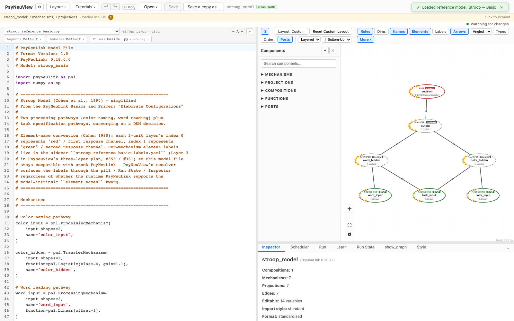

# What PsyNeuView is

A gentle introduction — no setup, no commands. Read this first if you have
never used PsyNeuView, or if someone has just shown it to you and you want to
know what you were looking at.

## The problem it solves

[PsyNeuLink](https://princetonuniversity.github.io/PsyNeuLink/) is a Python
library for building models of brain function and behaviour. You describe a
model in code — mechanisms that transform information, projections that carry
it between them — and then run it.

That works well, but a model written as code is hard to *see*. A few dozen
lines can describe a network whose shape only becomes clear once you draw it,
and when a run produces surprising numbers, the code shows you what you wrote
rather than what happened.

**PsyNeuView is the picture.** It reads a PsyNeuLink model and shows you the
network, lets you run it, and lets you watch the values move through it one
step at a time.

That is a real model — the Stroop task of Cohen, Dunbar & McClelland (1990) — as PsyNeuView draws it. Three
inputs at the bottom, two processing pathways rising to a shared decision, and
the arrows are the projections carrying values between them.

## Four things you can do

**See the model.** Open a `.py` file and PsyNeuView lays out the network. Nodes
are mechanisms, arrows are projections, colour marks their role — inputs green,
outputs red, control nodes distinct again. Nothing is generated or guessed: the
picture is read from the model your code actually builds.

**Run it.** Give the input nodes values and press Run. Results come back
per-trial, paired with the inputs that produced them, so you can see what each
trial did rather than reading a flat array.

**Step through execution.** This is the part that is hard to do any other way.
After a run you can move through it one execution step at a time and watch each
node's value as it is computed. When a model does something unexpected, you can
usually see *where* rather than inferring it.

**Edit and re-run.** Change a parameter in the inspector, or edit the source
directly, and the canvas rebuilds to match. You do not reload or restart — the
model updates and you run it again.

## What it is not

**Not a replacement for writing models.** Models are PsyNeuLink code. PsyNeuView
reads, runs and visualizes them; the code stays the source of truth, and you can
always open it.

**Not a separate format.** A model is a `.py` file. Layout and labels are stored
in small companion files next to it, so a model opened in PsyNeuView is still an
ordinary PsyNeuLink script that runs without it.

**Not only for models you wrote.** Ten reference models from the literature ship
with it — Stroop, conflict monitoring, locus coeruleus, temporal-difference
learning — each with a curated layout. They are a good place to start, because
you can look at a working model before building one.

## The pieces you will see

| | |
|---|---|
| **Canvas** | The network. Nodes and projections, laid out top-down or bottom-up. |
| **Code editor** | The model's Python source, alongside the picture. |
| **Run panel** | Enter inputs, run, and read per-trial results. |
| **Inspector** | Parameters of whatever you have selected, editable in place. |
| **Trace bar** | Step through a completed run one execution step at a time. |
| **Run State** | What every node held at the step you are looking at. |

## Where to go next

- **Want to try it?** [Loading a model](tutorials/01-loading-a-model.md) starts
  from an empty canvas and gets a model on screen.
- **Want the whole tour?** The [tutorials](tutorials/README.md) walk each
  workflow end-to-end — running, editing, stepping, saving, training.
- **Want to install it?** [Getting started](getting-started.md) covers setup.
- **Want the modelling library?** PsyNeuView visualizes PsyNeuLink models; for
  the concepts and API see the
  [PsyNeuLink documentation](https://princetonuniversity.github.io/PsyNeuLink/).

!!! note "About the screenshots"
    Every screenshot in these docs is captured from the running app by an
    automated test that also checks the behaviour described. If a workflow
    breaks, its test fails — so the documentation cannot quietly drift away
    from what the app does.
