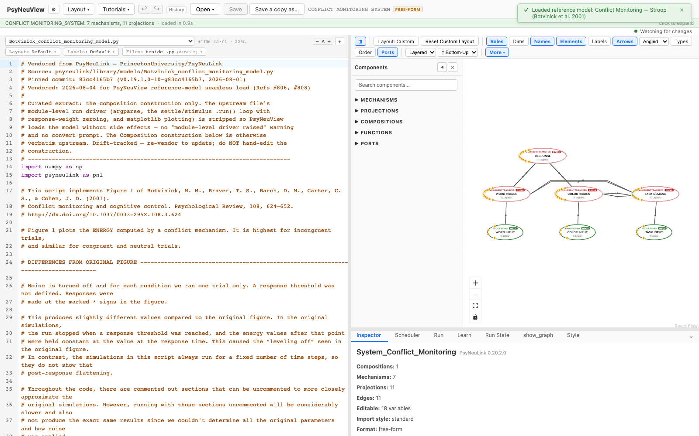
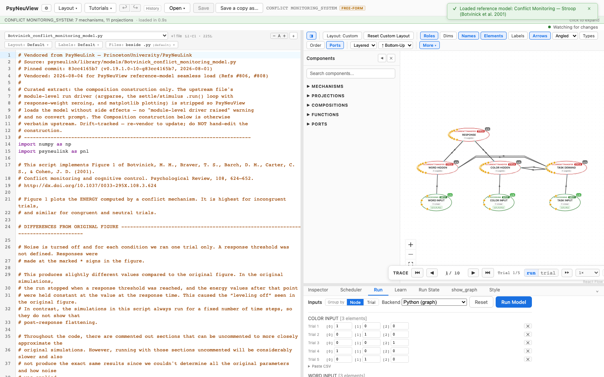

# Botvinick — Conflict Monitoring

> **Reference-model walkthrough.** A classic model of cognitive control: how the
> brain detects response *conflict* and recruits control in a Stroop-like task.
> **PsyNeuLink source:** any build — loads and runs on stock PsyNeuLink.

## What it is

This model implements **Figure 1 of Botvinick, Braver, Barch, Carter & Cohen
(2001), "Conflict monitoring and cognitive control"** (*Psychological Review*,
108, 624–652). It captures the core idea of the conflict-monitoring theory: a
dedicated mechanism computes the **ENERGY** (a measure of response conflict) in
a Stroop-like network. Conflict is **highest on incongruent trials** (e.g. the
word "RED" printed in green) and similar-and-low on congruent and neutral
trials — the signal the theory proposes the brain uses to know *when* to engage
cognitive control.

**Citation:** Botvinick, M. M., Braver, T. S., Barch, D. M., Carter, C. S., &
Cohen, J. D. (2001). Conflict monitoring and cognitive control. *Psychological
Review, 108*, 624–652. [doi:10.1037/0033-295X.108.3.624](http://dx.doi.org/10.1037/0033-295X.108.3.624)

## Structure

- **Compositions:** 1 · **Mechanisms:** 7 · **Projections:** 11

The network has color- and word-input layers feeding hidden and response
layers (the Stroop pathways), with a **conflict/energy** mechanism that reads
the response layer. It's a single flat composition — a good first model to read,
since the whole architecture is visible at once.

## See it in PsyNeuView

### Load it

Open → the **Reference Models** section → **"Conflict Monitoring — Stroop
(Botvinick et al. 2001)"**. The graph above draws immediately.

### Run it

Open the **Run** tab and click **Run Model**. The Run panel shows per-trial
output — this is where the conflict/energy signal the model is famous for shows
up (highest on incongruent trials).

## Guarantees

| Load | Run | Learn |
|------|-----|-------|
|  ✅  | ✅  | N/A (this model doesn't train) |

Validated against this build on every PR (the paired
`e2e/tutorials/models/model-walkthroughs.spec.ts` both verifies load+run and
regenerates the screenshots above, so this page can't drift from the app).

**Lineage:** vendored from
[`PrincetonUniversity/PsyNeuLink@83cc4165b7`](https://github.com/PrincetonUniversity/PsyNeuLink/blob/83cc4165b7/psyneulink/library/models/Botvinick_conflict_monitoring_model.py)
(`psyneulink/library/models/Botvinick_conflict_monitoring_model.py`), 2026-08-04
(refs #806, #808) — construction verbatim upstream, module-level run driver
stripped for seamless loading.

## Learn more

- The paper: [Botvinick et al. 2001](http://dx.doi.org/10.1037/0033-295X.108.3.624)
- Task-centric how-tos: [Running a model](../tutorials/02-running-a-model.md), [Viewing options](../tutorials/11-viewing-options.md)
- Coverage & parity tracking: #886
