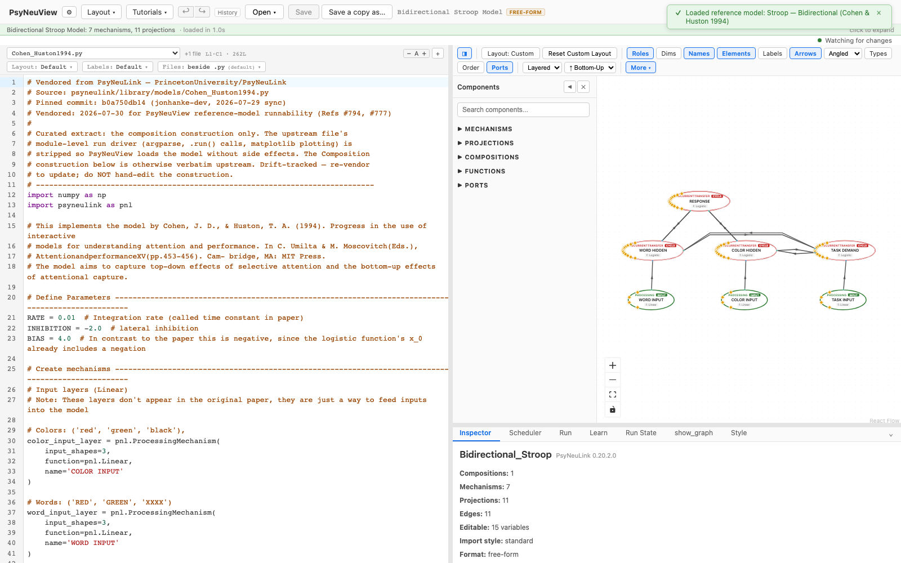
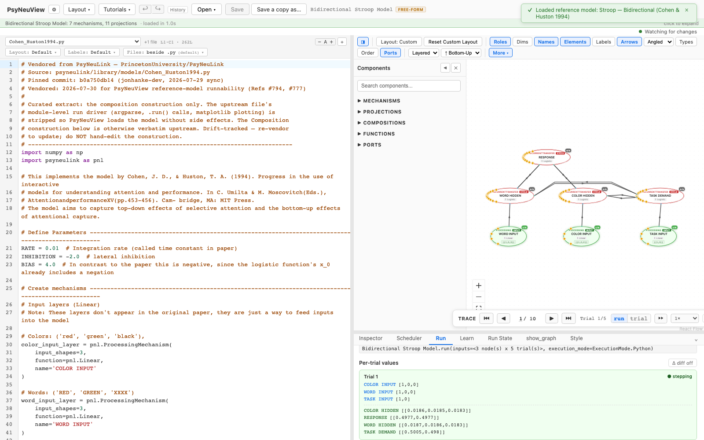

# Cohen & Huston 1994 — Bidirectional Stroop

> **Reference-model walkthrough.** An interactive-activation model of selective
> attention and attentional capture in the Stroop task.
> **PsyNeuLink source:** any build — loads and runs on stock PsyNeuLink.

## What it is

This model implements **Cohen, J. D., & Huston, T. A. (1994), "Progress in the
use of interactive models for understanding attention and performance."** It aims
to capture both the **top-down effects of selective attention** and the
**bottom-up effects of attentional capture** in a Stroop-like network. Color and
word information flow bidirectionally through hidden layers to a shared response
layer, with a task layer providing the top-down control signal that biases the
network toward color naming or word reading.

**Citation:** Cohen, J. D., & Huston, T. A. (1994). Progress in the use of
interactive models for understanding attention and performance. In C. Umiltà & M.
Moscovitch (Eds.), *Attention and Performance XV* (pp. 453–456). Cambridge, MA:
MIT Press.

## Structure

- **Compositions:** 1 · **Mechanisms:** 7 · **Projections:** 11

Linear input layers feed colors, words, and tasks into the network. The hidden
and response layers are recurrent (`RecurrentTransferMechanism`), implementing
the lateral inhibition between competing units described in the paper. It's a
single flat composition, so the full bidirectional architecture is visible at
once.

## See it in PsyNeuView

### Load it

Open → the **Reference Models** section → **"Stroop — Bidirectional (Cohen &
Huston 1994)"**. The graph above draws immediately.

### Run it

Open the **Run** tab and click **Run Model**. The Run panel shows per-trial
output across the color-naming and word-reading task conditions.

## Guarantees

| Load | Run | Learn |
|------|-----|-------|
|  ✅  | ✅  | N/A (this model doesn't train) |

Validated against this build on every PR (the paired
`e2e/tutorials/models/model-walkthroughs.spec.ts` both verifies load+run and
regenerates the screenshots above, so this page can't drift from the app).

**Lineage:** vendored from
[`PrincetonUniversity/PsyNeuLink@b0a750db14`](https://github.com/PrincetonUniversity/PsyNeuLink/blob/b0a750db14/psyneulink/library/models/Cohen_Huston1994.py)
(`psyneulink/library/models/Cohen_Huston1994.py`) — construction verbatim
upstream, module-level run driver (argparse, `.run()` calls, matplotlib plotting)
stripped for seamless loading.

## Learn more

- The paper: Cohen & Huston (1994), *Attention and Performance XV*, 453–456
- Task-centric how-tos: [Running a model](../tutorials/02-running-a-model.md), [Viewing options](../tutorials/11-viewing-options.md)
- Coverage & parity tracking: #886
