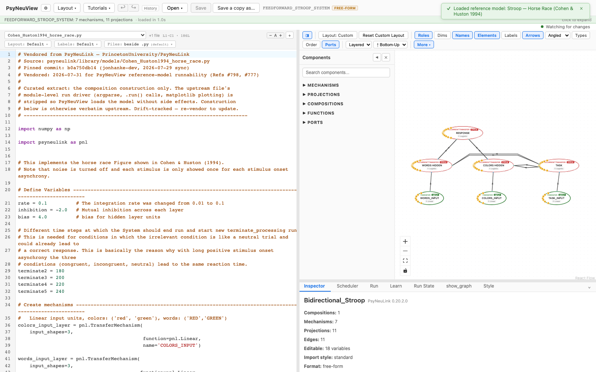
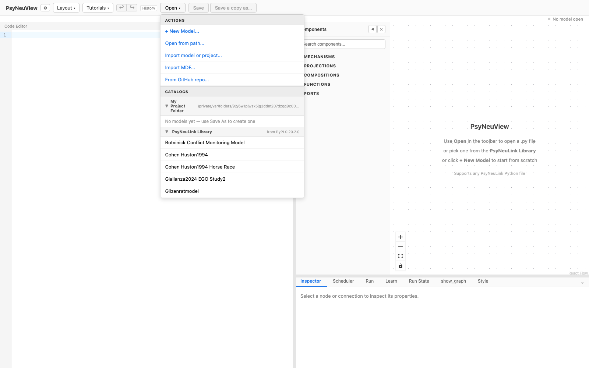
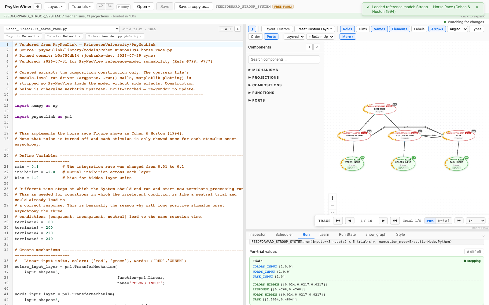

# Cohen & Huston 1994 — Horse Race

> **Reference-model walkthrough.** The stimulus-onset-asynchrony "horse race"
> variant of the Cohen & Huston bidirectional Stroop model.
> **PsyNeuLink source:** any build — loads and runs on stock PsyNeuLink.

## What it is

This model reproduces the **horse-race figure from Cohen & Huston (1994)**. It
explores how the timing of the relevant vs. irrelevant dimension — the
**stimulus onset asynchrony (SOA)** — determines the outcome of the race between
competing responses. Noise is turned off and each stimulus is shown once per SOA.
With a long positive SOA, the congruent, incongruent, and neutral conditions all
converge on the same reaction time, because the irrelevant dimension behaves like
a neutral trial and can already drive a correct response.

**Citation:** Cohen, J. D., & Huston, T. A. (1994). Progress in the use of
interactive models for understanding attention and performance. In C. Umiltà & M.
Moscovitch (Eds.), *Attention and Performance XV* (pp. 453–456). Cambridge, MA:
MIT Press.

## Structure

- **Compositions:** 1 · **Mechanisms:** 7 · **Projections:** 11

Linear input units feed colors and words into a hidden layer; a task layer
selects color naming vs. word reading; and a recurrent response layer
(`RecurrentTransferMechanism`) implements self-inhibition between the competing
responses. It's a single flat composition.

## See it in PsyNeuView

### Load it

Open → the **Reference Models** section → **"Stroop — Horse Race (Cohen & Huston
1994)"**. The graph above draws immediately.

### Run it

Open the **Run** tab and click **Run Model**. The Run panel shows per-trial
output — this is where the SOA-dependent race between responses plays out.

## Guarantees

| Load | Run | Learn |
|------|-----|-------|
|  ✅  | ✅  | N/A (this model doesn't train) |

Validated against this build on every PR (the paired
`e2e/tutorials/models/model-walkthroughs.spec.ts` both verifies
load+run and regenerates the screenshots above, so this page can't drift from the
app).

**Lineage:** vendored from
[`PrincetonUniversity/PsyNeuLink@b0a750db14`](https://github.com/PrincetonUniversity/PsyNeuLink/blob/b0a750db14/psyneulink/library/models/Cohen_Huston1994_horse_race.py)
(`psyneulink/library/models/Cohen_Huston1994_horse_race.py`) — construction
verbatim upstream, module-level run driver (argparse, `.run()` calls, matplotlib
plotting) stripped for seamless loading.

## Learn more

- The paper: Cohen & Huston (1994), *Attention and Performance XV*, 453–456
- Task-centric how-tos: [Running a model](../tutorials/02-running-a-model.md), [Viewing options](../tutorials/11-viewing-options.md)
- Coverage & parity tracking: #886
