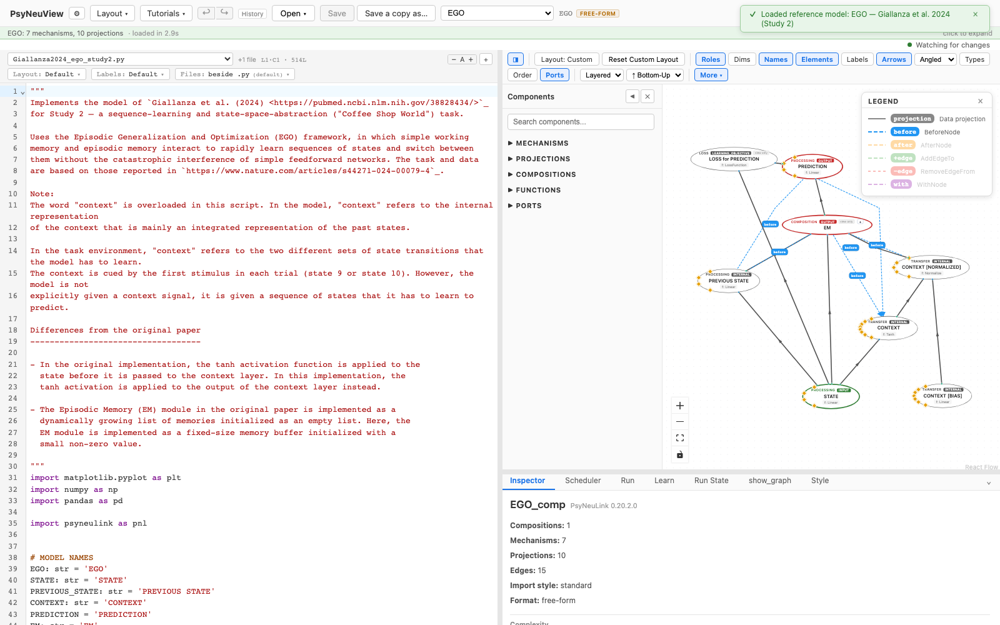
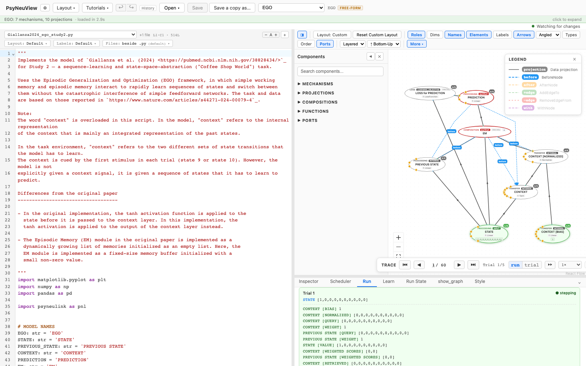

# EGO — Giallanza et al. 2024 (Study 2)

> **Reference-model walkthrough.** The EGO model from Giallanza et al. (2024),
> Study 2 — episodic memory meets working memory.
> **PsyNeuLink source:** any build — loads on stock PsyNeuLink.

## What it is

This model implements **Study 2 of Giallanza et al. (2024)**, using the **EGO —
Episodic Generalization and Optimization** framework, in which a simple
working-memory pathway interacts with a content-addressable **Episodic Memory
(EM)** module. In PsyNeuView it is instantiated at module scope so the GUI can
introspect and render the composition.

The upstream source here is primarily model configuration; for the full
theoretical account and results, see the paper.

**Citation:** Giallanza, T., et al. (2024). [pubmed.ncbi.nlm.nih.gov/38828434](https://pubmed.ncbi.nlm.nih.gov/38828434/) (Study 2).

## Structure

- **Compositions:** 1 · **Mechanisms:** 7 · **Projections:** 10

The model is instantiated at module scope as a single composition so PsyNeuView
can render it directly.

## See it in PsyNeuView

### Load it

Open → the **Reference Models** section → **"EGO — Giallanza et al. 2024 (Study
2)"**. The graph above draws immediately.

### Run it

Open the **Run** tab and click **Run Model**. The Run panel shows per-trial
output for the model's outputs (the retrieved episodic-memory states and the
prediction).

## Guarantees

| Load | Run | Learn |
|------|-----|-------|
|  ✅  | ✅  | ⚠️ blocked upstream by PsyNeuLink#30 |

Validated against this build on every PR (the paired
`e2e/tutorials/models/model-walkthroughs.spec.ts` both verifies load+run and regenerates
the screenshots above, so this page can't drift from the app).

**Lineage:** vendored — Giallanza et al. 2024 (Study 2), instantiated at module
scope so PsyNeuView can introspect and render the composition.

## Learn more

- The paper: [Giallanza et al. (2024)](https://pubmed.ncbi.nlm.nih.gov/38828434/)
- Task-centric how-tos: [Running a model](../tutorials/02-running-a-model.md), [Viewing options](../tutorials/11-viewing-options.md)
- Coverage & parity tracking: #886
