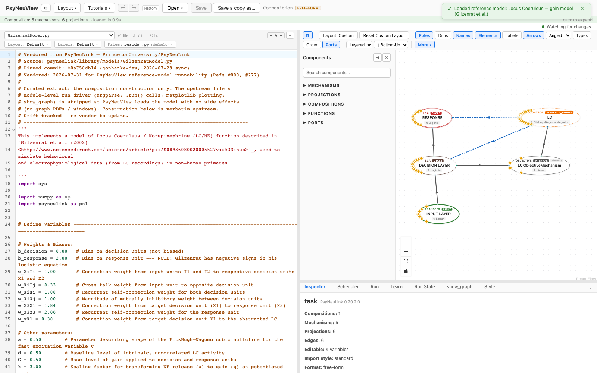
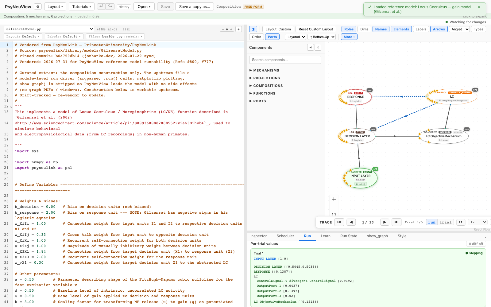

# Gilzenrat — Locus Coeruleus Gain Model

> **Reference-model walkthrough.** A locus-coeruleus model in which decision-layer
> activity modulates neural gain.
> **PsyNeuLink source:** any build — loads and runs on stock PsyNeuLink.

## What it is

This model implements a model of **Locus Coeruleus / Norepinephrine (LC/NE)
function** described in **Gilzenrat et al. (2002)**. A target/distractor input
drives a decision layer and a response layer, and the decision layer is
**monitored to modulate gain** — the LC's characteristic neuromodulatory role.
The model can switch between high-C and low-C conditions.

The upstream source is largely parameter definitions; for the full specification
of weights, biases, and the gain-modulation dynamics, see the paper.

**Citation:** Gilzenrat, M. S., et al. (2002). *Neural Networks.* [sciencedirect.com/…/S0893608002000552](http://www.sciencedirect.com/science/article/pii/S0893608002000552)

## Structure

- **Compositions:** 1 · **Mechanisms:** 5 · **Projections:** 6

An input layer (target, distractor) projects to a decision layer (target,
distractor), which projects to a response layer (target). A separate pathway
monitors the decision layer to modulate gain. It's a single flat composition.

## See it in PsyNeuView

### Load it

Open → the **Reference Models** section → **"Locus Coeruleus — gain model
(Gilzenrat et al.)"**. The graph above draws immediately.

### Run it

Open the **Run** tab and click **Run Model**. The Run panel shows per-trial
output as the stimulus drives the decision and response layers.

## Guarantees

| Load | Run | Learn |
|------|-----|-------|
|  ✅  | ✅  | N/A (this model doesn't train) |

Validated against this build on every PR (the paired
`e2e/tutorials/models/model-walkthroughs.spec.ts` both verifies load+run and
regenerates the screenshots above, so this page can't drift from the app).

**Lineage:** vendored from
[`PrincetonUniversity/PsyNeuLink@b0a750db14`](https://github.com/PrincetonUniversity/PsyNeuLink/blob/b0a750db14/psyneulink/library/models/GilzenratModel.py)
(`psyneulink/library/models/GilzenratModel.py`) — construction verbatim upstream,
module-level run driver (argparse, `.run()` calls, matplotlib plotting,
`show_graph`) stripped for seamless loading.

## Learn more

- The paper: [Gilzenrat et al. (2002), *Neural Networks*](http://www.sciencedirect.com/science/article/pii/S0893608002000552)
- Task-centric how-tos: [Running a model](../tutorials/02-running-a-model.md), [Viewing options](../tutorials/11-viewing-options.md)
- Coverage & parity tracking: #886
