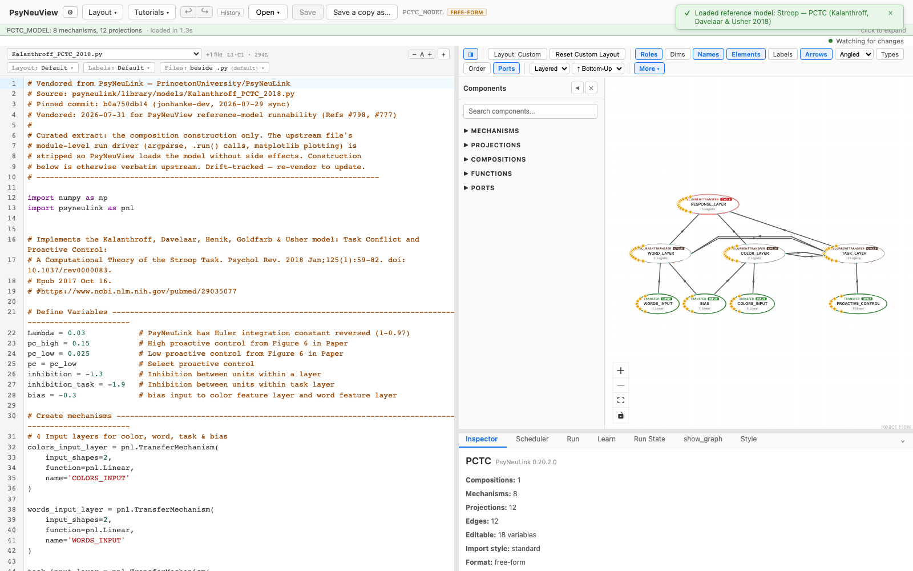
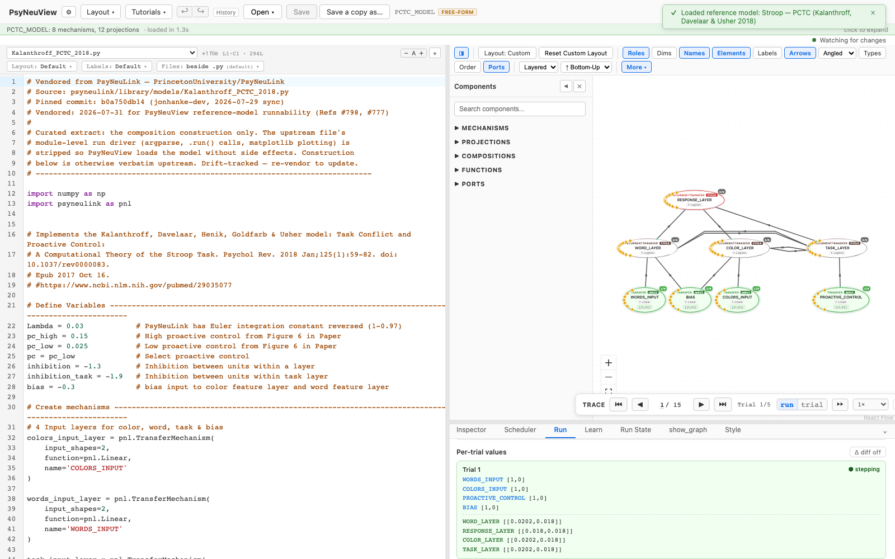

# Kalanthroff PCTC 2018 — Task Conflict & Proactive Control

> **Reference-model walkthrough.** A computational theory of the Stroop task that
> adds task conflict and proactive control on top of the classic architecture.
> **PsyNeuLink source:** any build — loads and runs on stock PsyNeuLink.

## What it is

This model implements the **Proactive Control and Task Conflict (PCTC)** model of
Kalanthroff, Davelaar, Henik, Goldfarb & Usher (2018), **"Task Conflict and
Proactive Control: A Computational Theory of the Stroop Task."** Beyond the
familiar response conflict, the model adds a **task-demand layer** whose two units
generate **task conflict** — computed by multiplying the two task-unit outputs
together — and a **proactive control** signal that regulates it. A special
logistic output (clamped to 0 for non-positive input) shapes the task layer's
contribution.

**Citation:** Kalanthroff, E., Davelaar, E. J., Henik, A., Goldfarb, L., & Usher,
M. (2018). Task conflict and proactive control: A computational theory of the
Stroop task. *Psychological Review, 125*(1), 59–82.
[doi:10.1037/rev0000083](https://doi.org/10.1037/rev0000083) ·
[PubMed 29035077](https://www.ncbi.nlm.nih.gov/pubmed/29035077)

## Structure

- **Compositions:** 1 · **Mechanisms:** 8 · **Projections:** 12

Four input layers feed color, word, task, and bias. These drive a color-feature
layer, a word-feature layer, a task-demand layer, and a response layer. The
task-demand layer uses a distinct output function and inhibition weight to produce
the task-conflict signal that defines the theory. It's a single flat composition.

## See it in PsyNeuView

### Load it

Open → the **Reference Models** section → **"Stroop — PCTC (Kalanthroff, Davelaar
& Usher 2018)"**. The graph above draws immediately.

### Run it

Open the **Run** tab and click **Run Model**. The Run panel shows per-trial
output, including the task-conflict signal that is central to the PCTC account.

## Guarantees

| Load | Run | Learn |
|------|-----|-------|
|  ✅  | ✅  | N/A (this model doesn't train) |

Validated against this build on every PR (the paired
`e2e/tutorials/models/model-walkthroughs.spec.ts` both verifies load+run and
regenerates the screenshots above, so this page can't drift from the app).

**Lineage:** vendored from
[`PrincetonUniversity/PsyNeuLink@b0a750db14`](https://github.com/PrincetonUniversity/PsyNeuLink/blob/b0a750db14/psyneulink/library/models/Kalanthroff_PCTC_2018.py)
(`psyneulink/library/models/Kalanthroff_PCTC_2018.py`) — construction verbatim
upstream, module-level run driver (argparse, `.run()` calls, matplotlib plotting)
stripped for seamless loading.

## Learn more

- The paper: [Kalanthroff et al. 2018](https://doi.org/10.1037/rev0000083)
- Task-centric how-tos: [Running a model](../tutorials/02-running-a-model.md), [Viewing options](../tutorials/11-viewing-options.md)
- Coverage & parity tracking: #886
