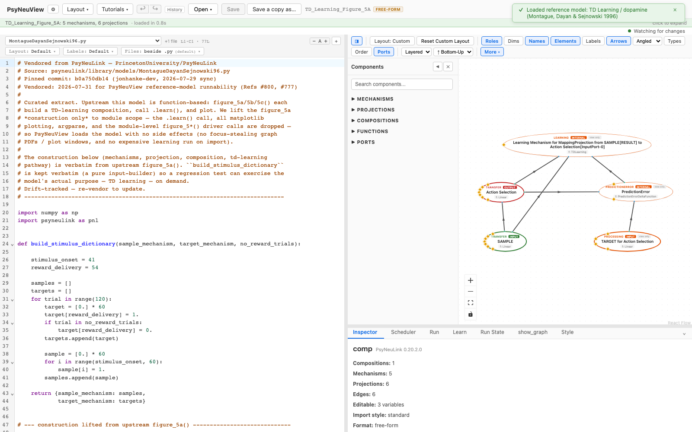
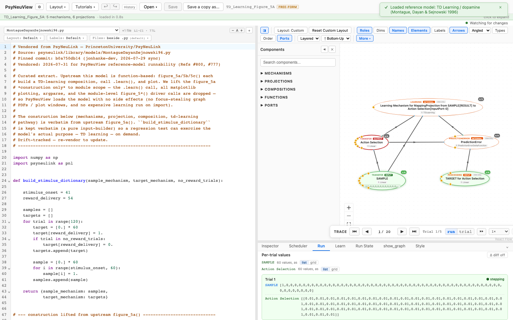

# Montague, Dayan & Sejnowski 1996 — TD Learning / Dopamine

> **Reference-model walkthrough.** A temporal-difference (TD) learning model of
> predictive dopamine signaling.
> **PsyNeuLink source:** any build — loads on stock PsyNeuLink.

## What it is

This model lifts the **Figure 5a construction from Montague, Dayan & Sejnowski
(1996)**, a temporal-difference (TD) learning account of the phasic dopamine
signal as a reward-prediction error. The model builds a TD-learning composition;
in PsyNeuView it is loaded **construction-only** (the upstream `.learn()` call and
plotting are dropped), so the architecture renders without triggering an expensive
learning run on import. The input-builder is kept so a regression test can
exercise the model's actual purpose — TD learning — on demand.

**Citation:** Montague, P. R., Dayan, P., & Sejnowski, T. J. (1996). A framework
for mesencephalic dopamine systems based on predictive Hebbian learning. *Journal
of Neuroscience, 16*(5), 1936–1947.

## Structure

- **Compositions:** 1 · **Mechanisms:** 5 · **Projections:** 6

Processing components feed a composition with a TD-learning pathway (processing
plus learning components). It's a single flat composition.

## See it in PsyNeuView

### Load it

Open → the **Reference Models** section → **"TD Learning / dopamine (Montague,
Dayan & Sejnowski 1996)"**. The graph above draws immediately.

### Run it

Open the **Run** tab and click **Run Model**.

## Guarantees

| Load | Run | Learn |
|------|-----|-------|
|  ✅  | ⚠️ blocked by #859: function-scoped compositions | N/A |

Validated against this build on every PR (the paired
`e2e/tutorials/models/model-walkthroughs.spec.ts` verifies load and
regenerates the screenshots above, so this page can't drift from the app).

**Lineage:** vendored from
[`PrincetonUniversity/PsyNeuLink@b0a750db14`](https://github.com/PrincetonUniversity/PsyNeuLink/blob/b0a750db14/psyneulink/library/models/MontagueDayanSejnowski96.py)
(`psyneulink/library/models/MontagueDayanSejnowski96.py`) — `figure_5a`
construction lifted verbatim to module scope; the `.learn()` call, matplotlib
plotting, argparse, and module-level driver calls dropped for seamless loading.

## Learn more

- The paper: Montague, Dayan & Sejnowski (1996), *J. Neurosci. 16*(5), 1936–1947
- Task-centric how-tos: [Running a model](../tutorials/02-running-a-model.md), [Viewing options](../tutorials/11-viewing-options.md)
- Coverage & parity tracking: #886
