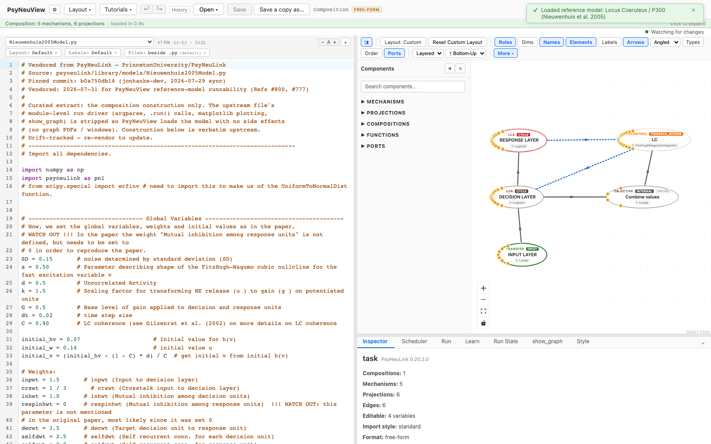
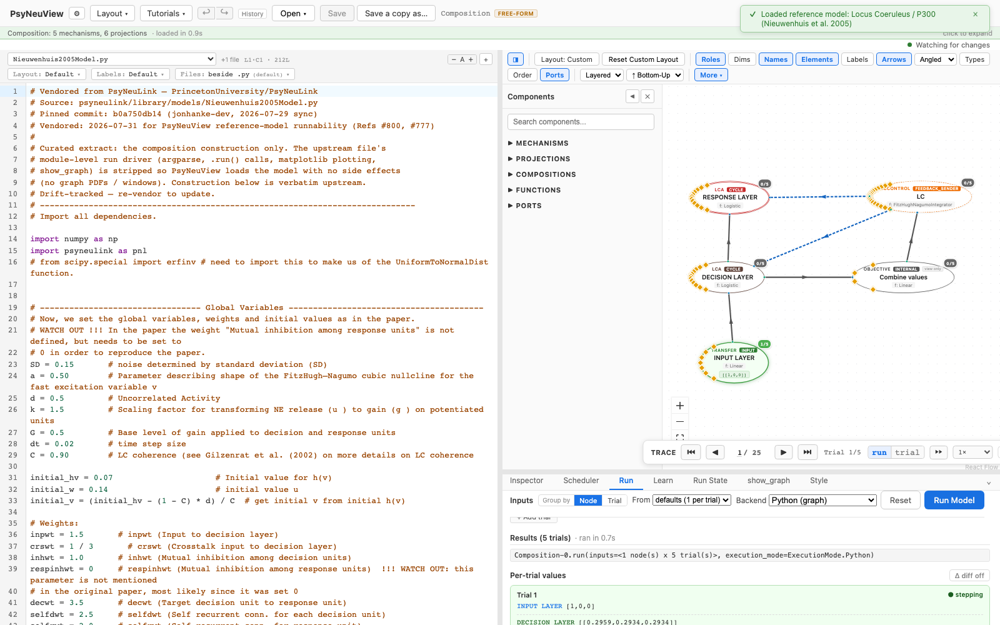

# Nieuwenhuis 2005 — Locus Coeruleus / P300

> **Reference-model walkthrough.** A locus-coeruleus model linking LC-mediated gain
> to the P300 event-related potential.
> **PsyNeuLink source:** any build — loads and runs on stock PsyNeuLink.

## What it is

This model implements the **locus-coeruleus / P300 model of Nieuwenhuis et al.
(2005)**. It reproduces the paper's account with the global variables, weights,
and initial values set as specified there. (Notably, the "mutual inhibition among
response units" weight — undefined in the paper — must be set to 0 to reproduce
the published results.)

The upstream source is largely parameter definitions; for the full specification
of the model, its dynamics, and the P300 interpretation, see the paper.

**Citation:** Nieuwenhuis, S., Aston-Jones, G., & Cohen, J. D. (2005). Decision
making, the P3, and the locus coeruleus–norepinephrine system. *Psychological
Bulletin, 131*(4), 510–532.

## Structure

- **Compositions:** 1 · **Mechanisms:** 5 · **Projections:** 6

An input layer (target 1, target 2, distractor) feeds the network, with weights
and initial values set as in the paper. It's a single flat composition.

## See it in PsyNeuView

### Load it

Open → the **Reference Models** section → **"Locus Coeruleus / P300 (Nieuwenhuis
et al. 2005)"**. The graph above draws immediately.

### Run it

Open the **Run** tab and click **Run Model**. The Run panel shows per-trial
output across the target and distractor conditions.

## Guarantees

| Load | Run | Learn |
|------|-----|-------|
|  ✅  | ✅  | N/A (this model doesn't train) |

Validated against this build on every PR (the paired
`e2e/tutorials/models/model-walkthroughs.spec.ts` both verifies load+run and
regenerates the screenshots above, so this page can't drift from the app).

**Lineage:** vendored from
[`PrincetonUniversity/PsyNeuLink@b0a750db14`](https://github.com/PrincetonUniversity/PsyNeuLink/blob/b0a750db14/psyneulink/library/models/Nieuwenhuis2005Model.py)
(`psyneulink/library/models/Nieuwenhuis2005Model.py`) — construction verbatim
upstream, module-level run driver (argparse, `.run()` calls, matplotlib plotting,
`show_graph`) stripped for seamless loading.

## Learn more

- Task-centric how-tos: [Running a model](../tutorials/02-running-a-model.md), [Viewing options](../tutorials/11-viewing-options.md)
- Coverage & parity tracking: #886
