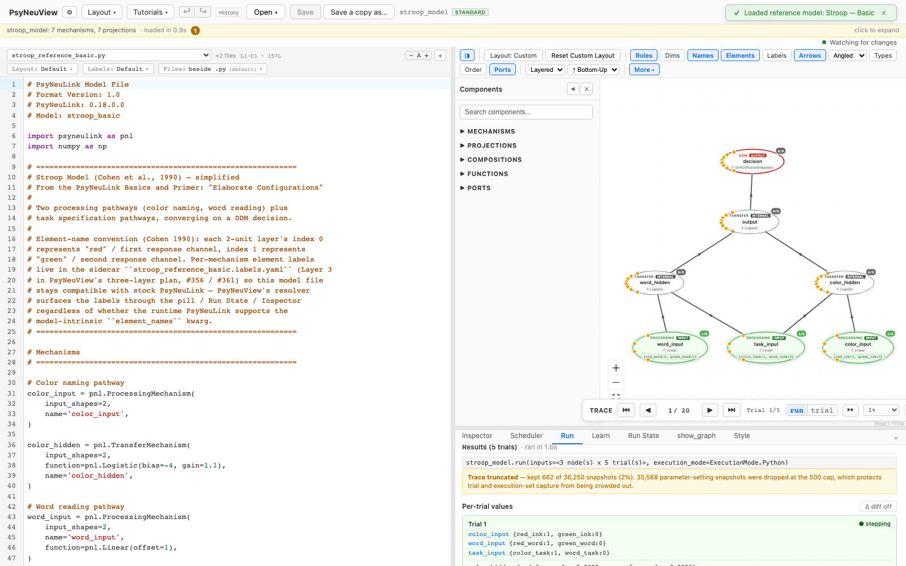

# Stroop — Basic

> **Reference-model walkthrough.** The canonical Stroop color-word interference
> task, as a compact PsyNeuView reference model.
> **PsyNeuLink source:** any build — loads and runs on stock PsyNeuLink.

## What it is

This is a **PsyNeuView-authored reference model** of the canonical **Stroop
color-word interference task** (in the tradition of Cohen et al., 1990). Two
processing pathways — **color naming** and **word reading** — plus task
specification pathways converge on a **DDM decision** mechanism. It is a
simplified configuration drawn from the PsyNeuLink Basics and Primer ("Elaborate
Configurations"), intended as a clean, readable entry point rather than a vendored
reproduction of any single paper.

Per-mechanism element labels (each 2-unit layer's index 0 = "red" / first
response channel, index 1 = "green" / second) live in the sidecar
`stroop_reference_basic.labels.yaml`, so the model file stays compatible with
stock PsyNeuLink while PsyNeuView surfaces the labels through the pill, Run State,
and Inspector.

## Structure

- **Compositions:** 1 · **Mechanisms:** 7 · **Projections:** 7

Color and word input layers feed hidden layers, with task-specification pathways
converging on a DDM decision mechanism. It's a single flat composition — a good
model to read since the whole architecture is visible at once.

## See it in PsyNeuView

### Load it

Open → the **Reference Models** section → **"Stroop — Basic"**. The
graph above draws immediately.

### Run it

Open the **Run** tab and click **Run Model**. The Run panel shows per-trial output
as the color and word pathways compete at the DDM decision stage.

## Guarantees

| Load | Run | Learn |
|------|-----|-------|
|  ✅  | ✅  | N/A (this model doesn't train) |

Validated against this build on every PR (the paired
`e2e/tutorials/models/model-walkthroughs.spec.ts` both verifies load+run and
regenerates the screenshots above, so this page can't drift from the app).

**Lineage:** PsyNeuView-authored reference model (not vendored from an upstream
paper source).

## Learn more

- Task-centric how-tos: [Running a model](../tutorials/02-running-a-model.md), [Viewing options](../tutorials/11-viewing-options.md)
- Coverage & parity tracking: #886
