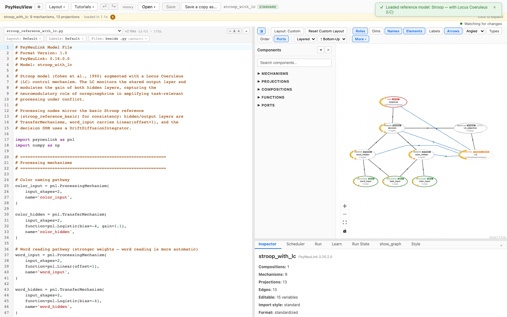
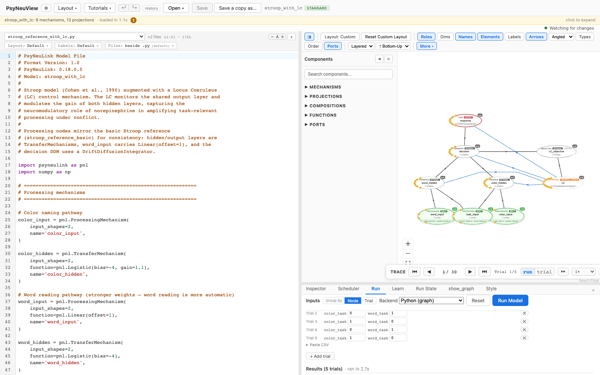

# Stroop — with Locus Coeruleus (LC)

> **Reference-model walkthrough.** The canonical Stroop task augmented with a
> locus-coeruleus gain mechanism.
> **PsyNeuLink source:** any build — loads and runs on stock PsyNeuLink.

## What it is

This is a **PsyNeuView-authored reference model**: the canonical **Stroop
color-word interference task** (in the tradition of Cohen et al., 1990) augmented
with a **Locus Coeruleus (LC) control mechanism**. The LC monitors the shared
output layer and **modulates the gain of both hidden layers**, capturing the
neuromodulatory role of norepinephrine in amplifying task-relevant processing
under conflict.

Its processing nodes mirror the basic Stroop reference
([stroop-basic](stroop-basic.md)) for consistency: the hidden and output layers
are `TransferMechanism`s, `word_input` carries `Linear(offset=1)`, and the
decision DDM uses a `DriftDiffusionIntegrator`.

## Structure

- **Compositions:** 1 · **Mechanisms:** 9 · **Projections:** 13

The Stroop processing pathways mirror the basic model, with an added LC mechanism
that reads the shared output layer and modulates hidden-layer gain. It's a single
flat composition.

## See it in PsyNeuView

### Load it

Open → the **Reference Models** section → **"Stroop — with Locus Coeruleus (LC)"**.
The graph above draws immediately.

### Run it

Open the **Run** tab and click **Run Model**. The Run panel shows per-trial output
— this is where the LC gain modulation shapes processing under conflict.

## Guarantees

| Load | Run | Learn |
|------|-----|-------|
|  ✅  | ✅  | N/A (this model doesn't train) |

Validated against this build on every PR (the paired
`e2e/tutorials/models/model-walkthroughs.spec.ts` both verifies load+run and
regenerates the screenshots above, so this page can't drift from the app).

**Lineage:** PsyNeuView-authored reference model (not vendored from an upstream
paper source).

## Learn more

- The basic variant: [Stroop — Basic](stroop-basic.md)
- Task-centric how-tos: [Running a model](../tutorials/02-running-a-model.md), [Viewing options](../tutorials/11-viewing-options.md)
- Coverage & parity tracking: #886
