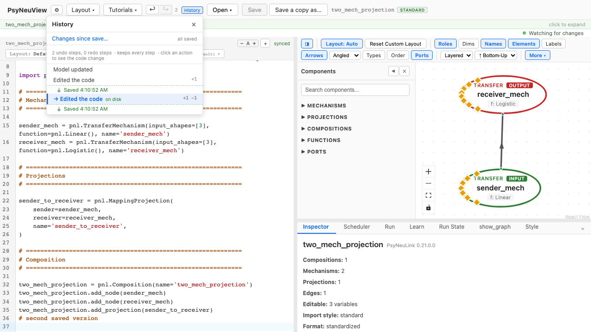
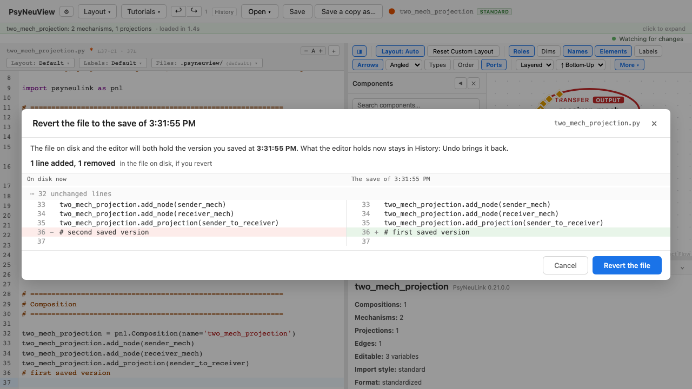

# Saving, autosave and undo

What reaches your model's file, and when; what undo can take back; and how
to put an earlier save back on disk. Which files you can save at all is on
[What you can edit, and why](what-you-can-edit.md).

## What Save writes

**Save** (the toolbar button, or ⌘S) writes the code in the editor to the
model's `.py` file, then reloads the model from it. It is greyed out until
there is something unsaved; the orange dot beside the model name means there
is.

Before writing, Save checks that the file on disk is still the one
PsyNeuView last opened or saved. If another editor (PyCharm) changed it in
the meantime, nothing is written: you are asked whether to keep your changes
or take the version on disk.

Edits made **on the canvas or in the inspector** are different: they are
written to the file as you make them, with no Save needed.

The layout (where the nodes sit) is saved as it changes, in the model's
layout file, separately from the code.

## The preview copy

Typing in the code editor does **not** write your file. So that the canvas
can keep up, PsyNeuView writes what you have typed to a private **preview
copy** (in `~/.psyneuview/previews/`, never beside your model) and builds
the graph from that. While you have unsaved changes, **Run** and **Learn**
use the preview copy too, so what you run is what you are looking at.

Your `.py` changes only when you save. That is what makes it safe to have
the same file open in another editor at the same time
([#1029](https://github.com/jonhanke-nam/PsyNeuView/issues/1029)).

## Autosave

Autosave is off by default. Turn it on in **Settings ▸ General ▸ Model files
▸ Autosave**, and choose how long to wait (10 seconds by default, from 2 to
600). It then presses Save for you that many seconds after your last edit to
the code, if there are unsaved changes; each edit starts the wait over.

It does not save:

- while the code has an error, or before the latest edit has been checked:
  only code that builds is written for you (Save still writes whatever is
  there);
- while the "file changed on disk" question is open, and after you answer
  **Keep my changes**, until you press Save yourself;
- while the model is locked (view only), or it is a PsyNeuLink file that
  can't be edited here;
- for a model opened from a `.pnlproject` bundle.

The line beside the model name says what autosave is doing: *Autosaved 12 s
ago*, *Autosave waiting: code has an error*, *Autosave paused: file changed
on disk*. More on [What you can edit](what-you-can-edit.md#autosave).

## Changes since save

To see what you haven't saved yet, click the orange dot beside the model
name, or **History ▸ Changes since save…**. It compares the editor with the
file **as it is on disk now**, side by side, and says so at the top if the
file changed outside PsyNeuView. It only looks; it never writes.
More on [What you can edit](what-you-can-edit.md#seeing-what-changed-since-the-last-save).

## Undo, and how deep it goes

**Undo** (↩ in the toolbar, or ⌘Z) and **Redo** (↪, or ⌘⇧Z) step through
everything you have done in this session: code edits, canvas and inspector
edits, parameter changes and node moves. Quick repeated changes to the same
thing (dragging a node, nudging one parameter) count as one step.

- **What it tells you:** one notice for a burst, not one per step. Undos
  in quick succession (each within about 1.5 s of the last) share one
  notice, updated as you go: *Undid 21 edits: back to Edit 37*, with a
  **Redo** button that redoes all 21. A single undo says *Undid Edit 57*.
  Redo works the same way (*Redid 3 edits: forward to Edit 40*, with
  **Undo**). The notice clears itself about 5 s after the last step; its ×
  clears it sooner.
- **Going back several steps at once:** open **History**, click a step, and
  press **Go back to this step** (or **Go forward**). That undoes or redoes
  everything up to it as one action, with one notice: *Went back 20 steps,
  to Edit 37* ([#1377](https://github.com/jonhanke-nam/PsyNeuView/issues/1377)).
- **How many steps:** all of them. History keeps every step of the
  session, and says so under its title (*keeps every step*). See
  [How History keeps every step](#how-history-keeps-every-step) below.
- **For how long:** for as long as the model is open. Opening a model starts
  History afresh, and it isn't kept when you quit
  ([#42](https://github.com/jonhanke-nam/PsyNeuView/issues/42) is about
  keeping versions across sessions).
- **What undo does to the file:** nothing. Undo changes the model in
  PsyNeuView; the file on disk stays as it was until you save. (The canvas
  and Run follow the undone code through the preview copy, as they do when
  you type.)

### How History keeps every step

Keeping a whole copy of the model for every step would not scale: on a
large model each step holds the code and the whole graph. So History keeps
the newest steps whole and the older ones **compactly**:

- a compact step keeps its code (stored as the difference from the step
  after it, usually a few characters, with the whole text kept every 32
  steps), where the nodes sat, its description, and its saves;
- it drops its graph, which is rebuilt from its code when you undo that far
  back, the way typing rebuilds it. On a large model that takes as long as
  a preview after typing does.

Measured on the EGO model (21,000 characters of code), what one step holds
in memory:

| Step | Memory |
|---|---|
| whole, after an edit that rebuilt the graph (a code edit) | about 90 KB |
| whole, the graph unchanged (a node move) | about 42 KB |
| compact | under 1 KB |

History keeps up to **32 MB** of whole steps (the newest 350 to 750 EGO
steps, thousands on a small model, and never fewer than 20), then compacts
the oldest. Only if all its steps came to more than **96 MB**, something on
the order of 100,000 compact steps, would it drop the oldest; History would
then say *keeps about 96 MB; N oldest dropped*. The History list shows the
200 steps around the current one; **Show earlier steps** lists more, and
undo reaches all of them either way.

(The numbers come from `frontend/e2e/_measure-undo-memory.spec.ts`, run with
`PERF_MEASURE=1`; the budget is `DEFAULT_BUDGET` in
`frontend/src/stores/historyStore.ts`,
[#558](https://github.com/jonhanke-nam/PsyNeuView/issues/558).)

### Undoing past a save

Saving doesn't clear History, so you can undo past a save. When you do, the
model becomes **unsaved** again (the orange dot comes back), and the file on
disk still holds what you saved. Redo brings the saved version back into the
editor (until you make a new edit, which, as in any editor, replaces the redo
steps), and Save writes whatever the editor holds.

## Saves in History

Click **History** in the toolbar to see the steps. Each save appears as a
line under the step it wrote:

- **Saved 14:32** — you pressed Save;
- **Autosaved 14:32**, tagged *automatic* — autosave saved it;
- **Saved 14:40 (reverted to 14:32)** — you reverted the file to an earlier
  save (below).

When two saves fall in the same minute, the times show seconds. The step
whose code is in the file now is tagged **on disk**. A save is not a step:
undo and redo still move one change at a time, and the save lines move with
their steps.

## Revert the file to a save

To put an earlier save back on disk:

1. Open **History** and click the save's line. If the file already holds
   that version, it says so. Otherwise it offers **Revert the file to this
   save…**.
2. Or undo back to it: when undo leaves you at a save the file no longer
   holds, the top of History says *You've undone to the save of 14:32* and
   offers the same.
3. A confirm shows exactly what will change in the file: the file on disk
   now on the left, the saved version on the right. Nothing is written yet;
   **Cancel**, Escape or a click outside leaves everything as it was.
4. **Revert the file** puts the saved version in the editor and writes it,
   through Save, so the check for a file changed on disk applies here too.
   History gets a new line for it, *Saved … (reverted to …)*.

What the editor held before the revert, unsaved changes included, stays in
History: **Undo** brings it back into the editor (and Save writes it, if you
want it on disk again).

Revert isn't offered for a model you can't save: a locked (view only) model,
or a PsyNeuLink file that can't be edited here. History says why.

Writing to the file is always your choice: Save, autosave if you turned it
on, an edit on the canvas or in the inspector, or Revert. Undo, redo,
typing, and looking at changes never write it.

