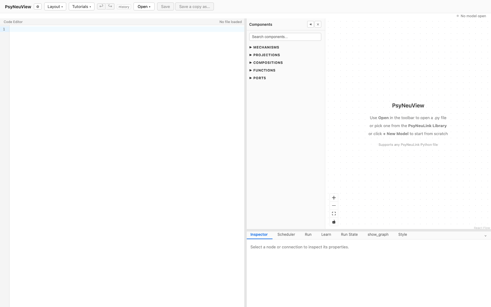
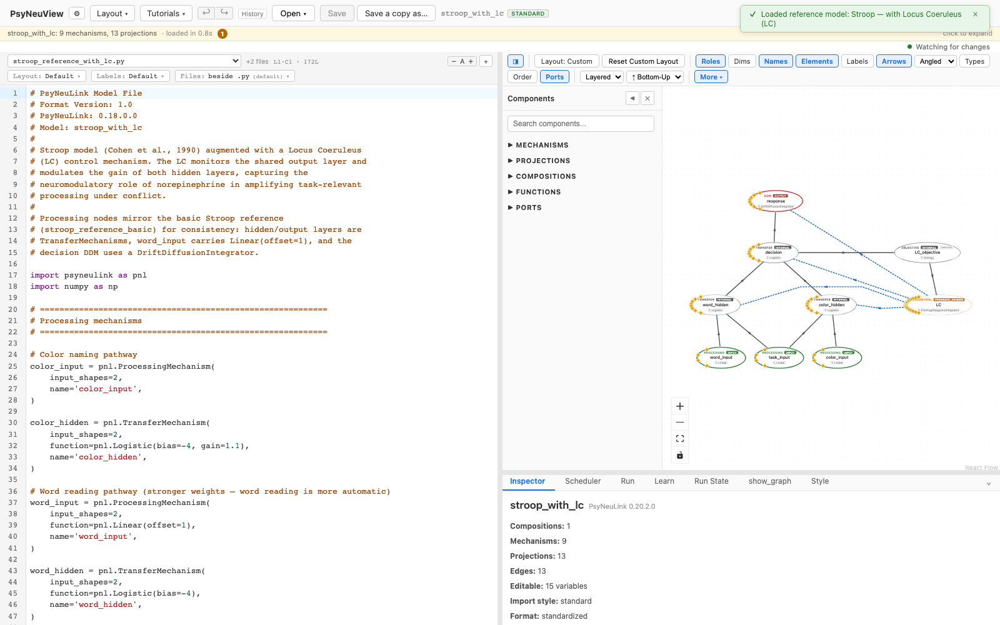

# Loading a model

How to get a PsyNeuLink model onto the PsyNeuView canvas.

> **What you need:** a running PsyNeuView (backend + frontend). No particular
> PsyNeuLink source is required for loading — any build that runs the app can
> load these models.
>
> **Models used in this walkthrough:** the bundled reference models
> [**EGO**](../reference-models/ego.md), [**Stroop — Basic**](../reference-models/stroop-basic.md), and [**Stroop — with LC**](../reference-models/stroop-with-lc.md).

---

## 1. Open the app

When PsyNeuView starts with no model, the canvas is empty and prompts you to
load one.



## 2. Open the model menu

Click **Open** in the top toolbar. The menu groups every way to get a model in:

- **Actions** — start a **New Model**, **Open from path** (any PsyNeuLink `.py`
  file), **Import MDF**, or pull **From GitHub repo**.

> **Open from path looks different in the Mac app.** In a browser it opens
> PsyNeuView's own file browser, with a box for typing a path. The Mac app hands
> the job to macOS instead, so you get the standard **Open** panel — the same one
> every Mac app uses, including ⇧⌘G to type a path. Both end up loading the same
> file; only the chooser differs. Screenshots in these pages show the browser
> version.
- **Catalogs → My Project Folder** — your own models, and where new ones are
  saved — and **PsyNeuLink Library**, the models that ship with the PsyNeuLink
  you have installed. Add other folders as catalogs of their own in ⚙ Settings ▸
  Open menu; each gets a section here, and removing one leaves its files alone.
- **Reference Models**, **Demo Models** and **PsyNeuLink Examples** are still
  under development, so they're hidden unless you ask for them: turn on
  developer mode, or tick **show** next to one in ⚙ Settings ▸ Open menu. They
  also appear on their own while a guided walkthrough is running.


## 3. Pick a reference model

With Reference Models shown (above), click one — for example **EGO — Giallanza et al. 2024 (Study 2)**.
PsyNeuView loads the model, its saved layout, and its node labels, then renders
the graph on the canvas.


The same flow works for the other reference models:

| Stroop — Basic | Stroop — with LC |
| --- | --- |
|  |  |

---

## What you can expect

After loading a reference model, you can rely on:

- [x] The graph renders, with the model's nodes on the canvas.
- [x] The model's **bundled layout** is applied (not a fresh auto-layout).
- [x] The model's **node labels** travel with it.
- [x] Loading is **non-destructive** — it opens a working copy, leaving the
      pristine reference model untouched.

> **Other model sources** (Open-from-path, Import MDF, From GitHub) follow the
> same pattern but are covered in their own tutorials.

---

## Further reading

PsyNeuView visualizes the model; for the underlying concepts and full API, see the PsyNeuLink docs on [Compositions](https://princetonuniversity.github.io/PsyNeuLink/Composition.html) and their [Mechanisms](https://princetonuniversity.github.io/PsyNeuLink/Mechanism.html).

## How this tutorial stays accurate

The screenshots above are **captured from the live app** by an executable spec,
and that spec also asserts the behavior in the checklist. Regenerate them after
any UI change:

```bash
cd frontend
npm run tutorials:capture
```

**Validated by:** [`frontend/e2e/tutorials/loading.tutorial.spec.ts`](https://github.com/jonhanke-nam/PsyNeuView/blob/devel/frontend/e2e/tutorials/loading.tutorial.spec.ts)
**Reference models:** EGO (#395), Stroop — Basic (#396), Stroop — with LC (#399)
**Tracking:** #663 (under the tutorials umbrella #662)
