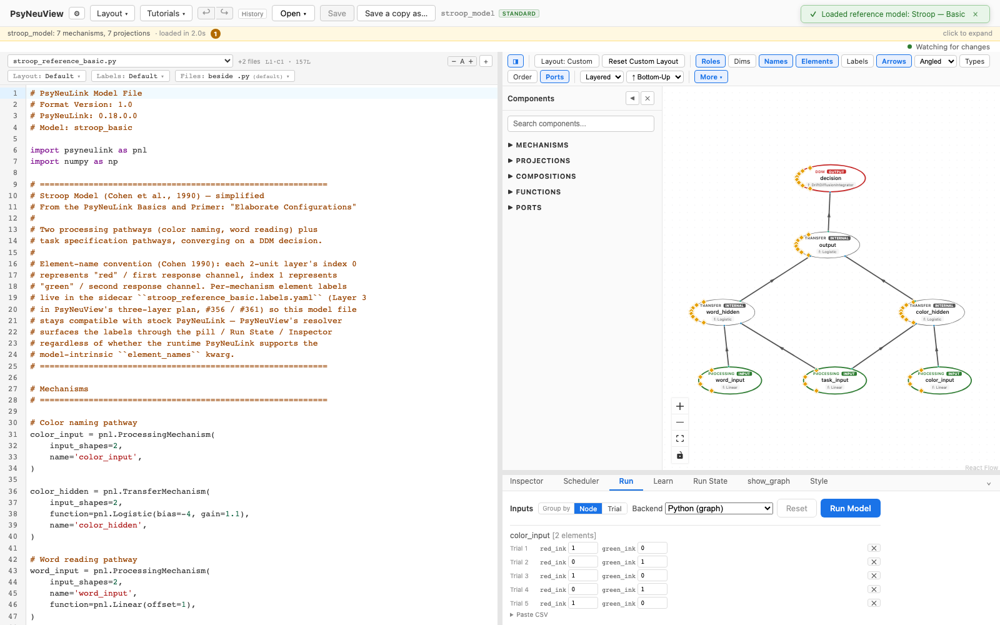
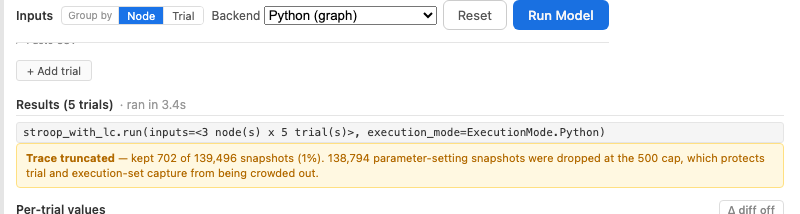
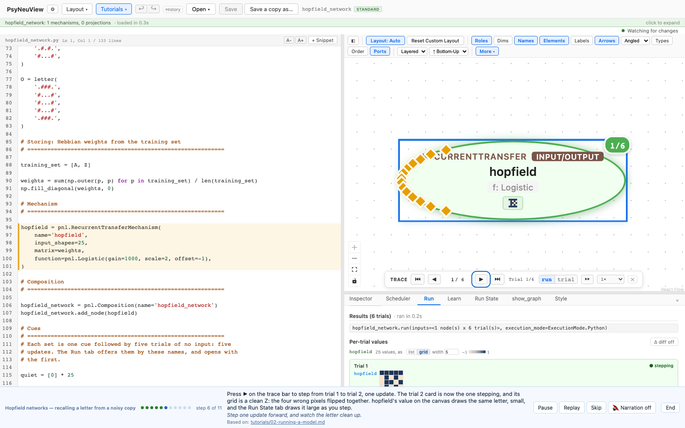

# Running a model

How to run a loaded model and read its per-trial output.

> **What you need:** a model already loaded (see
> [Loading a model](01-loading-a-model.md)). This walkthrough uses the
> deterministic reference models [**Stroop — Basic**](../reference-models/stroop-basic.md) and [**Stroop — with LC**](../reference-models/stroop-with-lc.md),
> which run through `Composition.run`.
>
> **Note on EGO:** the EGO model runs via *learning* (`.learn()` under PyTorch),
> a different path the executor doesn't yet drive (#321/#363), so it isn't
> covered here.

---

## 1. Open the Run tab

With a model loaded, click the **Run** tab in the bottom panel. PsyNeuView shows
the **Inputs** grid — one block per input node, pre-filled with default trials
you can edit — and a **Run Model** button.



## 2. (Optional) edit the inputs

Each input node lists its trials; edit any cell to change a value, add/remove
trials, or paste a CSV. You can group the grid **by Node** (default) or **by
Trial**. The defaults run as-is, so you can skip this step the first time.

### Inputs a model declares

A model can bring its own inputs. Any module-level dict in the shape
`Composition.run` takes, `{input_node: [trial, …]}`, is offered in a **From**
menu next to **Group by**, named by its variable, and the Run tab opens with the
first one. The Bistable Attractor demo, for example, declares the course's
`kick` and `steady_difference`:

```python
kick = {node_attract1: [2] + [0] * 9, node_attract2: [6] + [0] * 9}
```

**From → defaults** switches back to the synthesized inputs (1 on every trial).
A dict that doesn't cover every input node, or whose nodes have different trial
counts, isn't offered.

## 3. Click **Run Model**

PsyNeuView executes the model and shows **Results (N trials)** with a
**Per-trial values** breakdown — the input and the computed output of every node,
for each trial.


The same flow runs Stroop — with LC:



### A layer as a grid

A node whose value is four or more numbers can be shown as a **grid** of
shaded cells instead of a list: dark for high, light for low. Above the trial
cards, each such node has **list | grid**; pick **grid**, and every card draws
that node's input and output as a small picture. It is how the Hopfield demo's
25-unit layer reads as a 5 × 5 letter.

- **Shape.** A node with a 2-D shape is drawn in that shape; otherwise a size
  that is a perfect square is drawn square (25 → 5 × 5); otherwise the smallest
  square that holds it, with a short last row. **width** sets how many cells
  across.
- **Shade.** One scale for all the trials, shown beside the toggle. Values of
  0 or more run from 0 (light) to the largest (dark). Values that go negative
  are centred on 0: −1 is light, +1 dark, as a Hopfield letter's pixels are.
- **Hover** a cell for its unit, row, column and value.
- The same choice applies in **Run State** and on the node's value pill while
  you step the trace ([Stepping through a model](04-debugger-stepping.md)), and
  it is saved in the model's layout file, so the node opens as a grid next time.



---

## What you can expect

- [x] Running produces a **Results (N trials)** section with per-trial values.
- [x] A node of four or more values can be shown as a **grid**, and the choice
      is kept with the model (checked by `frontend/e2e/value-grid.spec.ts`).
- [x] For these deterministic models, the output **matches stock PsyNeuLink** —
      i.e. the same numbers you'd get from `Composition.run` directly. This
      numeric guarantee is enforced by the backend equivalence tests
      (#580 / #653), not re-derived here.
- [x] No error banner appears for the supported reference models.

> Models with intrinsic randomness (e.g. a noisy DDM) won't be bit-identical
> run-to-run; the deterministic Stroop models are.

---

## Further reading

PsyNeuView visualizes the model; for the underlying concepts and full API, see the PsyNeuLink docs on [Composition execution and `run()`](https://princetonuniversity.github.io/PsyNeuLink/Composition.html).

## How this tutorial stays accurate

The screenshots are captured from the live app by an executable spec that also
asserts the behavior above. Regenerate after any UI change:

```bash
cd frontend
npm run tutorials:capture
```

**Validated by:** [`frontend/e2e/tutorials/running.tutorial.spec.ts`](https://github.com/jonhanke-nam/PsyNeuView/blob/devel/frontend/e2e/tutorials/running.tutorial.spec.ts)
**Reference models:** Stroop — Basic (#396), Stroop — with LC (#399)
**Tracking:** #664 (under the tutorials umbrella #662)
