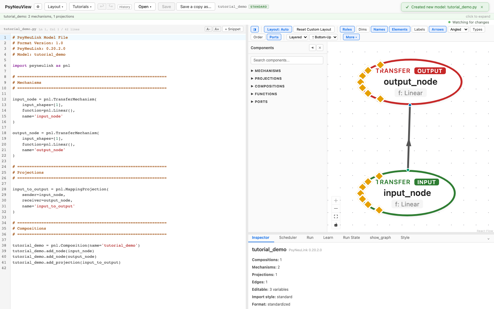
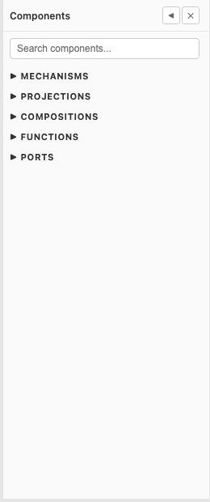
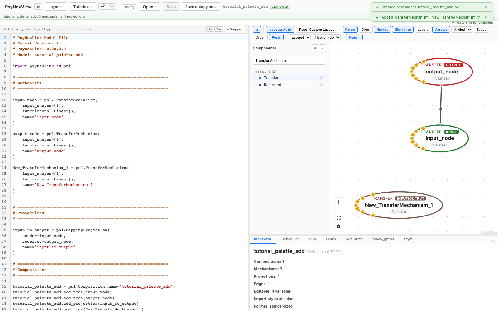

# Building a model

How to start a brand-new model and grow it on the canvas.

> **What you need:** a running PsyNeuView. No model loaded — you'll create one.

---

## 1. Start a new model

Click **Open ▾ → + New Model…**, give it a name, and PsyNeuView scaffolds a
valid starter model: two `TransferMechanism`s, **input_node → output_node**,
wired by a `MappingProjection`. The canvas shows the graph and the **Code
Editor** shows the generated PsyNeuLink source — the two stay in sync.



This starter is already a runnable model — you can switch to the **Run** tab and
run it immediately (see [Running a model](02-running-a-model.md)).

## 2. Add components from the palette

The **Components** palette (left of the canvas) holds every PsyNeuLink building
block, grouped into mechanisms, projections, compositions, functions, and ports.
The groups start closed so the palette opens short — **click** a heading to open
one.



There are two ways to add a component, and they do exactly the same thing:

- **Click** it — the component is added to your model straight away.
- **Drag** it onto the canvas — useful when you care where it lands.

Rather than opening groups, you can **search**: type into the box at the top of
the palette and the matching components are listed directly.

> **Labels are short; types are full.** The palette lists a component as
> *Transfer*, not *TransferMechanism* — hover it and the tooltip gives the real
> PsyNeuLink type. Searching matches either, so typing `TransferMechanism`
> finds it even though the list says `Transfer`.

New components arrive under a generated name — `New_TransferMechanism_1`, and so
on — which you can change in the [inspector](05-editing-inspector.md). The
canvas and the Code Editor update together: the node appears, its declaration is
written into the source, and it's added to the composition.



## 3. Wire and customize

- **Connect** nodes by dragging from one node's port to another's.
- **Customize** any node's parameters, ports, or function — see
  [Editing via the inspector](05-editing-inspector.md) and
  [Editing via the code editor](06-editing-code.md).

---

## What you can expect

- [x] **New Model** produces a valid, runnable PsyNeuLink model (input → output)
      with matching source in the Code Editor.
- [x] The canvas and the generated code stay in sync.
- [x] The palette exposes the full PsyNeuLink component set.
- [x] **Clicking a palette component adds it** — to the canvas, to the generated
      source, and to the composition, under a generated default name.

> Click-to-add is verified by the spec. The **drag** variants — drag-to-add and
> drag-to-connect — are demonstrated here but not auto-captured, because HTML5
> drag-drop is brittle to script. Both routes call the same code to change the
> model, so what's gated above holds for either.

---

## Further reading

PsyNeuView visualizes the model; for the underlying concepts and full API, see the PsyNeuLink docs on [Mechanisms](https://princetonuniversity.github.io/PsyNeuLink/Mechanism.html), [Projections](https://princetonuniversity.github.io/PsyNeuLink/Projection.html), and [Compositions](https://princetonuniversity.github.io/PsyNeuLink/Composition.html).

## How this tutorial stays accurate

```bash
cd frontend
npm run tutorials:capture
```

**Validated by:** [`frontend/e2e/tutorials/building.tutorial.spec.ts`](https://github.com/jonhanke-nam/PsyNeuView/blob/devel/frontend/e2e/tutorials/building.tutorial.spec.ts)
**Tracking:** #665 (under the tutorials umbrella #662)
