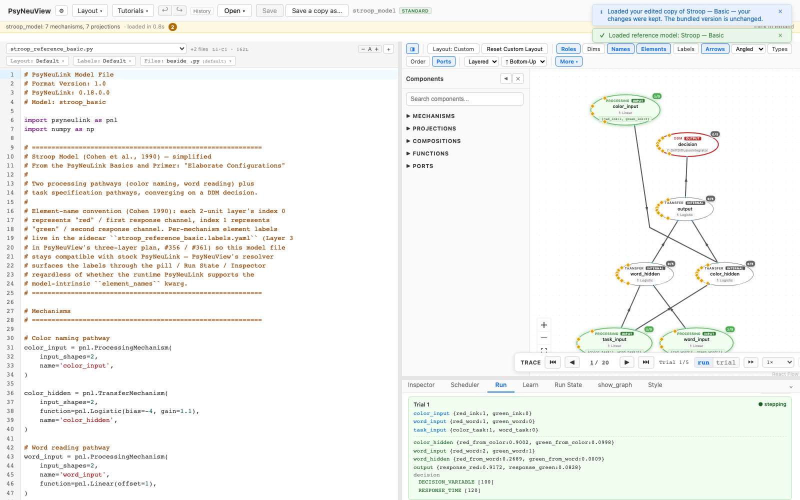
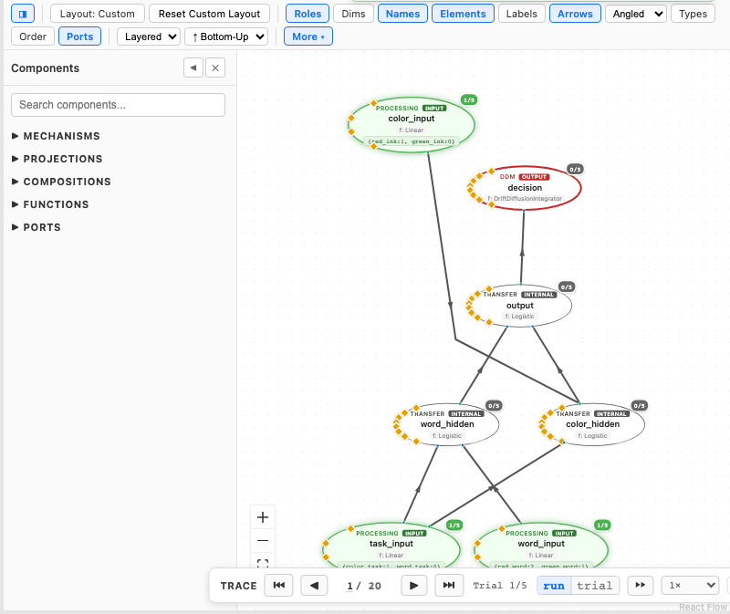
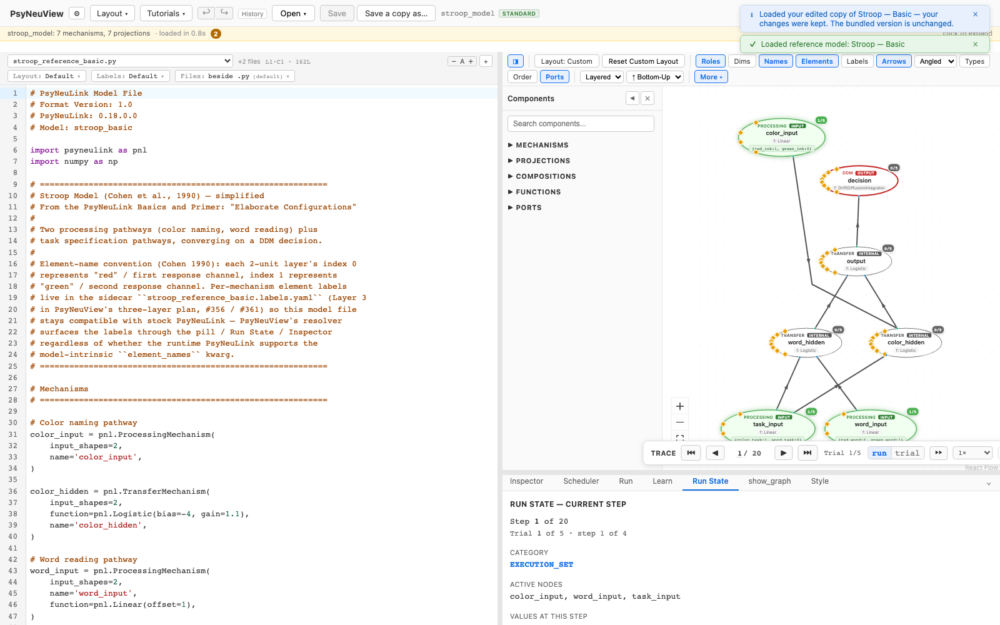

# Stepping through a model with the debugger

How to step through a run and inspect each node's state as execution unfolds.

> **What you need:** a model that runs (see [Running a model](02-running-a-model.md)).
> This walkthrough uses [**Stroop — Basic**](../reference-models/stroop-basic.md).
>
> ⚠️ **Source dependency.** The fine-grained stepping features below — value
> pills, the within-trial **Run State**, and the `trial` step mode — are driven
> by PsyNeuLink's `_debugger` hook. That hook shipped in **PsyNeuLink 0.19.1.0**,
> so the default PyPI install and current Princeton `devel`/`master` all include
> it (the `jonhanke-dev` fork may carry newer additions). Only builds predating
> 0.19.1.0 lack it. Check **Open ▾ → ⚙ settings** (or `/api/settings/info`) to see
> your active source and version. On a build *without* the hook, the trace bar
> still steps **trial-to-trial**, but within-trial values and value pills are
> unavailable and the Run State panel says so.

---

## 1. Run the model

Run the model as usual (Run tab → **Run Model**). Once it completes, a **TRACE**
stepper appears beneath the canvas.



## 2. Step through execution

Use the TRACE controls to move through the run. Two step modes:

- **run** — step across the whole run (trial to trial).
- **trial** — step *within* a trial, across the scheduler's consideration sets
  (PASS / TIME_STEP). _(hook-backed)_

As you step, each node shows a **value pill** with its current output, so you can
watch values propagate through the graph.



## 3. Inspect the current step in Run State

Open the **Run State** tab to see the **current step** in detail — which nodes
are in the active execution set and their values at this point in the run.



A node shown as a **grid** in the Run results ([A layer as a grid](02-running-a-model.md#a-layer-as-a-grid))
is a grid here too, and in its value pill on the canvas: each press of ▶
redraws the cells, so you can watch a pattern settle. Run State has the same
**list | grid** toggle under the node's name, and the grid's **width**.

---

## What you can expect

- [x] After a run, the **TRACE** stepper lets you move through execution.
- [x] **With the `_debugger` hook:** value pills on nodes, within-trial `trial`
      stepping, and a live **Run State** of the current step.
- [x] **Without the hook:** trial-to-trial stepping still works; within-trial
      detail is unavailable and the UI says so (no silent wrong data).

> Always validate stepping against **both** a hook-capable build and a stock
> build, since the available detail differs.

---

## Further reading

PsyNeuView visualizes the model; for the underlying concepts and full API, see the PsyNeuLink docs on the [Scheduler](https://princetonuniversity.github.io/PsyNeuLink/Scheduler.html) and execution [Conditions](https://princetonuniversity.github.io/PsyNeuLink/Condition.html).

## How this tutorial stays accurate

```bash
cd frontend
npm run tutorials:capture
```

This spec asserts the hook-backed view, so it passes only on a hook-capable
build (the doc covers the no-hook fallback in prose).

**Validated by:** [`frontend/e2e/tutorials/debugger.tutorial.spec.ts`](https://github.com/jonhanke-nam/PsyNeuView/blob/devel/frontend/e2e/tutorials/debugger.tutorial.spec.ts)
**Tracking:** #666 (under the tutorials umbrella #662); debugger umbrellas #247 / #355
