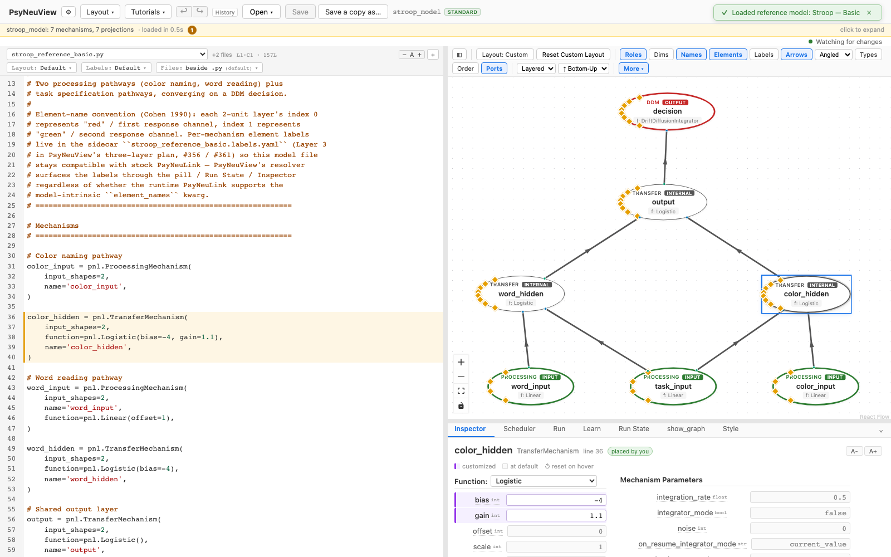
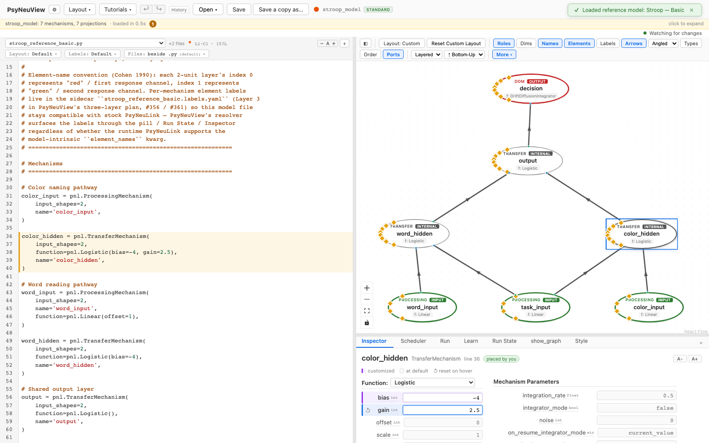

# Editing a model via the inspector

How to change a model by selecting parts of it and editing their properties.

> **What you need:** a model loaded (see [Loading a model](01-loading-a-model.md)).
> This walkthrough uses [**Stroop — Basic**](../reference-models/stroop-basic.md).

---

## 1. Select a node

Click a node on the canvas. The **Inspector** (bottom panel) shows its details:
its **function** and that function's parameters, the **mechanism parameters**,
and its **ports**.



## 2. Edit a parameter

Change a value directly in the Inspector — here, the Logistic **gain**. The edit
flows straight into the model: the **Code Editor** updates to match, so the
canvas, the inspector, and the source all stay in sync.



The Inspector is also where you:

- rename a node or port,
- add/remove ports and change input shapes,
- swap a node's **function type**,
- set display labels for ports and elements.

---

## What you can expect

- [x] Selecting a node shows its function, parameters, and ports.
- [x] Editing a parameter in the Inspector **updates the model source** (the
      Code Editor reflects the change).
- [x] The canvas, inspector, and code stay consistent — one model, three views.

---

## Further reading

PsyNeuView visualizes the model; for the underlying concepts and full API, see the PsyNeuLink docs on [Mechanism](https://princetonuniversity.github.io/PsyNeuLink/Mechanism.html) and [Function](https://princetonuniversity.github.io/PsyNeuLink/Function.html) parameters.

## How this tutorial stays accurate

```bash
cd frontend
npm run tutorials:capture
```

**Validated by:** [`frontend/e2e/tutorials/inspector.tutorial.spec.ts`](https://github.com/jonhanke-nam/PsyNeuView/blob/devel/frontend/e2e/tutorials/inspector.tutorial.spec.ts)
**Tracking:** #667 (under the tutorials umbrella #662)
**See also:** [Editing via the code editor](06-editing-code.md), [Live editing](07-live-editing.md)
