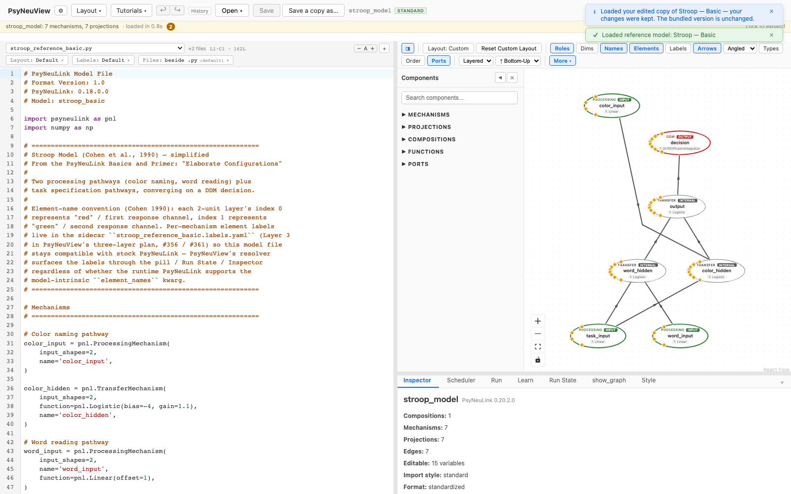
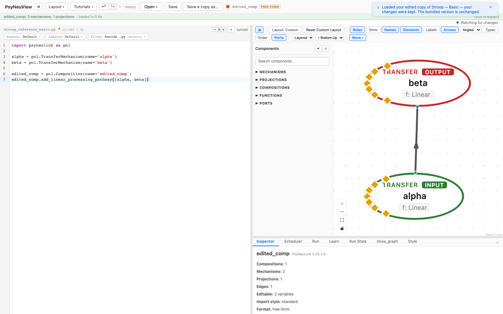

# Editing a model via the code editor

How to change a model by editing its PsyNeuLink Python source directly.

> **What you need:** a model loaded (see [Loading a model](01-loading-a-model.md)).
> This walkthrough uses [**Stroop — Basic**](../reference-models/stroop-basic.md).

---

## 1. The Code Editor is the source of truth

The left panel shows the model's PsyNeuLink **Python source**. The canvas is a
view of this code — they describe the same model.



## 2. Edit the source and save

Edit the Python however you like — change a parameter, rename a node, add or
remove mechanisms and projections — then press **Save** (**⌘S** / **Ctrl+S**, or
the toolbar **Save** button). PsyNeuView re-parses the source and **rebuilds the
canvas** to match.

Here the source was replaced with a small two-node model (`alpha → beta`); on
save, the canvas rebuilds accordingly.



---

## What you can expect

- [x] The Code Editor holds the model's full PsyNeuLink source.
- [x] **Save (⌘S / Ctrl+S)** re-parses the source and rebuilds the canvas.
- [x] Any valid PsyNeuLink edit works — params, names, nodes, projections.
- [x] If your edit has a problem, PsyNeuView surfaces it rather than failing
      silently (see [Incomplete / broken state handling](09-incomplete-state.md)).

> The Code Editor and the [Inspector](05-editing-inspector.md) edit the *same*
> model from two directions — use whichever fits the change.

---

## Further reading

PsyNeuView visualizes the model; for the underlying concepts and full API, see the PsyNeuLink docs on [defining models with Compositions](https://princetonuniversity.github.io/PsyNeuLink/Composition.html).

## How this tutorial stays accurate

```bash
cd frontend
npm run tutorials:capture
```

**Validated by:** [`frontend/e2e/tutorials/code.tutorial.spec.ts`](https://github.com/jonhanke-nam/PsyNeuView/blob/devel/frontend/e2e/tutorials/code.tutorial.spec.ts)
**Tracking:** #668 (under the tutorials umbrella #662)
