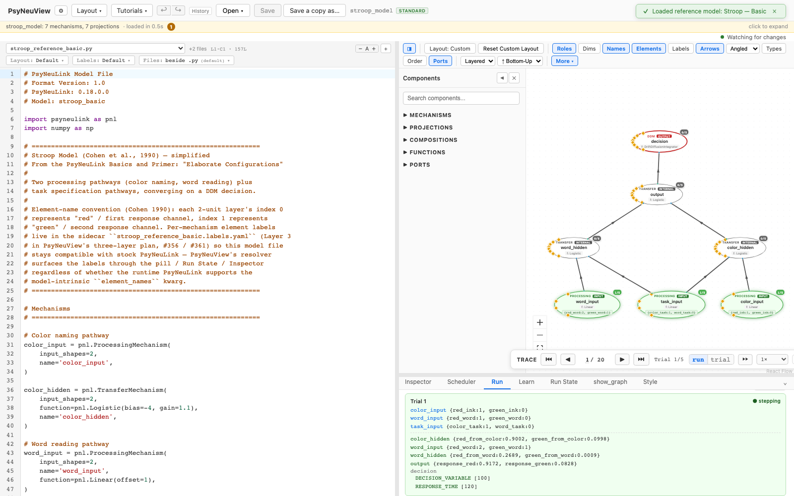
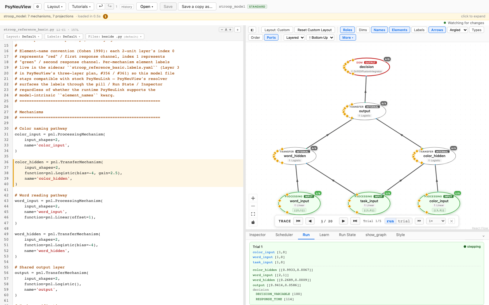

# Live editing (edit + re-run)

How to iterate on a model — change something, run it again, repeat — without
reloading.

> **What you need:** a model loaded (see [Loading a model](01-loading-a-model.md)).
> This walkthrough uses [**Stroop — Basic**](../reference-models/stroop-basic.md).

---

## 1. Run the model

Run the model and look at the results (see [Running a model](02-running-a-model.md)).



## 2. Change something

Edit the model in place — here, the Logistic **gain** on a node, via the
[Inspector](05-editing-inspector.md) (you could equally edit the
[code](06-editing-code.md)). No reload required.

## 3. Run again

Switch back to the **Run** tab and **Run Model** again. The model runs with your
edit applied, and your **inputs and layout persist** across the change — so you
can tighten the edit-run loop while exploring a model's behavior.



---

## What you can expect

- [x] You can edit and re-run repeatedly **without reloading** the model.
- [x] Edits (inspector or code) apply to the next run.
- [x] Your **inputs and layout persist** across an edit.

> If a new model is loaded, prior run results are cleared — live editing keeps
> the same model across iterations.

---

## Further reading

PsyNeuView visualizes the model; for the underlying concepts and full API, see the PsyNeuLink docs on [Composition structure and re-running](https://princetonuniversity.github.io/PsyNeuLink/Composition.html).

## How this tutorial stays accurate

```bash
cd frontend
npm run tutorials:capture
```

**Validated by:** [`frontend/e2e/tutorials/live.tutorial.spec.ts`](https://github.com/jonhanke-nam/PsyNeuView/blob/devel/frontend/e2e/tutorials/live.tutorial.spec.ts)
**Tracking:** #669 (under the tutorials umbrella #662)
