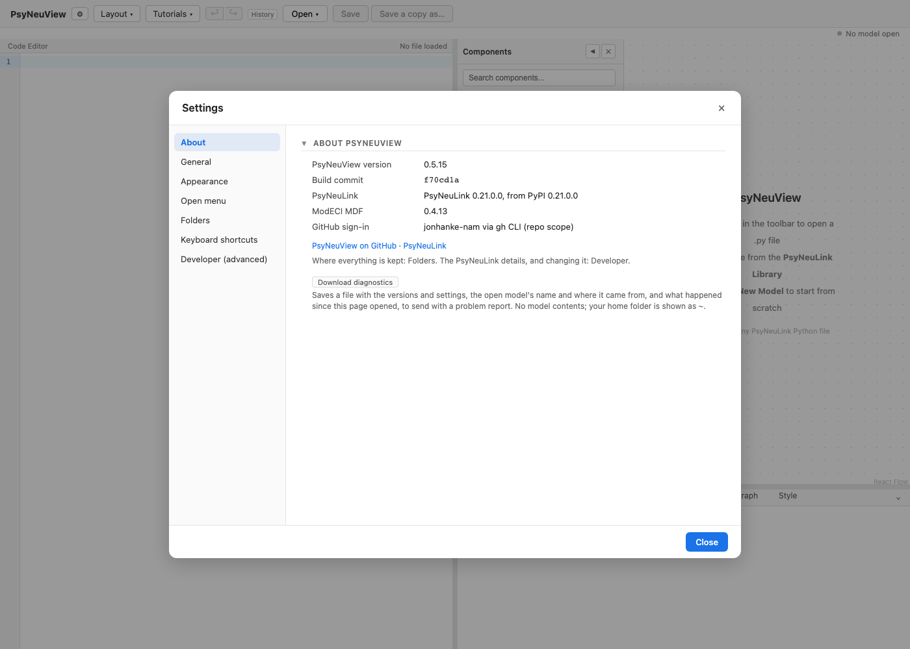
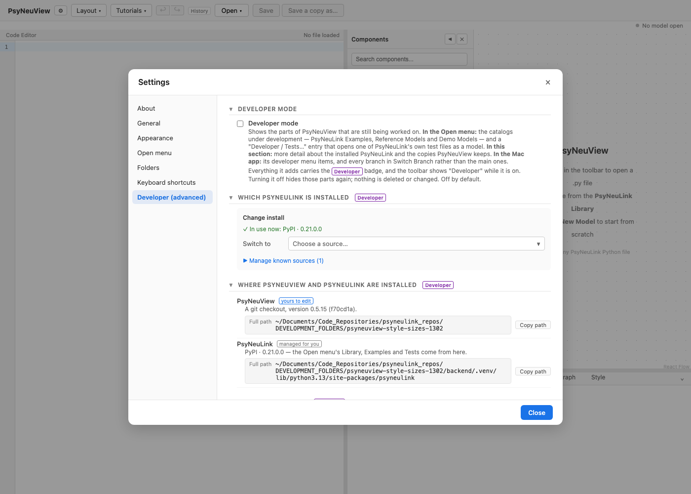

# Configuring which PsyNeuLink source is used

How to see — and change — which PsyNeuLink build PsyNeuView runs against.

> **Why it matters:** PsyNeuView runs your models against a specific PsyNeuLink
> install. Which one you use determines what works. For example, the **debugger
> stepping** features (value pills, within-trial Run State) require a build that
> ships the `_debugger` hook — see [Stepping with the debugger](04-debugger-stepping.md).

---

## 1. Open Settings

Click the **⚙** button in the toolbar, next to the app name (or **Layout ▸
Settings…**; in the Mac app, **Settings… ⌘,** opens the same panel). Settings
has a sidebar of sections; **About** says in one line which PsyNeuLink is
installed and where it comes from, and **Developer ▸ PsyNeuLink details**
has the full readout: repo, branch/ref, commit, path, version and how far
behind its branch it is.



In the screenshot, the active build is `PrincetonUniversity/PsyNeuLink @
jonhanke-dev` — one build that includes the `_debugger` hook. As of PsyNeuLink
0.19.1.0 the hook is upstreamed, so PyPI and Princeton `devel`/`master` include
it too; the stepping features are available on any of them.

## 2. Change the source

Changing it is a developer's job, so it lives in the **Developer** section,
last in the sidebar. Under **Which PsyNeuLink is installed ▸ Change install**,
a line says what is in use now. Open the **Switch to** dropdown and pick a
source: **Another local checkout…** (a Path field, with **Choose…** in the
Mac app; choose an empty folder and Settings offers to download PsyNeuLink
into it, from *Latest development* or another GitHub source you have used) or **Another GitHub repo or branch…** (Repo and Branch) at the top,
or one you have used before, in groups that fold — your checkouts, one
group per GitHub repo listing its branches, and the official releases (the
newest five, then **Show older**). The group holding the PsyNeuLink in use
starts open, with that row marked ✓. Settings says what the switch will change, and
**Apply & restart** appears once the choice is complete and differs from
what is in use. **Manage known sources**, folded below, is where you rename
or remove a source.

 PsyNeuView reinstalls PsyNeuLink and restarts the backend against the
new source.

> ⚠️ **Apply & restart** reinstalls PsyNeuLink and restarts the backend — it can
> take a little while and briefly interrupts the app.

---

## What you can expect

- [x] Settings shows exactly which PsyNeuLink build is active (repo, branch,
      commit, path, version).
- [x] You can switch sources from here and apply with a restart.
- [x] Feature availability follows the source — notably, debugger stepping needs
      a build with the `_debugger` hook (PsyNeuLink ≥ 0.19.1.0, including PyPI and
      Princeton `devel`/`master`).

> The Settings readout is also available programmatically at `/api/settings/info`.
> Native packaging (the macOS app) can pin a default source; this panel is the
> in-app source of truth and switcher.

---

## Further reading

PsyNeuView visualizes the model; for the underlying concepts and full API, see the [PsyNeuLink documentation](https://princetonuniversity.github.io/PsyNeuLink/) for installing and configuring PsyNeuLink.

## How this tutorial stays accurate

```bash
cd frontend
npm run tutorials:capture
```

The spec verifies the Settings readout and the Change-install control without
applying a change (a restart would reinstall PsyNeuLink).

**Validated by:** [`frontend/e2e/tutorials/source-config.tutorial.spec.ts`](https://github.com/jonhanke-nam/PsyNeuView/blob/devel/frontend/e2e/tutorials/source-config.tutorial.spec.ts)
**Tracking:** #670 (under the tutorials umbrella #662); settings strategy #118
