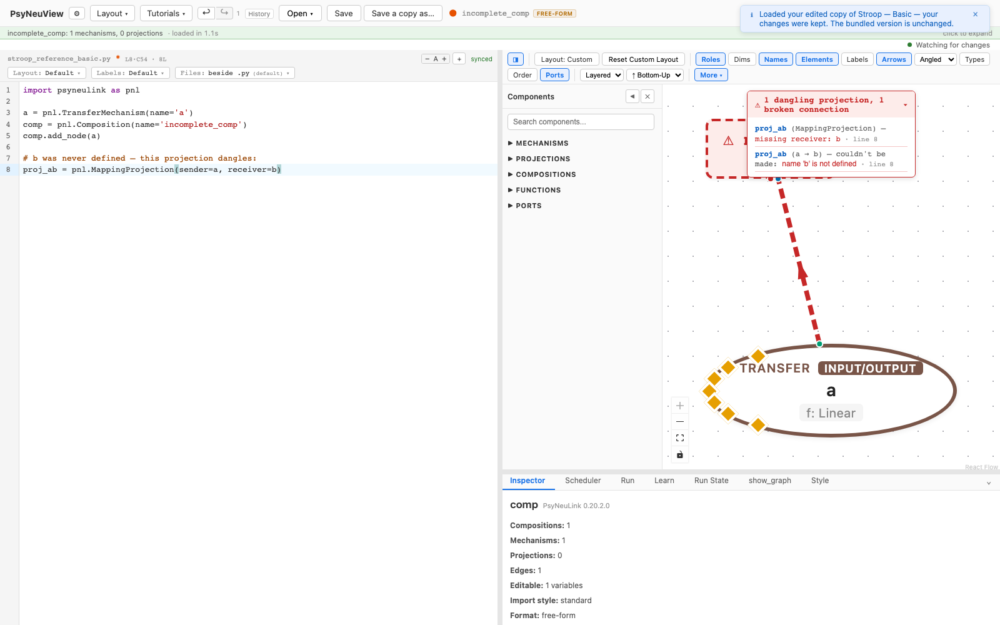

# Incomplete / broken state handling

What PsyNeuView does when a model isn't fully wired up yet — and why that's by
design.

> **What you need:** a model loaded. This walkthrough edits it into an
> incomplete state on purpose.

---

## Models in progress are normal

While you build or edit a model, it's often temporarily incomplete — a
projection whose other end doesn't exist yet, a node referenced before it's
defined. PsyNeuView is built to **render these states helpfully** instead of
failing, so you can keep working.

## An incomplete model

Here the source defines node `a` and a projection `proj_ab` to a node `b` that
was never created. PsyNeuView:

- renders what it **can** — node `a`,
- draws a **phantom endpoint** (the red "MISSING b") and a **dangling
  projection** for the missing piece,
- **surfaces the problem** — a "1 dangling projection" callout and a "Partial
  execution: name 'b' is not defined" notice,
- and **stays fully usable** — the editor, canvas, and inspector keep working.



To finish the model, define `b` (in the [code](06-editing-code.md) or via the
[palette](03-building-a-model.md)) and the dangling projection resolves.

---

## What you can expect

- [x] An incomplete model **renders what it can** rather than failing.
- [x] Missing endpoints appear as **phantom nodes** with **dangling projections**.
- [x] Problems are **surfaced** (dangling-projection callout, partial-execution
      notice) — never silently wrong.
- [x] The app stays usable so you can fix the model in place.

---

## Further reading

PsyNeuView visualizes the model; for the underlying concepts and full API, see the PsyNeuLink docs on [Composition construction](https://princetonuniversity.github.io/PsyNeuLink/Composition.html).

## How this tutorial stays accurate

```bash
cd frontend
npm run tutorials:capture
```

**Validated by:** [`frontend/e2e/tutorials/incomplete.tutorial.spec.ts`](https://github.com/jonhanke-nam/PsyNeuView/blob/devel/frontend/e2e/tutorials/incomplete.tutorial.spec.ts)
**Tracking:** #671 (under the tutorials umbrella #662); incomplete-state umbrella #185
