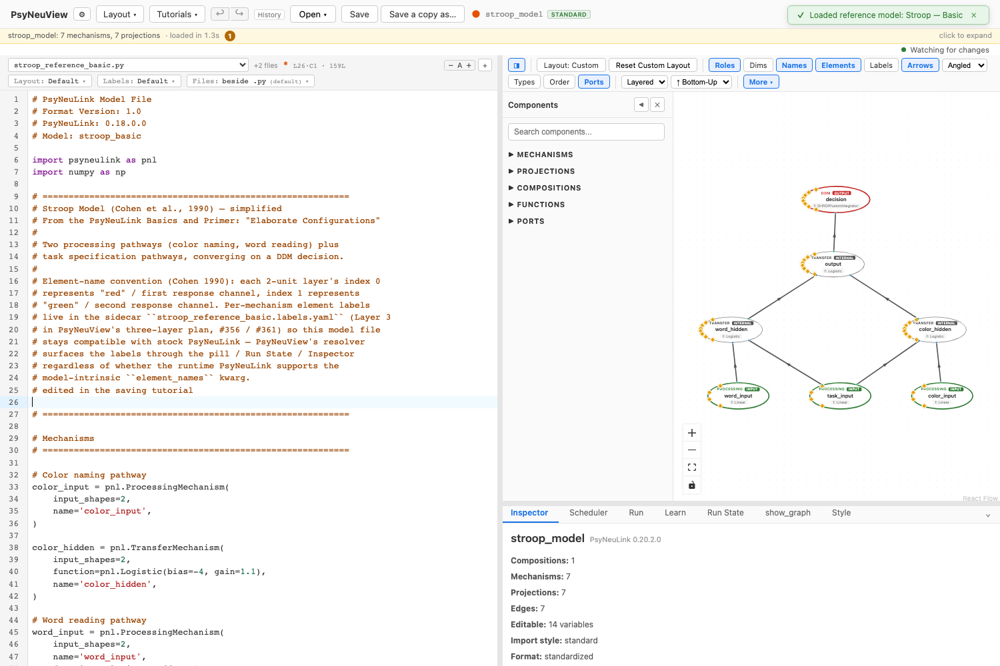
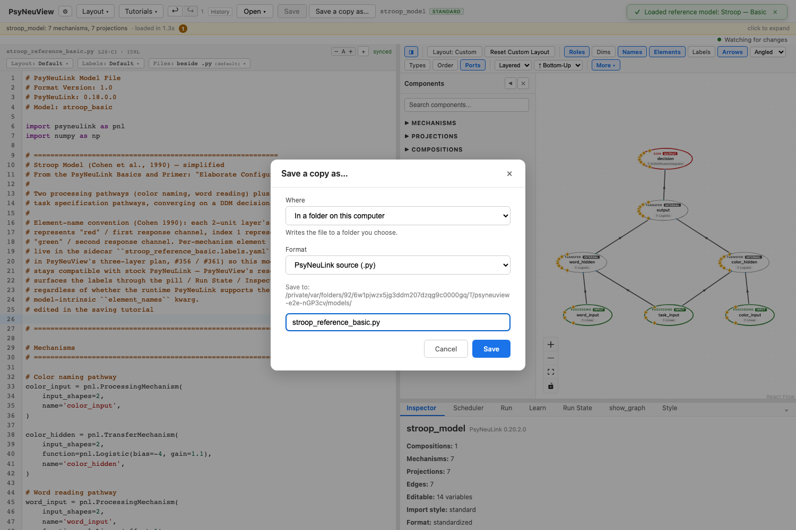

# Saving & exporting a model

How to persist your work and share it in other formats.

> **What you need:** a model loaded with some changes to save.

---

## 1. Save your changes

The toolbar **Save** button is enabled whenever there are unsaved changes.
Click it (or press **⌘S / Ctrl+S**) to write the model back to its file. Once
saved, the button greys out until you make another change.



## 2. Save a copy, or export to another format

**Save a copy as…** opens one dialog that handles both saving a copy and
exporting. Pick a **Format**:

- **PsyNeuLink source (.py)** — a standalone Python copy that becomes the active
  file.
- **PsyNeuView Project (.pnlproject)** — the model bundled with its layout and
  labels, so the curated view travels with it.
- **MDF (YAML)** / **MDF (JSON)** — export to the ModECI Model Description Format
  for use in other tools.



---

## What you can expect

- [x] **Save** writes changes back to the model's file; it's disabled when there's
      nothing to save.
- [x] **Save a copy as…** writes a `.py` copy or a `.pnlproject` bundle, or
      exports **MDF (YAML/JSON)**.
- [x] A project bundle keeps your **layout and labels** with the model.

> Prefer **YAML** over JSON when you want a human-readable export.

---

## Further reading

PsyNeuView visualizes the model; for the underlying concepts and full API, see the PsyNeuLink docs on [model serialization](https://princetonuniversity.github.io/PsyNeuLink/Composition.html) and the [MDF format](https://mdf.readthedocs.io/).

## How this tutorial stays accurate

```bash
cd frontend
npm run tutorials:capture
```

**Validated by:** [`frontend/e2e/tutorials/saving.tutorial.spec.ts`](https://github.com/jonhanke-nam/PsyNeuView/blob/devel/frontend/e2e/tutorials/saving.tutorial.spec.ts)
**Tracking:** #687 (under the tutorials umbrella #662); MDF interop #88
