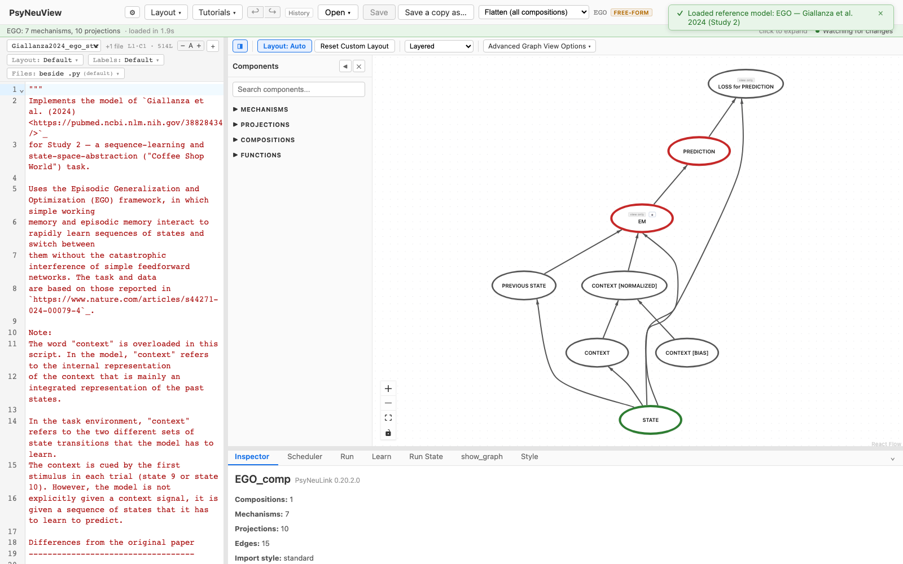
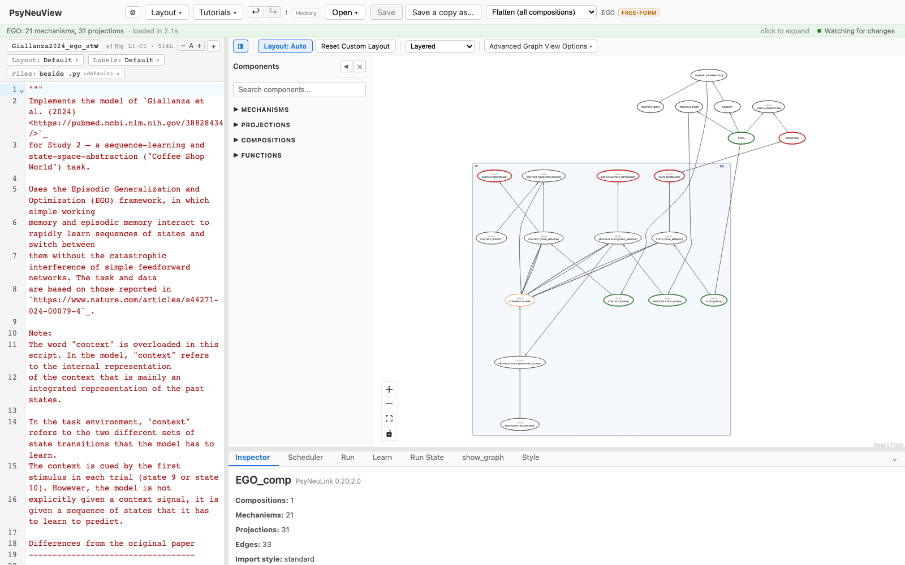

# Viewing options & the flat view

How to control what the graph shows — layout, nesting, and the flattened view.

> **What you need:** a model loaded. This walkthrough uses [**EGO**](../reference-models/ego.md), which has a
> nested **EM** composition.

---

## Layout and display controls

The graph toolbar controls how the model is drawn:

- **Layout: Auto / Custom** — auto-layout vs. your hand-arranged positions, plus
  **Reset Custom Layout** and the layout (**Like show_graph**, **Layered**, …).
- **Advanced Graph View Options ▾** — one panel that stays open while you
  change things, grouped as **Nodes** (names, type and role tags, full type
  names, colour by role, dimensions, run order, show ports, expand or collapse
  all), **Layout** (direction such as **Bottom-Up**, flips), **Lines** (line
  style, direction arrows, line names, spreading shared lines) and **What the
  graph shows** (controller, learning, interface nodes, inactive lines).
  Escape, a click outside or its × closes it. The dashed scheduling arrows are
  hidden by default; turn them on in Settings ▸ Appearance.
  By default a node shows just its name, as `show_graph()` draws it, with its
  role in the outline colour; **Type and role tags** adds each node's tags and
  its function (for example `f: Logistic`), and is remembered once you choose.
- The **view selector** (the composition dropdown) — switch between a single
  composition, the whole nested model, and the **flattened** view (below).

## Nested vs. flat

By default a nested composition is drawn as a container you can drill into — here
**EM** is a single composition node.



In the **view selector**, choose **Flatten (all compositions)** to inline every
nested composition into one graph — the autodiff-flattened view. EM's internals
(e.g. `RETRIEVE`, `STORE`, `MATCH`, `QUERY`) become top-level nodes, so you can
see the whole computation at once.



Pick a composition from the selector again to return to the nested view. When a
node has been flattened out of a nested composition, the Inspector shows its
**provenance** (which composition it came from).

---

## What you can expect

- [x] Layout can be **auto** or your **custom** arrangement, with a reset and
      direction options.
- [x] Advanced Graph View Options shows or hides roles, names, ports, arrows,
      and more, and stays open while you change several.
- [x] **Flatten** inlines nested compositions into one graph; toggling it off
      restores the nested view.
- [x] Flattened nodes carry **provenance** back to their source composition.

> The flat view is especially useful for learning models like EGO, where the
> interesting computation lives inside a nested composition.

---

## Further reading

PsyNeuView visualizes the model; for the underlying concepts and full API, see the PsyNeuLink docs on [`Composition.show_graph`](https://princetonuniversity.github.io/PsyNeuLink/Composition.html) and [AutodiffComposition](https://princetonuniversity.github.io/PsyNeuLink/AutodiffComposition.html) (the PyTorch view).

## How this tutorial stays accurate

```bash
cd frontend
npm run tutorials:capture
```

**Validated by:** [`frontend/e2e/tutorials/viewing.tutorial.spec.ts`](https://github.com/jonhanke-nam/PsyNeuView/blob/devel/frontend/e2e/tutorials/viewing.tutorial.spec.ts)
**Tracking:** #688 (under the tutorials umbrella #662); flat view #216 / #230
