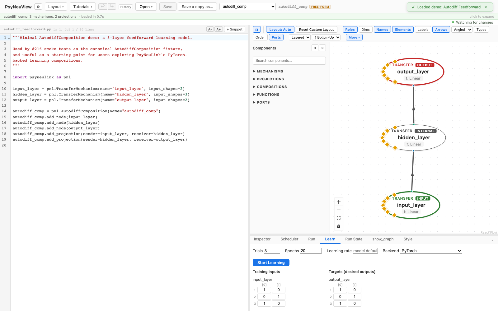
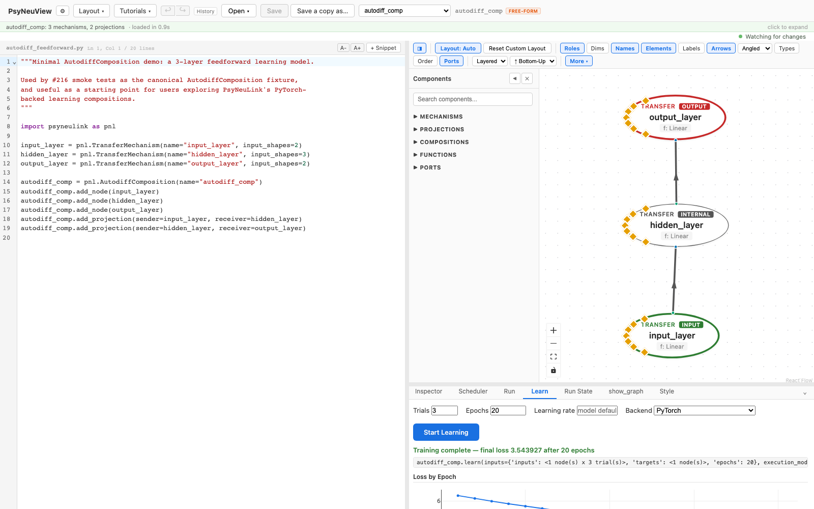
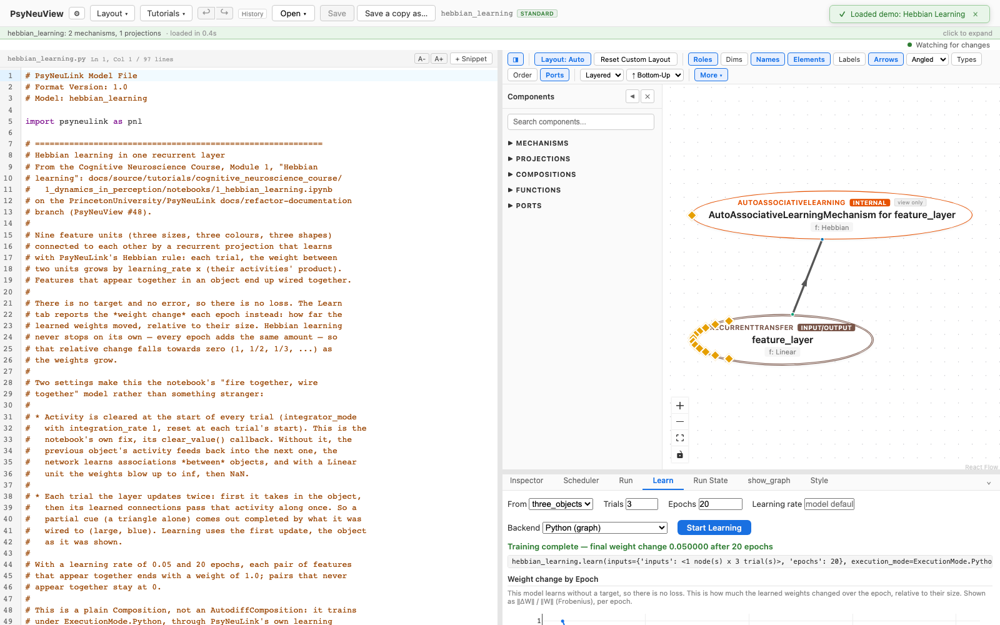

# Training a learning model

How to *train* a model — distinct from running it — using the Learn panel.

> **What you need:** a model that can learn. That is either an
> **AutodiffComposition**, which trains under PyTorch, or a plain **Composition**
> with a learning pathway or a learning mechanism, which trains under Python
> through PsyNeuLink's own learning mechanisms. This walkthrough uses the
> **Autodiff Feedforward** demo, then the **Hebbian Learning** demo.
>
> Training (`.learn()`) adjusts the model's weights; running
> (`Composition.run`, see [Running a model](02-running-a-model.md)) executes the
> model as-is. They're separate workflows.

---

## 1. Open the Learn tab

With an autodiff model loaded, open the **Learn** tab. It lets you set the
training **inputs** and **targets**, the number of **epochs**, and the
**learning rate**, and pick the execution backend. The backend list is the
model's own: an AutodiffComposition trains under PyTorch, a Composition with
learning pathways under Python, and the options that can't train this model are
greyed out with the reason. Leave the learning rate empty to use the model's
own; a value you type overrides it.



### Training sets a model declares

A model can bring its own training sets, too: any module-level dict in the shape
`Composition.learn` takes, `{"inputs": {…}, "targets": {…}, "epochs": n}`
(leave out `"targets"` for a model that learns without them).
They're offered in a **From** menu, named by their variables, and the Learn tab
opens with the first. Choosing one fills the inputs, targets and trial count,
plus the epochs if the set gives them. The Logic Gate Network demo declares
`and_gate`, `or_gate` and `xor_gate`.

## 2. Start learning

Click **Start Learning**. Training runs as a job and streams **per-epoch loss**
live. When it finishes you get **Training complete — final loss …** and a
**Loss by Epoch** chart.



## 3. Models that learn without PyTorch

A plain `Composition` learns through **learning pathways**
(`add_backpropagation_learning_pathway`, `add_td_learning_pathway`, …) or
**learning mechanisms** (`RecurrentTransferMechanism(enable_learning=True)`).
These train under **Python**, and the Learn tab trains them the same way: one
job, streamed an epoch at a time, cancellable. What changes is what each epoch
reports, because there is no PyTorch loss:

| The model | Each epoch reports | Bundled demo |
|---|---|---|
| AutodiffComposition | **Loss** (PyTorch's) | Autodiff Feedforward |
| TD learning pathway | **Prediction error**: the TD error, squared and averaged over the trial's timesteps and the epoch's trials | TD Learning |
| Other learning pathway (backprop, reinforcement) | **Error at target**: mean squared error between output and target | |
| No target at all (Hebbian) | **Weight change**: how far the learned weights moved, relative to their size, ‖ΔW‖ / ‖W‖. Not a loss | Hebbian Learning |

The chart, the running status and the final value are labelled with that name.
A Hebbian model has no targets, so its **Targets** column says so instead of
showing a grid. A learning pathway's generated `TARGET` node is not an input
you type: the reward or target goes in the target grid, against the node being
trained.

Open the **Hebbian Learning** demo, open the Learn tab (it opens with the
model's `three_objects` set) and click **Start Learning**:



Hebbian learning never stops on its own: every epoch adds roughly the same
amount to the weights. What falls is the change *relative* to the weights, as
they settle into their final pattern.

---

## What you can expect

- [x] An **AutodiffComposition** trains under PyTorch; a **Composition** with a
      learning pathway or learning mechanism trains under Python. A model with
      neither says so in the Learn tab.
- [x] **Start Learning** runs training as a job with **live per-epoch progress**
      and a **Cancel** button.
- [x] On completion you see the **final value** and a **by-epoch** chart,
      labelled for what it is: loss, prediction error, error at target, or
      weight change.

> Some published learning models (e.g. EGO) still have open runnability gaps in
> the executor (#363); this tutorial uses the Autodiff Feedforward demo, which
> trains end-to-end today. As those gaps close, the same workflow applies to the
> reference learning models.

---

## Further reading

PsyNeuView visualizes the model; for the underlying concepts and full API, see the PsyNeuLink docs on [AutodiffComposition](https://princetonuniversity.github.io/PsyNeuLink/AutodiffComposition.html), [learning in a Composition](https://princetonuniversity.github.io/PsyNeuLink/Composition.html#composition-learning) and [LearningMechanism](https://princetonuniversity.github.io/PsyNeuLink/LearningMechanism.html).

## How this tutorial stays accurate

```bash
cd frontend
npm run tutorials:capture
```

**Validated by:** [`frontend/e2e/tutorials/training.tutorial.spec.ts`](https://github.com/jonhanke-nam/PsyNeuView/blob/devel/frontend/e2e/tutorials/training.tutorial.spec.ts)
**Tracking:** #689 (under the tutorials umbrella #662); executor learning #363, learning GUI #182, non-autodiff learning #997
