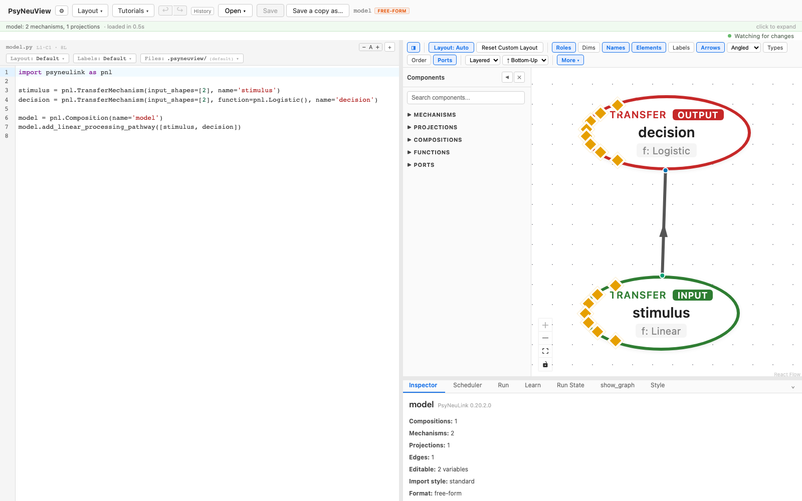
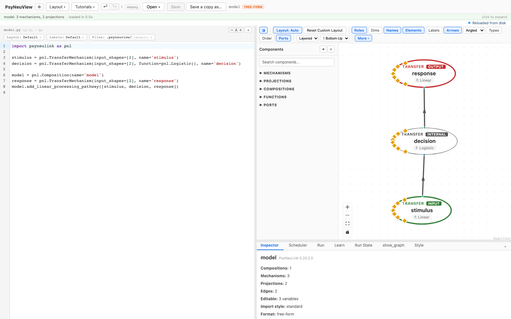
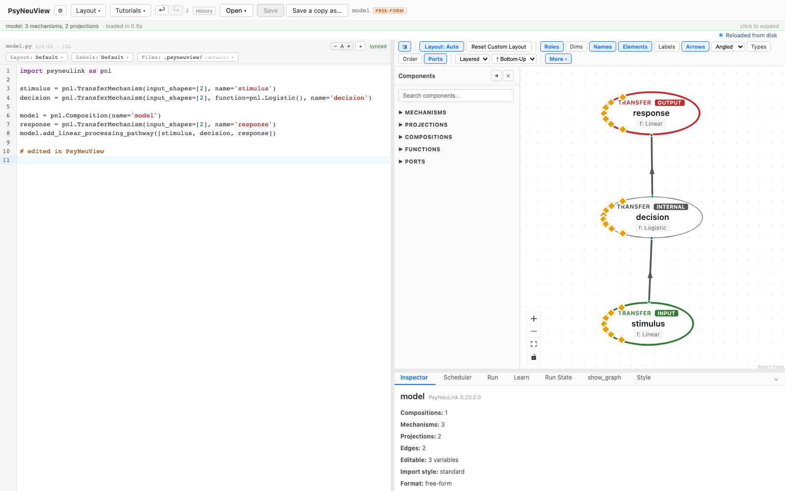

# The two-editor workflow, end to end

One continuous session with PsyNeuView and PyCharm open on the same model:
write it in the IDE, see it here, edit it in both, and understand what ends up
on disk.

> **What you need:** PsyNeuView running, PyCharm set up
> ([macOS setup](../guides/pycharm-setup-macos.md)), and a folder to keep models
> in. If your model doesn't exist yet, start with
> [Starting a model](14-starting-a-model.md).

---

## 1. Write the model in PyCharm

In your models folder, `model.py`:

```python
import psyneulink as pnl

stimulus = pnl.TransferMechanism(input_shapes=[2], name='stimulus')
decision = pnl.TransferMechanism(input_shapes=[2], function=pnl.Logistic(), name='decision')

model = pnl.Composition(name='model')
model.add_linear_processing_pathway([stimulus, decision])
```

Save it (**⌘S**). Ordinary PsyNeuLink — nothing PsyNeuView-specific.

## 2. Open it in PsyNeuView

**Open ▸ from path…**, and give it the full path to `model.py`. Two nodes, one
projection between them.

In the **Mac app** this is the standard macOS Open panel rather than
PsyNeuView's own file browser — navigate to the file, or press **⇧⌘G** to type
the path.



Leave this window open. You won't touch it in the next step — that's the point.

## 3. Edit in PyCharm, and watch

Back in **PyCharm**, add a third mechanism to the pathway:

```python
response = pnl.TransferMechanism(input_shapes=[2], name='response')
model.add_linear_processing_pathway([stimulus, decision, response])
```

Save.

**Now look at PsyNeuView without clicking anything.** The new node is on the
canvas, wired into the pathway.



This is the whole workflow in one step. PsyNeuView watches the file, re-reads
the model when it changes, and rebuilds the graph. There is no reload button to
press and no import step.

> **Guarantee.** This behavior is asserted by
> `frontend/e2e/tutorials/two-headed.tutorial.spec.ts` — the screenshots above
> are captured from it. If it stopped working, that spec would fail.

## 4. Arrange and label — and notice what *doesn't* change

Drag the nodes into an arrangement you like. Name a few vector dimensions in the
inspector.

Look at `model.py` in PyCharm: **unchanged.** Layout and labels went to
companion files beside it (`model.pnlview.json`, `model.labels.yaml`). This is
the division that makes two editors workable — PsyNeuView's visual work never
touches the file PyCharm is editing.

## 5. Edit in PsyNeuView, and see it in PyCharm

Now the other direction. Change something here — a parameter in the inspector,
or the source in the code panel.



PsyNeuView writes your `.py`. PyCharm notices the file changed and reloads it,
assuming it has no unsaved changes of its own — if it does, it asks you first
("File Cache Conflict").

> **Worth knowing:** typing in PsyNeuView's code panel updates the canvas but
> does **not** write your file — that happens when you Save. An inspector or
> canvas edit does write immediately, and commits any unsaved code-panel text
> along with it, because the change is applied to the file itself.

## 6. Run it

Run the model in PsyNeuView as usual ([Running a model](02-running-a-model.md)).
Running doesn't change the loop — the code is the same code PyCharm has open.

## 7. What's on disk at the end

```text
my_models/
  model.py               # yours — edited in both places
  model.pnlview.json     # PsyNeuView's — the arrangement from step 4
  model.labels.yaml      # PsyNeuView's — the names from step 4
```

`git status` shows all three. Commit the companions if you want collaborators to
open the model and see the same arrangement; leave them out if PsyNeuView is
just your personal viewer. The reasoning, and a `.gitignore` for the one-shot
backups, is in
[Using PsyNeuView alongside PyCharm](../external-editor-workflow.md#what-to-commit-to-version-control).

---

## The one rule

**Edit code in one window at a time.** Everything above works because each file
had a single author at each moment. When both sides change the same file before
either is saved, neither tool can know which version you meant, so each will
stop and ask — see [the sync check](13-sync-check.md), check 4.

## See also

- [Two ways to work](../workflow-modes.md) — this workflow versus using
  PsyNeuView alone.
- [The sync check](13-sync-check.md) — confirm both directions on your machine.
- [PyCharm setup on macOS](../guides/pycharm-setup-macos.md)
