# Guided walkthroughs: the Cognitive Neuroscience Course

Step-by-step walkthroughs that run **inside the app**, one per model of PsyNeuLink's
*Cognitive Neuroscience Course*. A walkthrough points at the
thing to use, tells you what to do and why, and moves on once you have actually
done it: selected the node, run the model, trained it. Clicking "next" isn't
enough.

> **What you need:** nothing beyond a working build. Each walkthrough either
> starts a new model or opens a bundled demo.
>
> **Tracking:** #1180 (the course), #1181 (the walkthrough engine).

---

## Starting a walkthrough

Open **Tutorials ▾** in the toolbar and pick one. A walkthrough can also be
linked directly with `?tour=<id>`, e.g. `?tour=ddm`.

The menu's sections fold: click a heading (▼/▶) to show or hide its
walkthroughs. The first time, PsyNeuView First Steps is open and the rest are
folded; after that the menu remembers your choice, and the section of a running
walkthrough opens by itself. Not taking the course? Settings ▸ Tutorials and
Voice ▸ Tutorials ▸ **Hide the Cognitive Neuroscience Course** leaves this
section out of the menu (off by default); a `?tour=` link to a course
walkthrough still works.

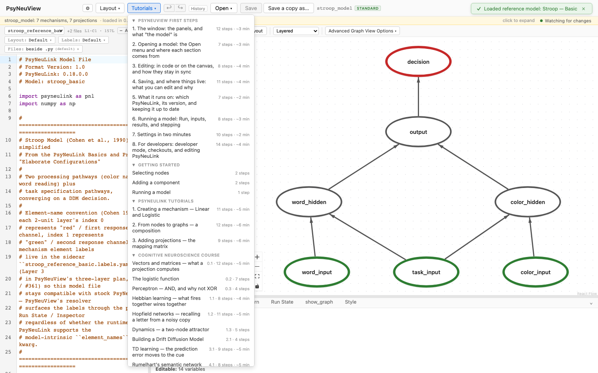

The instruction sits in a bar along the bottom of the window, and a ring marks
what to use. When you've done it, the bar says so and moves on. **End** leaves
the walkthrough at any point.

---

## The course models

| Module | Walkthrough | `?tour=` | What you do |
| --- | --- | --- | --- |
| 0: Vectors and matrices | Vectors and matrices — what a projection computes | `vectors` | Open a demo, **run** the notebook's vectors, check them by hand, then **edit** one weight and a slope |
| 0: Logistic function | The logistic function | `logistic` | **Build** from New Model |
| 0: Perceptron and XOR | Perceptron — AND, and why not XOR | `perceptron` | Open a demo and **train** it |
| 1: Hebbian learning | Hebbian learning — what fires together wires together | `hebbian` | Open a demo, **run** a partial cue, then **train** it and see the cue completed |
| 1: Hopfield networks | Hopfield networks — recalling a letter from a noisy copy | `hopfield` | Open a demo, **run** a noisy letter, show the layer as a **grid**, **step** the trace, then store more letters in the **code** and run it again |
| 1: Dynamic systems | Dynamics — a two-node attractor | `dynamics` | Open a demo and **drive** it |
| 2: Drift diffusion | Building a Drift Diffusion Model | `ddm` | **Build** from an empty canvas |
| 3: Reinforcement learning | TD learning — the prediction error moves to the cue | `td` | Open a demo, **train** it, then move the cue and **train** it again |
| 4: Backpropagation | Rumelhart's semantic network — learning what a robin is | `semantic` | Open a demo, run it untrained, then **train** it twice |
| 5: Episodic memory | Episodic memory — how a query finds a memory | `memory` | Open a demo and **explore** it |
| 5: EGO | EGO — learning which coffee shop you are in | `ego` | Open a demo, **run** the same day blocked and interleaved, and compare |
| 6: Stroop | Exploring and testing the Stroop model | `stroop` | Open and **explore**, then change a parameter and compare |
| 7: Conflict monitoring | Conflict monitoring — a Stroop model that measures its own conflict | `conflict` | Open a demo, **run** three trial types, **step** the trace, then change a parameter and compare |
| 8: ISC-CI | ISC-CI — inferring a context from what occurs together | `iscci` | Open a demo and **explore** it, **run** the notebook's test, then **train** it |

Small models are **built** by hand. Larger ones are **opened**: connecting
their projections needs drag-to-connect, which is better learned on your own
models than followed step by step.

### Vectors and matrices — what a projection computes (Module 0)

Notebook: [`0_primer/notebooks/1_scalars_vectors_and_matrices.ipynb`](https://github.com/PrincetonUniversity/PsyNeuLink/blob/docs/refactor-documentation/docs/source/tutorials/cognitive_neuroscience_course/0_primer/notebooks/1_scalars_vectors_and_matrices.ipynb).
Validated against PsyNeuLink 0.21.0.0.

The notebook is numpy; this is the same lesson as a PsyNeuLink model. Open the
**Vectors and Matrices** demo: `vector_b` (three units) into `vector_c` (two)
through the projection `matrix_A`. Click the arrow: its matrix,
`[[1, 4], [2, 5], [3, 6]]`, is the notebook's A with rows and columns swapped,
because PsyNeuLink writes a row per sending unit. Run the notebook's b, 7, 8, 9:
`vector_c` is **50 and 122**, and the walkthrough has you check it by hand
(1 × 7 + 2 × 8 + 3 × 9 = 50), each output a dot product. Two trials, the columns
of the notebook's B, give the columns of A B (50 and 122, 68 and 167); the rows
of the identity give the weights back. Then change the top-left weight from 1
to 10 in the Inspector: only the first output moves, to **113**. Last, set
`vector_b`'s slope to 2, a scalar: every output doubles.

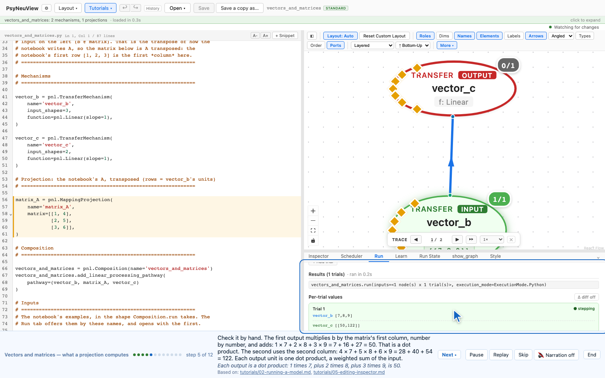

### The logistic function (Module 0)

Start a new model, switch `output_node`'s function from Linear to **Logistic**,
and see an input of 1 give about **0.73**. Then solve the course's exercise:
make the output exactly 1 for an input of 1 by setting `x_0` to 1 and `offset`
to 0.5.

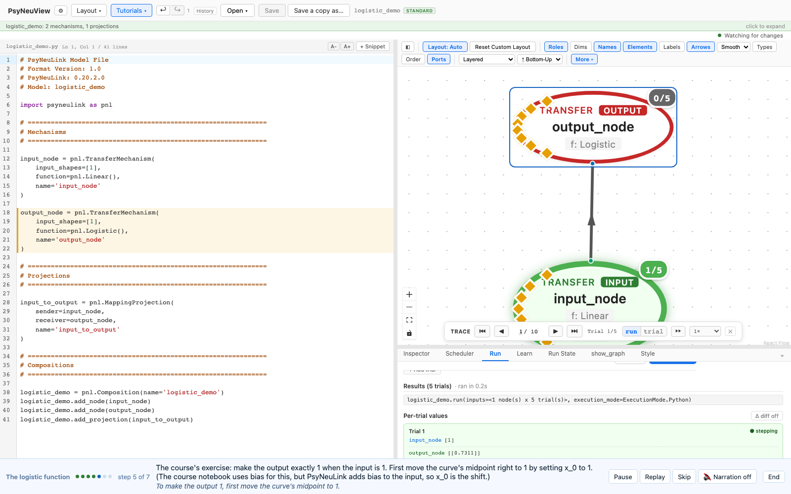

### Perceptron — AND, and why not XOR (Module 0)

Open the **Logic Gate Network** demo (three inputs, one of them a constant bias,
into one Logistic unit) and train it in the **Learn** tab, which opens with the
demo's `and_gate` training set; `xor_gate` is in the same menu. On **AND** the loss
falls from about 0.32 to under 0.001. On **XOR** it stalls near 0.25, the loss
of answering 0.5 to everything: one layer of weights draws one straight line,
and XOR isn't linearly separable.

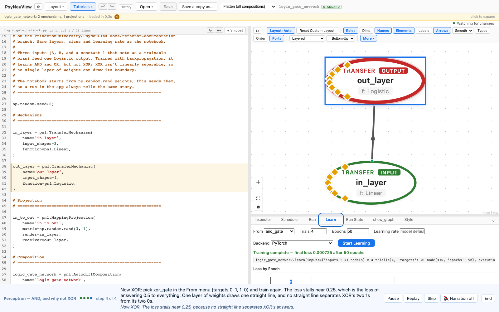

### Hebbian learning — what fires together wires together (Module 1)

Notebook: [`1_dynamics_in_perception/notebooks/1_hebbian_learning.ipynb`](https://github.com/PrincetonUniversity/PsyNeuLink/blob/docs/refactor-documentation/docs/source/tutorials/cognitive_neuroscience_course/1_dynamics_in_perception/notebooks/1_hebbian_learning.ipynb).
Validated against PsyNeuLink 0.21.0.0.

Open the **Hebbian Learning** demo: `feature_layer`, nine units (small, medium,
large, red, yellow, blue, circle, rectangle, triangle), each connected to every
other by connections that start at 0, and the learning mechanism PsyNeuLink adds
for `enable_learning=True`, whose function is **Hebbian**: after each trial, two
units' connection grows by the learning rate (0.05) times their activities. Run
a triangle alone first: only the triangle comes on. Then, in the **Learn** tab,
add a fourth trial to `three_objects` (a small red circle, a medium yellow
rectangle, a large blue triangle): the triangle alone. Train it for 20 epochs.
There is no loss, since there's nothing to get right; the chart shows the
**weight change**, relative to the weights' size, falling as 1, 1/2, 1/3 … to
0.05, because every epoch adds the same amount. Features seen together end wired
at 1.0, the rest stay at 0, and on the last pass the triangle alone comes out as
**large, blue and triangle**: the whole object recalled from part of it.

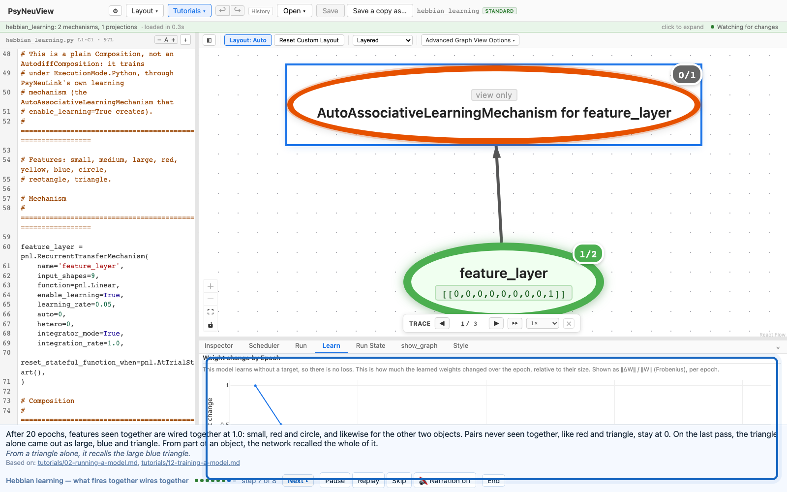

### Hopfield networks — recalling a letter from a noisy copy (Module 1)

Notebook: [`1_dynamics_in_perception/notebooks/2_hopfield_networks.ipynb`](https://github.com/PrincetonUniversity/PsyNeuLink/blob/docs/refactor-documentation/docs/source/tutorials/cognitive_neuroscience_course/1_dynamics_in_perception/notebooks/2_hopfield_networks.ipynb).
Validated against PsyNeuLink 0.21.0.0.

The notebook is numpy; this is the same network as a PsyNeuLink
`RecurrentTransferMechanism`. Open the **Hopfield Network** demo: `hopfield`,
25 units, one per pixel of a 5 × 5 letter (+1 dark, −1 light), storing the
notebook's A and Z. The code draws each letter with `#` and `.`, and builds the
weights from `training_set = [A, Z]` by the notebook's rule (pixels that agree
in a letter add to their weight, pixels that disagree subtract). Run `noisy_Z`,
the notebook's own noisy Z with four pixels wrong: one trial puts it in, five
more let the network update itself. Switch the layer from **list** to **grid**
above the results, and each trial is drawn as the 5 × 5 letter, dark for +1:
trial 1 is a Z with four extra dark pixels. Step the trace from trial 1 to 2 and
watch the letter clean up, in the trial card and on the canvas; turn on
**Δ diff** and see that all four flipped in that one update, then nothing: Z is
an attractor. A cue with A's top over Z's bottom goes
to Z, the nearer letter. Then change the code to `training_set = [A, Z, X, O]`
and run the noisy Z again: it settles on **X**, a row at a time. Too many
memories, too alike, interfere.

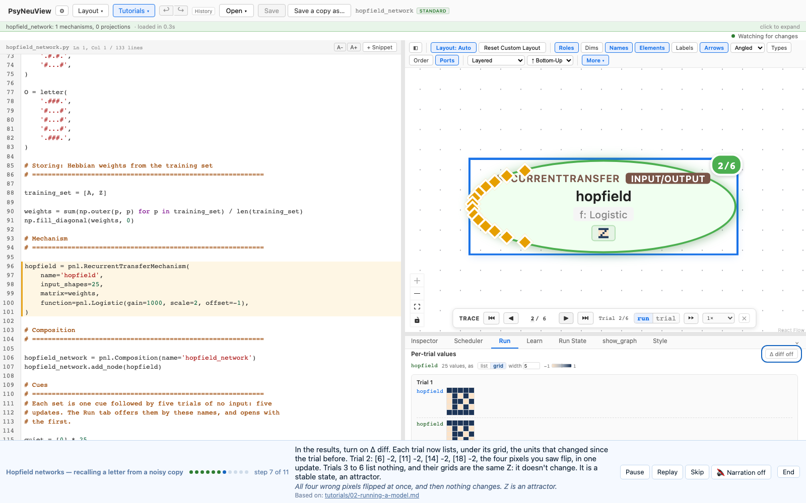

### Dynamics — a two-node attractor (Module 1)

Open the **Bistable Attractor** demo: two integrating Logistic units that
inhibit each other. The demo declares the course's two experiments, so the Run
tab opens with `kick` already filled in (2 and 6 on the first of ten trials,
then zeros). Run it and watch the pair pull together to about 0.40, an
attractor. Then pick `steady_difference` (0 and 1 on every trial) and watch them
pull apart.

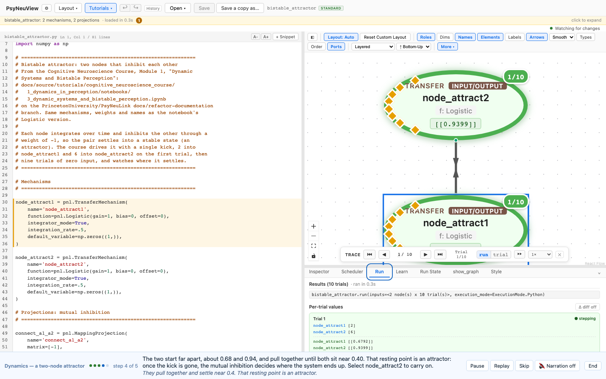

### Building a Drift Diffusion Model (Module 2)

Start from an empty canvas, add a **DDM** from the Components palette, run it,
and look at its drift rate, threshold and noise in the Inspector.

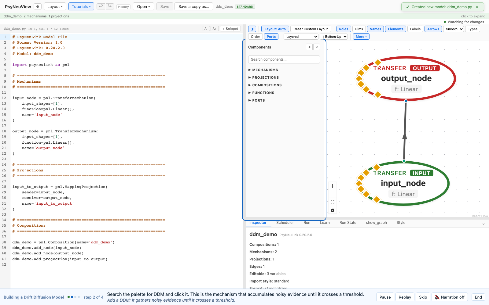

### TD learning — the prediction error moves to the cue (Module 3)

Notebook: [`3_reinforcement_learning/notebooks/1_reinforcement_learning.ipynb`](https://github.com/PrincetonUniversity/PsyNeuLink/blob/docs/refactor-documentation/docs/source/tutorials/cognitive_neuroscience_course/3_reinforcement_learning/notebooks/1_reinforcement_learning.ipynb).
Validated against PsyNeuLink 0.21.0.0.

Open the **TD Learning** demo, the notebook's model of Montague, Dayan &
Sejnowski (1996) scaled down to ten timesteps: `cue` (one unit per timestep),
`value_estimate` (the predicted reward at each timestep, learned through
`cue_to_value`) and `PredictionError`, which `add_td_learning_pathway` adds: the
reward now, plus the prediction now, minus the prediction a moment ago. Train
`conditioning` in the **Learn** tab (five trials, the cue on throughout, the
reward at timestep 7): the prediction error falls from about 0.06 to 0. Inside
the trial it moved earlier a timestep at a time, reached the start and vanished.
Then make the cue come on part-way through, as the notebook's light does (one
trial, the cue's first three timesteps 0, 50 epochs): the error starts at 0.1,
dips to about 0.02 while it's spread out on its way back, and climbs back to
about 0.1, now all at the cue's onset. It moved; it didn't vanish. That is the
dopamine result: after learning, the response comes at the cue, not the reward.

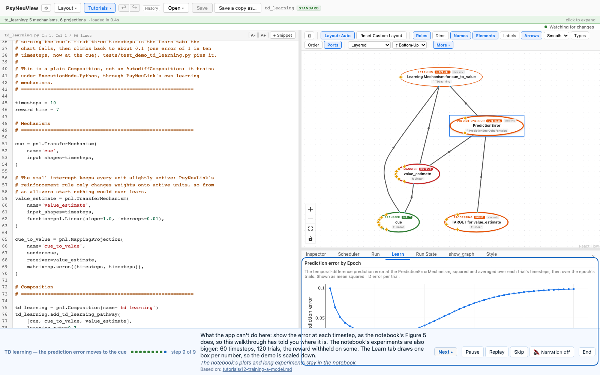

### Rumelhart's semantic network — learning what a robin is (Module 4)

Open the **Rumelhart Semantic Network** demo (Rumelhart, Hinton & Williams,
1986): a noun and a relation go in, and what the noun is, has and can do come
out, through a nine-unit representation layer (`hidden_nouns`) and a sixteen-unit
mixing layer (`hidden_mixed`). Ask it `robin_is` before training: every output
is about 1.0. Then train `all_relations` in the **Learn** tab, all 24
noun-relation pairs for 100 epochs: the loss falls from about 3.5 to about 0.04,
and on the last pass robin + is gives living 0.97, animal 0.88, bird 0.80 and
yellow 0.82, with fish at 0.14 and every has and can output quiet. Finally train
the notebook's Exercise 3, `all_relations_discounted`, where the two relations
not asked about get their true answers halved instead of zeroed: robin + is now
also gives skin, feathers and wings about 0.5 each.

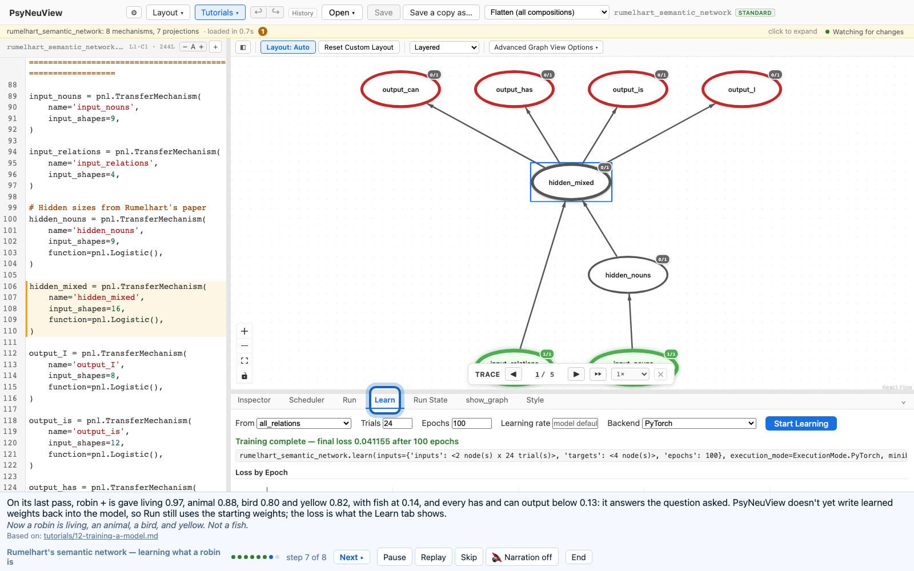

### Episodic memory — how a query finds a memory (Module 5)

Open the **Episodic Memory** demo, an EMComposition whose episodes have three
fields, and follow a query from the bottom of the graph to the top:
`[QUERY]` → `[FIELD_MEMORY]` (similarity to every stored episode) →
`[WEIGHTED SCORES]` (× the field's weight) → `COMBINED SCORES` (summed and
softmaxed) → `[RETRIEVED]`.

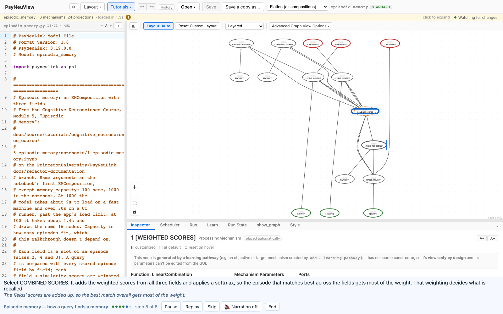

### EGO — learning which coffee shop you are in (Module 5)

Notebook: [`5_episodic_memory/notebooks/2_ego.ipynb`](https://github.com/PrincetonUniversity/PsyNeuLink/blob/docs/refactor-documentation/docs/source/tutorials/cognitive_neuroscience_course/5_episodic_memory/notebooks/2_ego.ipynb).
Validated against PsyNeuLink 0.21.0.0.

Open the **EGO Coffee Shop** demo: PsyNeuLink's EGO model (Giallanza, Campbell
& Cohen, 2024) from the PsyNeuLink Library, set up for the course's Coffee Shop
World. Each trial is one state, 1 to 10; 9 and 10 are the two shops' cues, and
each shop has its own paths through states 1 to 8. Look at `STATE`, `CONTEXT`
(a fading trace of recent states), `EM` (the episodic memory: given the state
just before and the context, what came next last time?), `CONTEXT [NORMALIZED]`
(the one connection EGO learns) and `PREDICTION`. Then pick `blocked` in the
Run tab (six visits to one shop, then six to the other, 60 trials) and run it:
EGO learns as it runs, and on trial 60 `PREDICTION` puts **0.93** on the right
state. Run `interleaved`, the same visits with the shops taking turns: on trial
60 it splits **0.48 / 0.47** between the two shops' next states, and across the
day it averages about 0.29 on the predictable states against blocked's 0.58.
Blocked training wins, as it does for people.

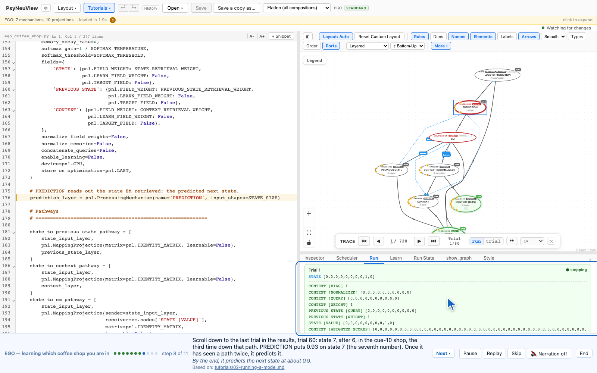

### Exploring and testing the Stroop model (Module 6)

Open **Stroop — Basic**, compare the colour-naming and word-reading pathways,
run it, find the DDM that makes the decision, then raise `color_hidden`'s gain
and run again to compare.

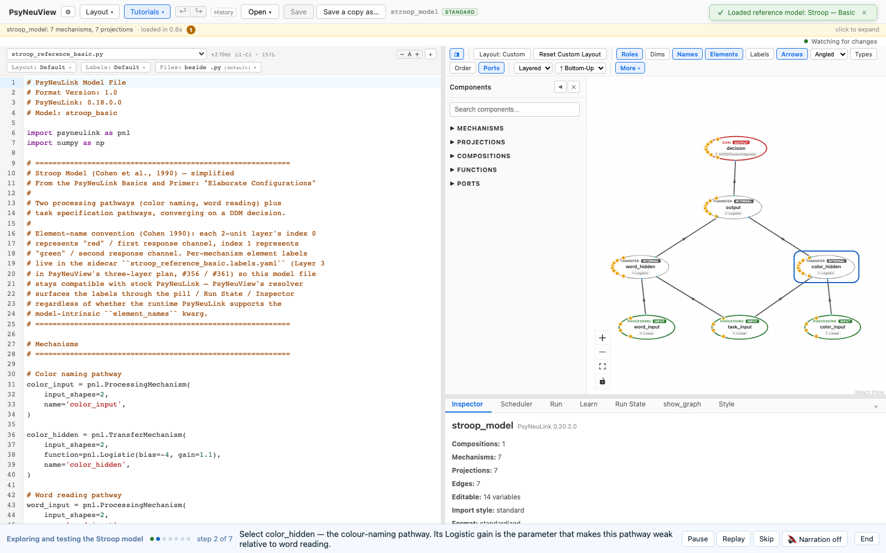

### Conflict monitoring — a Stroop model that measures its own conflict (Module 7)

Open the **Conflict Monitoring** demo, PsyNeuLink's model of Botvinick et al.
(2001) from the PsyNeuLink Library: a Stroop model whose `RESPONSE` layer has a
second output port, `DECISION ENERGY`, the energy of its two response units,
highest when both are active. Look at `TASK DEMAND` (one unit per task, each
inhibiting the other), `WORD HIDDEN` (the stronger pathway) and `RESPONSE`. Pick
`incongruent` in the Run tab (50 trials of the task cue to settle, then 100 of
red ink under the word GREEN) and run it; step the trace to see both responses
half active at the start; by trial 150 the energy is about 1.87 and the word has
won. Run `congruent` (red ink, the word RED): red reaches 0.96 and the energy ends
near 0.82. Then raise `TASK DEMAND`'s gain from 1 to 2 and run `incongruent`
again: the word-reading demand unit drops to about 0.12, red wins, and the energy
ends near 0.94. Conflict is the signal; control is the answer.

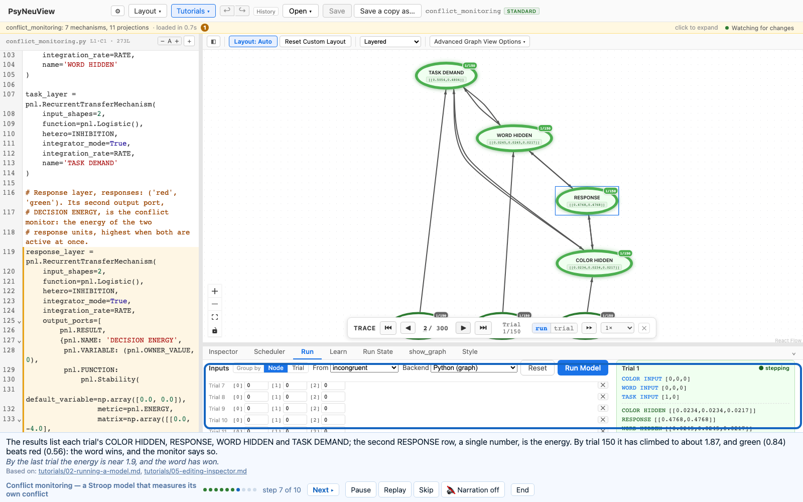

### ISC-CI — inferring a context from what occurs together (Module 8)

Notebook: [`8_integration_attention_context_and_control/notebooks/1_iscci_model.ipynb`](https://github.com/PrincetonUniversity/PsyNeuLink/blob/docs/refactor-documentation/docs/source/tutorials/cognitive_neuroscience_course/8_integration_attention_context_and_control/notebooks/1_iscci_model.ipynb).
Validated against PsyNeuLink 0.21.0.0.

Open the **ISC-CI Model** demo, the notebook's model: two objects seen together
(`support_1`, `support_2`, each a 64-number embedding) are averaged (`mean`)
into an inferred `context`, which `context_label` names (one unit per feature)
and through which a third object, the query, is judged (`context_dependent`,
then `response`: yes or no). Run the notebook's test, `owl_falcon_test` (an owl
and a falcon, then a cat or a penguin): untrained, every context is 0.1 and
every answer 0.5. Train `episodes` in the Learn tab, 24 episodes made by the
notebook's recipe, for 30 epochs: the loss falls from about 0.34 to about 0.08,
and on the last pass all 24 answers are right at 0.94 or better, but
`context_label` never goes above 0.42. It memorized the answers; it didn't
learn to infer a context. The notebook trains on 20,000 episodes and says even
that isn't enough.

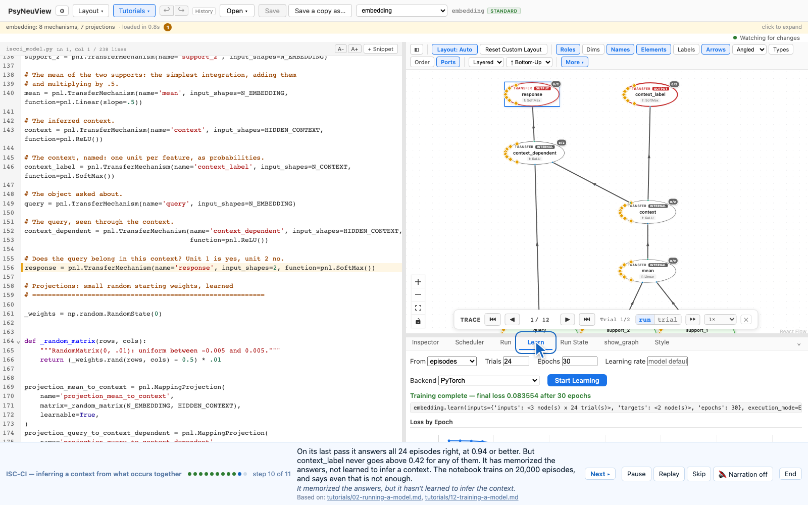

---

## Where the app differs from the course notebooks

The walkthroughs follow what PsyNeuLink actually does in the pinned build
(0.19; Module 4 and Module 7 were checked against 0.20.2.0 as well, and EGO,
ISC-CI, Hebbian learning, TD learning, vectors and matrices, and Hopfield
networks were written against 0.21.0.0), which in a few places differs from the
notebooks:

- **Vectors and matrices.** The notebook is numpy code to type, with two
  exercises on mismatched sizes. The walkthrough is the PsyNeuLink side of it:
  what a projection's matrix does to a vector. Vector addition, the transpose
  as an operation and the size errors aren't shown; the matrix is written
  transposed, as PsyNeuLink holds it, and the walkthrough says so.
- **Hopfield networks.** The notebook is numpy. The demo is the same network as
  a `RecurrentTransferMechanism`, with three differences: each unit is a
  Logistic stretched to −1..+1 with gain 1000 (a step; PsyNeuLink has no sign
  function, and its `Tanh` overflows to NaN at that gain), so a sum of exactly
  0 would give 0 rather than the notebook's +1 (no cue here produces one); the
  diagonal is 0, as the notebook's text says, where its code leaves it at 1
  (which changes nothing here); and each trial is one update, the cue going in
  on the first. The notebook makes a new random cue each run; the demo's cues
  are fixed. Its pictures of each pattern are the app's grid view (#1387).
  The notebook has no energy plot, and neither does the walkthrough.

- **Logistic bias.** The notebook's formula subtracts the bias, so its answer
  to the exercise is `bias = 1`. PsyNeuLink's `Logistic` *adds* it
  (`1 / (1 + e^(−gain·(x + bias − x_0))) + offset`), so that answer gives 1.38.
  The horizontal shift is `x_0`, and the walkthrough uses that.
- **Episodic memory's graph.** The notebook describes **STORE** and **MATCH**
  nodes. PsyNeuLink 0.19 builds the same computation without them. The
  walkthrough names the nodes the app draws.
- **Conflict monitoring's model.** The notebook builds its own Stroop model and
  computes the decision energy afterwards in numpy; the walkthrough opens
  PsyNeuLink's Botvinick et al. (2001) model instead, which computes the energy
  inside the model. To fit a run in the Run tab the demo integrates at 0.1
  rather than the library model's 0.01 and keeps the response weights during
  the settle period; the energies come out within about 0.2 of the library
  model's. The notebook's task-demand sweep and reaction-time plots are numpy
  over many runs and aren't in the walkthrough; one edit makes their point.
- **EGO's model and data.** The walkthrough opens a demo rather than the
  PsyNeuLink Library's *Giallanza2024 EGO Study2*: the library file builds the
  model with a memory of two episodes unless told otherwise, so opened as it is
  a run predicts nothing. The demo is the library model with the memory sized to
  the day, as the library's own experiment does. The notebook builds the same
  architecture by hand with states 0 to 10; the library numbers them 1 to 10,
  with 9 and 10 as the cues. The notebook's days are made in Python (1,000
  trials, random first states, a test phase, many participants) and plotted; the
  demo carries one fixed 60-trial day in each order, and the app doesn't make
  the data or the plot.
- **ISC-CI's data.** The notebook downloads the Leuven Concepts Database (293
  objects, 385 features, a 64-number embedding each) and makes 20,000 training
  episodes from it in Python. A model file opened in PsyNeuView can't count on a
  download, and the Learn tab shows a training set as one box per number (204
  per episode), so the demo carries a slice (24 objects, 10 features) and 24
  episodes by the notebook's recipe, at a learning rate of 0.1 rather than 0.01.
  And as with the semantic network, the trained network can't be run from the
  Run tab, so the notebook's after-training test isn't in the walkthrough.
- **Hebbian learning's model.** The notebook's Models #1 and #2 are numpy
  arithmetic with no PsyNeuLink model, and its plots of the weights and
  activations are matplotlib; the app shows neither the learned weights nor
  those plots, so the walkthrough quotes them. The demo is the notebook's Model
  #3 (a `RecurrentTransferMechanism` with `enable_learning=True`) with activity
  cleared at the start of each trial, as the notebook's last model does with a
  callback (otherwise the network also learns links *between* objects, and with
  Linear units the weights blow up), and with one extra pass per trial so a
  partial cue comes back completed. The recall quoted comes from the training's
  last pass, since a run doesn't use learned weights.
- **TD learning's scale.** The notebook's experiments are 60 timesteps and 120
  trials, with the reward withheld on some, and its results are plots of the
  error at every timestep (Figure 5). The demo is 10 timesteps, and the Learn
  tab charts only the total error per epoch, so the walkthrough says where in
  the trial the error is; a backend test checks those claims.
- **Training the semantic network.** The notebook trains one noun at a time and
  repeats; the Learn tab trains one set, so the demo trains all 24 pairs at
  once with a learning rate of 4 for 100 epochs. And PsyNeuView does not yet
  write learned weights back into the model, so the trained network can't be
  run from the Run tab: the answers the walkthrough quotes are the outputs of
  the training's last pass, which its test reads.

---

## What you can expect

- [x] **Tutorials ▾** lists every walkthrough; `?tour=<id>` opens one directly.
- [x] Each step completes only when you have done it, judged on the app's state
      (the selection, a finished run, a finished training), never on a click.
- [x] Every walkthrough is also an **e2e test**: the same step list drives
      `frontend/e2e/tutorials/tour-demo.tutorial.spec.ts`, which captures the
      screenshots on this page. A walkthrough can't silently drift from the app.
- [x] The numbers quoted in the steps are measured in the app. The Perceptron
      test checks that AND is learned and XOR isn't; the Logistic test checks
      the output is exactly 1; the semantic-network test checks a robin comes
      out a bird and not a fish; the conflict test checks the energy ordering
      and that the edit resolves the conflict; the EGO test checks blocked
      predicts trial 60 and interleaved splits it; the ISC-CI test checks the
      untrained answers and that training gets every answer right while the
      context stays unsure; the Hebbian test checks the weight change and the
      recalled triangle; the TD test checks the error vanishing, then, with a
      late cue, coming back; the vectors test checks every number the learner
      checks by hand; the Hopfield test checks the noisy Z recalled, and the
      overloaded network settling on X.
- [x] All 14 of the course's modules have a walkthrough. Two, vectors and
      matrices (#45) and Hopfield networks (#49), are PsyNeuLink versions of
      notebooks that are numpy only.
- [ ] **Not yet:** a walkthrough that opens a bundled model opens *your* working
      copy of it, edits included, rather than the original.

## Further reading

- The course notebooks: `docs/source/tutorials/cognitive_neuroscience_course/`
  on PsyNeuLink's `docs/refactor-documentation` branch; the course's landing page
  is [`index.rst`](https://github.com/PrincetonUniversity/PsyNeuLink/blob/docs/refactor-documentation/docs/source/tutorials/cognitive_neuroscience_course/index.rst).
- [Training a learning model](12-training-a-model.md) covers the Learn tab the
  Perceptron walkthrough uses.
- [Writing a guided walkthrough](../guided-walkthroughs.md), for adding one.
- PsyNeuLink: [`EMComposition`](https://princetonuniversity.github.io/PsyNeuLink/EMComposition.html),
  [`AutodiffComposition`](https://princetonuniversity.github.io/PsyNeuLink/AutodiffComposition.html),
  [`Logistic`](https://princetonuniversity.github.io/PsyNeuLink/TransferFunctions.html).
