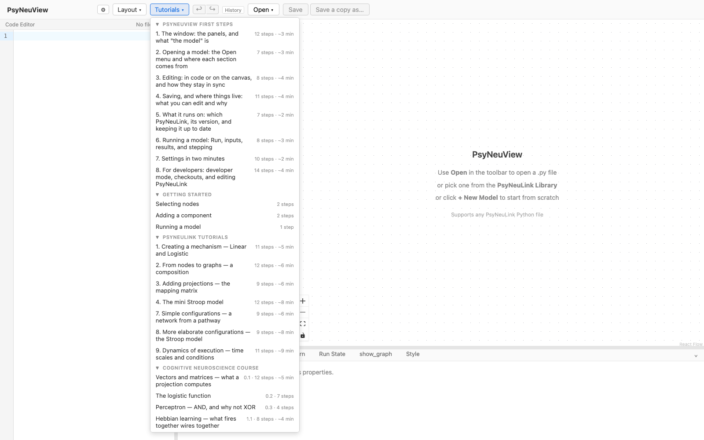
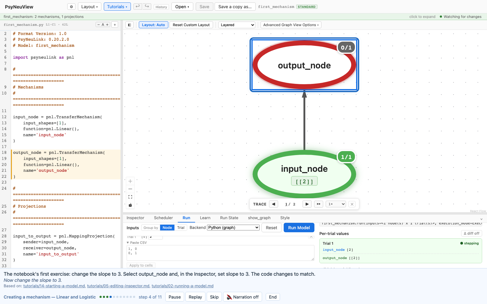
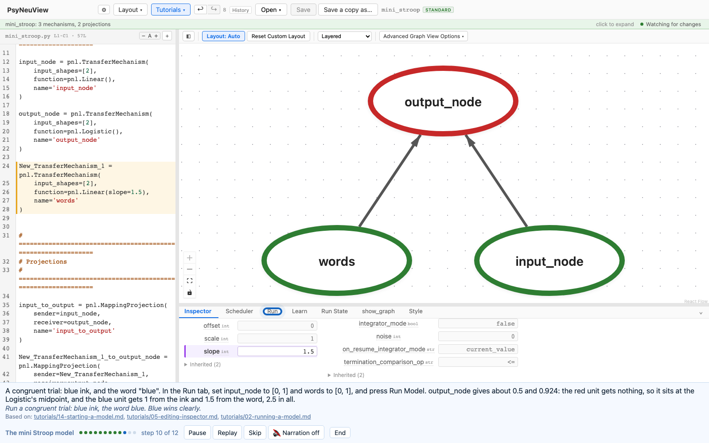
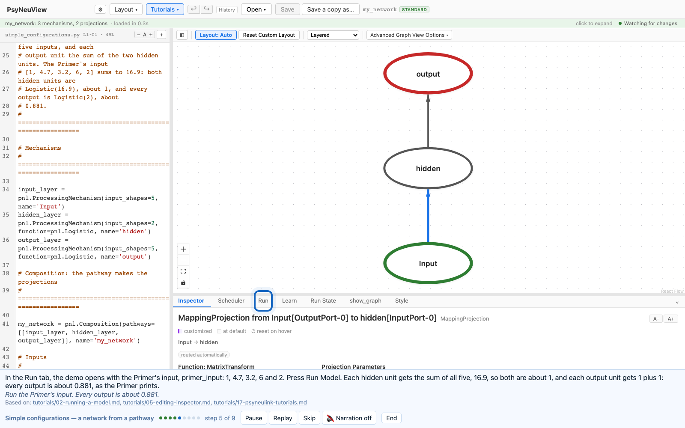
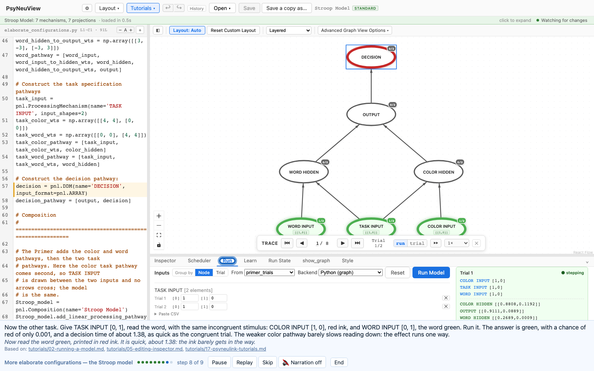
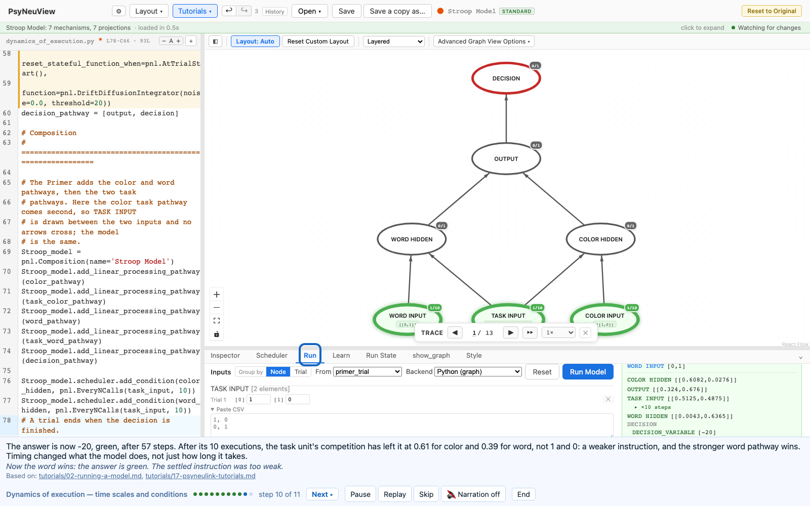
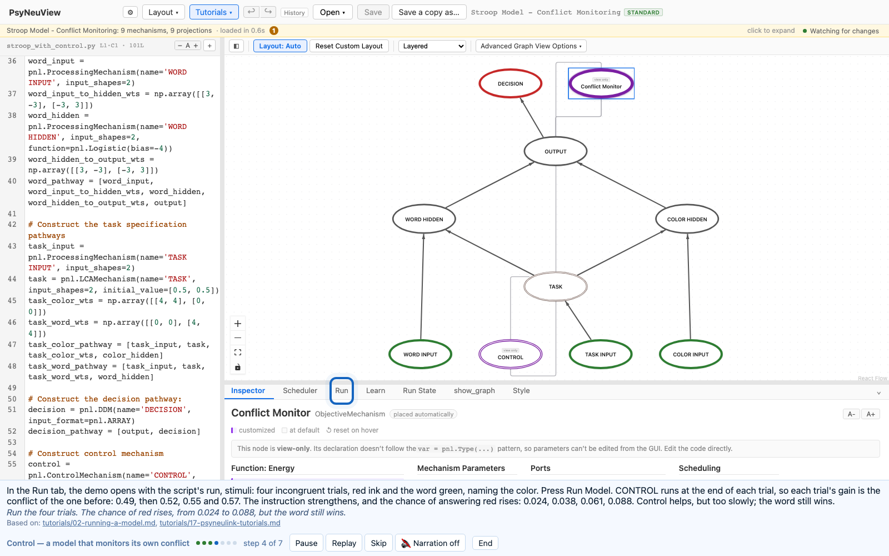
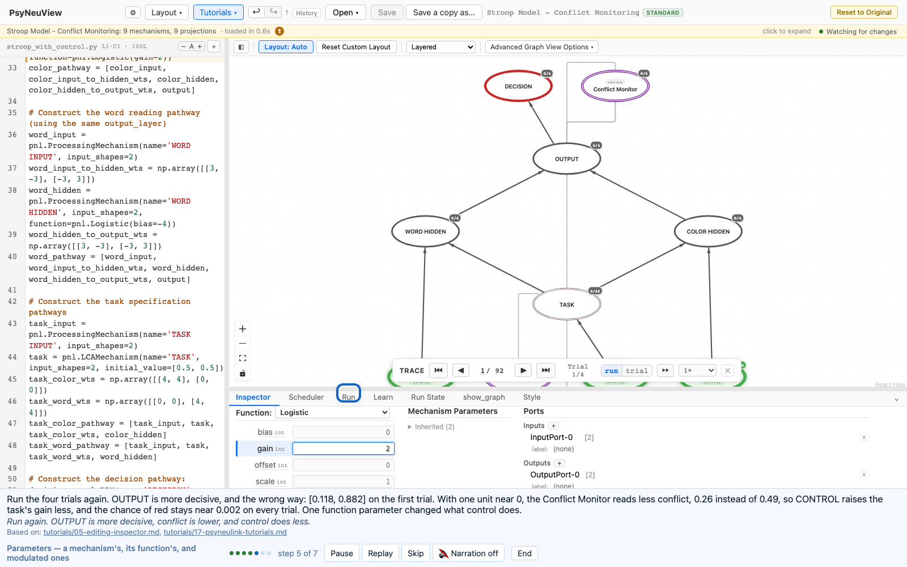
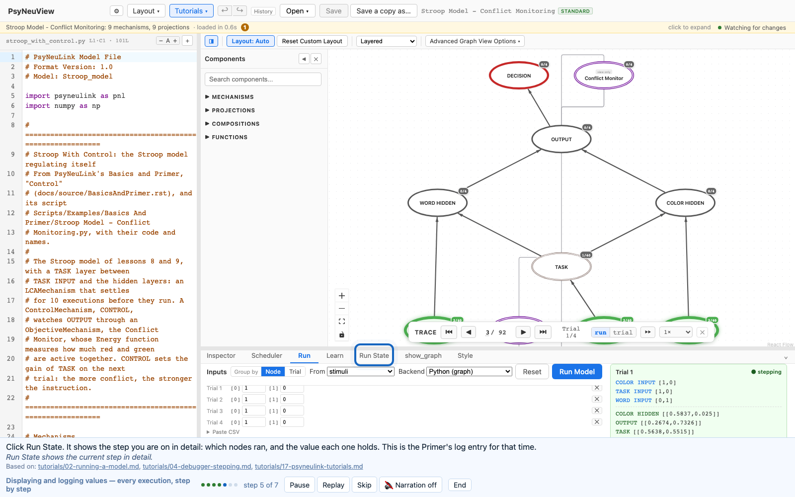

# Guided walkthroughs: the PsyNeuLink Tutorials

Step-by-step walkthroughs that run **inside the app** and follow PsyNeuLink's
own introductory material: its *Tutorial* notebook and its *Basics and
Primer*. They are the **PsyNeuLink Tutorials** section of the **Tutorials ▾**
menu, between PsyNeuView First Steps / Getting started and the Cognitive
Neuroscience Course. As with the course walkthroughs, a step moves on only
once you have done it.

> **What you need:** nothing beyond a working build. Each lesson starts a new
> model or opens a bundled demo.
>
> **Tracking:** #9 (this section), #8 (the foldable menu it depends on),
> #1181 (the walkthrough engine).

---

## The lessons, in order

The source material, in PsyNeuLink's repository:

- the Tutorial notebook, [`tutorial/PsyNeuLink Tutorial.ipynb`](https://github.com/PrincetonUniversity/PsyNeuLink/blob/master/tutorial/PsyNeuLink%20Tutorial.ipynb)
  (also linked from the docs as *Tutorial*);
- the [Basics and Primer](https://princetonuniversity.github.io/PsyNeuLink/BasicsAndPrimer.html)
  (`docs/source/BasicsAndPrimer.rst`), with its example scripts under
  `Scripts/Examples/Basics And Primer/` and `Scripts/Examples/Tutorial/`.

The notebook first, section by section, then the Primer's sections. The
numbers are the `psyneulink:` lesson numbers in the walkthrough files; the
rows with a `?tour=` are built.

| # | Lesson | Source | `?tour=` | What you do |
| --- | --- | --- | --- | --- |
| 1 | Creating a mechanism — Linear and Logistic | Tutorial: *Creating a mechanism*, *Logistic Function* | `pnl-mechanism` | **Build** from New Model, **run** the notebook's inputs, **edit** slope and intercept, switch the function to Logistic |
| 2 | From nodes to graphs — a composition | Tutorial: *From Nodes to Graphs: Compositions* | `pnl-composition` | **Build** from New Model, select the projection, **run** 4 and a five-trial sweep, give both nodes **two units**, make it Logistic, run x and 3x, and the step mechanism |
| 3 | Adding projections — the mapping matrix | Tutorial: *Adding Projections* | `pnl-projections` | **Build** from New Model: a Linear unit (slope 2, intercept 2) into a Logistic one; click the arrow for the **identity matrix**; **run** the sweep; write **0.5** into the matrix (the explicit `MappingProjection`) and run again |
| 4 | The mini Stroop model | Tutorial: *Compositions*, *Mini-Stroop Model* | `pnl-mini-stroop` | **Build** from New Model: add a third node from the palette and **name** it words; give all three **two units**; make the response Logistic and words' slope 1.5; **join** words to the response with a MappingProjection from the palette; **run** a congruent and an incongruent trial |
| 5 | The pre-trained Stroop model | Tutorial: *Pre-trained Complete Stroop Model* | | The Cohen et al. (1990) network with its weights written in; task demand; the eight input combinations |
| 6 | Constructing compositions | Tutorial: *Constructing Compositions* | | Lines of two and three layers, a recurrent pathway, several hidden layers, and what each graph looks like |
| 7 | Simple configurations — a network from a pathway | Primer: *Simple Configurations* | `pnl-simple-configurations` | **Open** the Simple Configurations demo, the Primer's 5-2-5 network from a pathway; click the arrow **PsyNeuLink made** (full connectivity, all 1s); **run** the Primer's input and five zeros; write a **matrix into the pathway** and run again |
| 8 | More elaborate configurations — the Stroop model | Primer: *More Elaborate Configurations* | `pnl-elaborate-configurations` | **Open** the Elaborate Configurations demo, the Primer's Stroop model from five pathway lists; click the **color** and **word** arrows (weights 2 and 3); see how the **task** input's 4 cancels the hidden layers' bias; **run** the Primer's congruent and incongruent trials (decision times 1.41 and 2.75), then **read the word** green in red ink (1.38) |
| 9 | Dynamics of execution — time scales and conditions | Primer: *Dynamics of Execution* | `pnl-dynamics-of-execution` | **Open** the Dynamics of Execution demo, the Stroop model with a step-by-step decision; see in the **Scheduler** that a trial ends when the decision is finished; **run** with noise (a different step count each time), then without (59 incongruent, 25 congruent); make the task an **LCAMechanism** the hidden layers **wait** 10 executions for, and watch the word win (−20 in 57) |
| 10 | Control — a model that monitors its own conflict | Primer: *Control* | `pnl-control` | **Open** the Stroop With Control demo; see the **task** layer and the **Conflict Monitor** CONTROL listens to; **run** four incongruent trials (the chance of red creeps from 0.024 to 0.088), then **double** the conflict weight and run again (0.024, 0.136, 0.462, 0.682) |
| 11 | Parameters — a mechanism's, its function's, and modulated ones | Primer: *Parameters* (accessing, setting, function and modulable parameters) | `pnl-parameters` | **Open** Stroop With Control again; see a mechanism's parameters and its **function's**; **run** and read every trial; set OUTPUT's **gain** to 2 in the Inspector and run again (conflict 0.26, control does less); see TASK's **base** gain |
| 12 | Displaying and logging values — every execution, step by step | Primer: *Displaying and Logging Values* | `pnl-displaying-and-logging` | **Open** Stroop With Control; **run** the four trials and read each trial's values; **step** the trace through every execution (TASK ten times a trial); open **Run State**; see the run record's **JSON/YAML** export |
| 13 | Learning | Primer: *Learning*, *LearningMechanisms* | | A learning pathway and backpropagation |
| 14 | Customization | Primer: *Customization* | | A user-defined function |

Lessons 5, 6, 13 and 14 are listed so the order is settled; they are not built
yet, so lesson 7 follows lesson 4 in the menu for now. The
notebook's own ending, *Constructing Compositions*, says "more content is
being added weekly", so the list may grow with it.

---

### 1. Creating a mechanism — Linear and Logistic

Notebook cells 6–17. Validated against PsyNeuLink 0.20.2.0.

The notebook makes one `TransferMechanism` with `Linear(slope=1, intercept=0)`
and executes it on its own. The app always runs a composition, so the
walkthrough starts a **new model**, `first_mechanism`, whose starter has
`input_node` feeding `output_node`: `input_node` passes the number through
unchanged, and `output_node` plays the notebook's mechanism. Select
`output_node`: a TransferMechanism takes an input, applies its function, and
passes the result on; the Inspector shows Linear, slope 1, intercept 0, the
notebook's y = ax + b.

Then the notebook's executions, each in the **Run** tab: an input of **2**
gives **2**. Set slope to **3** in the Inspector (the code changes to match)
and run **4**: **12**. The second exercise, slope **4** and intercept **5**
with an input of **3**: **17**, since 4 × 3 + 5. Last, change the function
from Linear to **Logistic**, an S-shaped curve between 0 and 1, and run the
notebook's **−2**: about **0.119**, low on the curve's left tail. The
tutorial spec asserts all four outputs.

**What stays in the notebook.** `.execute()` on a lone mechanism, with no
composition; `.plot()` of the curve, which the app does not draw, so you read
one point at a time; and the notebook's gain and offset examples
(`Logistic(gain=5, offset=10)`, and gain −5), which were written for an older
Logistic. PsyNeuLink now adds `offset` to the output
(`scale / (1 + e^(−gain · (x + bias − x_0))) + offset`), so that setting gives
10.00005 for an input of −2, not a step at −2; the horizontal shift the
notebook means is `x_0` today, and a steep gain makes the step. The
walkthrough's last step says so, as the course's Logistic walkthrough does
for the same drift.

---

### 2. From nodes to graphs — a composition

Notebook cells 18–27. Validated against PsyNeuLink 0.20.2.0.

The notebook puts its mechanism in a `Composition` with
`add_linear_processing_pathway`, draws it with `show_graph`, and runs the
composition. Here a model is always a composition, so the walkthrough starts a
**new model**, `first_composition`, and points at what the starter already
is: `input_node`, `output_node`, and the projection `input_to_output` between
them. Click the arrow: the Inspector shows the projection, and in the code
the pathway is `add_node` twice and `add_projection` once; the canvas is the
notebook's `show_graph`, redrawn on every edit.

Then the notebook's runs, in the **Run** tab. An input of **4** gives **4**:
two Linear nodes pass it straight through. The notebook's 51-point sweep
from −3 to 3 becomes one run of five trials, **−3, −1.5, 0, 1.5, 3**, whose
outputs equal their inputs, five points of the straight line it plots. Next
the notebook's two-unit mechanism, `default_variable=[0, 0]`: in the
Inspector's **Inputs** row, set `input_node`'s shape to **[2]**, then
`output_node`'s. The code changes to `input_shapes=[2]`, today's name for
that size, and the projection between them resizes to a 2 × 2 identity
matrix. Change `output_node`'s function to **Logistic** and run two trials,
**[−1, −3]** and **[1, 3]**: **0.269, 0.047** and **0.731, 0.953**, each unit
its own point on the curve, the second unit's the steeper of the notebook's
two plotted curves. Last, the notebook's step mechanism: set **gain** to
**100** and the midpoint **x_0** to **1**, and run **[0.9, 1.1]**:
**0.00005** and **0.99995**, which the results table rounds to 0 and 1, just
below the step and just above it. The tutorial spec asserts all four runs.

![The two-unit model after the sweep, with input_node's shape set to [2]](assets/tour/pnl-composition-step-6.png)

**What stays in the notebook.** `show_graph()`, which the canvas does all
the time; `reportOutputPref`, whose printout is the Run tab's results table;
the 51-point loops and their plots, which here are trials in one run with no
curve drawn; and `default_variable` as the input used when none is given,
which has no counterpart because the Run tab always sends inputs. The step
mechanism's `Logistic(gain=100, offset=100)` was written for the older
Logistic that added `offset` inside the exponent; PsyNeuLink now adds it to
the output, so the step at an input of 1 is `x_0=1` today, as the walkthrough
sets it.

---

### 3. Adding projections — the mapping matrix

Notebook cells 28–33. Validated against PsyNeuLink 0.20.2.0.

The notebook joins a `Linear(slope=2, intercept=2)` unit to a `Logistic()`
one, first with the `IDENTITY_MATRIX` keyword in the pathway list and then
with an explicit `MappingProjection(sender=…, receiver=…, matrix=[[1]])`, and
sweeps each from −3 to 3: a projection takes one mechanism's output,
multiplies it by its matrix, and delivers the result to the next. The
walkthrough starts a **new model**, `adding_projections`, and makes the
starter's two nodes the notebook's units: set `input_node`'s **slope** to
**2** and **intercept** to **2**, and change `output_node`'s function to
**Logistic**. Click the arrow: under **Projection Parameters** the matrix is
**[[1]]**, the 1 × 1 identity the keyword means, and in the code the
projection is already the notebook's explicit form, a `MappingProjection`
with its sender and receiver; the identity is its default, so no matrix is
written.

Then the sweep, in the **Run** tab: five trials, **−3, −1.5, 0, 1.5, 3**,
give **0.018, 0.269, 0.881, 0.993, 1.000**, the Logistic curve with its
midpoint at −1 (where 2x + 2 = 0) and twice as steep. The notebook keeps the
matrix at 1, so its two compositions draw the same curve; to see the matrix
do something, the walkthrough writes **[[0.5]]** into the matrix row, which
puts `matrix=[[0.5]]` into the code (the notebook's explicit matrix), and
runs the same five trials again: **0.119, 0.378, 0.731, 0.924, 0.982**, the
midpoint still at −1 and the curve half as steep. The tutorial spec asserts
both runs and that `matrix=[[0.5]]` reached the source.

![The projection selected: under Projection Parameters its matrix is [[1]], the identity](assets/tour/pnl-projections-step-6.png)

**What stays in the notebook.** The `IDENTITY_MATRIX` keyword inside a
pathway list, which makes the projection for you; here the projection is
always written out, the notebook's explicit way, with the identity as its
default. `show_graph()` is the canvas; the 51-point sweeps are five trials
with no curve drawn; and the notebook's names for its units, `linear` and
`logistic`, stay there, since the walkthrough does not rename the starter's
nodes.

---

### 4. The mini Stroop model

Notebook cells 34–38. Validated against PsyNeuLink 0.20.2.0.

The notebook's first composition that is not a line: two input mechanisms,
`Colors` (Linear) and `Words` (Linear, slope 1.5), converge on a `Response`
mechanism (Logistic), each with two units (`default_variable=[0, 0]`), one
for red and one for blue, joined by two `add_linear_processing_pathway`
calls. It models the Stroop task, where naming a word's ink colour is slowed
when the word names a different colour. The walkthrough starts a **new
model**, `mini_stroop`, whose starter is already one of the two pathways:
`input_node` plays Colors and `output_node` plays Response. It adds a
**TransferMechanism** from the Components palette and **renames** it `words`
(double-click the name in the Inspector's header); gives `words`,
`input_node` and `output_node` an input shape of **[2]**; makes
`output_node` **Logistic** and sets `words`' **slope** to **1.5**; then
joins `words` to `output_node`: drag **MappingProjection** from the palette
onto `output_node` and click `words`, its sender. A second arrow appears,
and the code gains a `MappingProjection` with the 2 × 2 identity as its
matrix, so the word "red" feeds the red response.

Then the notebook's two trials, in the **Run** tab. Congruent, blue ink and
the word "blue" (`input_node` **[0, 1]**, `words` **[0, 1]**): **0.5** and
**0.924**. The red unit gets nothing and sits at the Logistic's midpoint; the
blue unit gets 1 from the ink and 1.5 from the word. Incongruent, red ink and
the word "blue" (`input_node` **[1, 0]**): **0.731** and **0.818**. The ink
pushes toward red, the word pushes harder toward blue, and the two responses
are close: the conflict that slows naming the ink. The tutorial spec asserts
both trials and that the drag wrote a second `MappingProjection` into
`output_node`.

**What stays in the notebook.** `add_linear_processing_pathway`, which makes
each projection for you; here every projection is written out as a
`MappingProjection`. `show_graph()` is the canvas. The names `Colors` and
`Response` stay there, since `input_node` and `output_node` play them; and
renaming in the Inspector changes a node's `name=`, not the Python variable
that holds it, so the code still calls the word unit
`New_TransferMechanism_1`. The pre-trained Stroop model that follows in the
notebook is lesson 5.

### 7. Simple configurations — a network from a pathway

Basics and Primer, *Simple Configurations*. Validated against PsyNeuLink
0.20.2.0.

The Primer's first example is a 5-2-5 feedforward network: three
`ProcessingMechanism`s, `Input` (five units, Linear, the default), `hidden`
(two, `Logistic`) and `output` (five, `Logistic`), put in a composition with
`Composition(pathways=[[input_layer, hidden_layer, output_layer]])` and no
projection written. Its point is that PsyNeuLink adds the projections for
you, so the walkthrough opens a bundled demo, **Simple Configurations**,
which is that code with the Primer's names, rather than building it: a model
built in the app always writes its projections out. Select `Input` and
`hidden` to see their units and functions, and the code's one-line pathway.
Then click the arrow from `Input` to `hidden`: the Inspector marks it
*routed automatically*, and under **Projection Parameters** its matrix is
five rows of **[1, 1]**, one row per input unit and one column per hidden
unit, the Primer's `FULL_CONNECTIVITY_MATRIX`. The arrow on to `output` is
two rows of five 1s.

Then the runs, in the **Run** tab. The demo opens with the Primer's input,
`primer_input`, **[1, 4.7, 3.2, 6, 2]**: each hidden unit gets the sum,
16.9, so both are about **1**, and every output is **0.881**, as the Primer
prints. Five **zeros** give **0.5** on both hidden units and **0.731** on
every output: with every weight 1, each layer hears only the sum of the one
before, so the five outputs are always equal. The Primer then gives a
projection its own matrix by putting it in the pathway list between the
layers it joins; the walkthrough edits the code to
`[[input_layer, [[1, 0], [-1, 0], [0, 1], [0, -1], [0, 0]], hidden_layer, output_layer]]`
(a fixed matrix, where the Primer's is random; the Primer also writes its
matrix 2 by 5, which PsyNeuLink refuses, since a matrix has one row per
sending unit), so the first hidden unit
hears the first input minus the second and the other the third minus the
fourth. The Primer's input again gives hidden units of **0.024** and
**0.057** (Logistic of −3.7 and −2.8) and **0.520** on every output. The
tutorial spec asserts the three runs and both matrices, and
`backend/tests/test_demo_simple_configurations.py` pins the same numbers.

**What stays in the Primer.** `output_layer.execute([0, 2.5, 10.9, 2, 7.6])`,
a mechanism executed on its own, since the app always runs a composition;
`show_graph()`, which is the canvas; `add_linear_processing_pathway` and
`add_nodes`, the other ways to build the same composition; the random
matrix and the explicit `MappingProjection` object in the pathway; and the
recurrent projection from `output` back to `hidden` (a fourth entry in the
pathway, or `add_projection`), whose timing is the Primer's *Dynamics of
Execution*, lesson 9. The walkthrough's last step says so.

### 8. More elaborate configurations — the Stroop model

Basics and Primer, *More Elaborate Configurations*, and its script
`Scripts/Examples/Basics And Primer/Stroop Model - Basic.py`. Validated
against PsyNeuLink 0.20.2.0.

The Primer's Stroop model is a simplified version of Cohen, Dunbar and
McClelland (1990), built from five pathway lists, each with the matrices of
its projections written between the mechanisms: color naming (`COLOR INPUT`,
`COLOR HIDDEN`, `OUTPUT`), word reading (`WORD INPUT`, `WORD HIDDEN`, the same
`OUTPUT`), two task pathways from `TASK INPUT` to each hidden layer, and
`OUTPUT` to `DECISION`, a `DDM`. The walkthrough opens a bundled demo,
**Elaborate Configurations**, with the Primer's code and names. (It adds the
color task pathway second, where the Primer adds it third, so the Layered
layout puts `TASK INPUT` between the two inputs and no arrows cross; the
model is the same.)

Every layer has two units, red then green. Select `COLOR HIDDEN`: its
`Logistic` has a bias of **−4**, which keeps it nearly off. Click the color
arrow: **[[2, −2], [−2, 2]]**, red ink exciting red and inhibiting green; the
word arrow is **[[3, −3], [−3, 3]]**, stronger, since reading is the more
practised skill. `TASK INPUT`'s arrows, **[[4, 4], [0, 0]]** to color and
**[[0, 0], [4, 4]]** to word, add 4 to the hidden layer of the task asked
for, cancelling its bias: the task says which pathway to use. `DECISION`
accumulates the difference between `OUTPUT`'s two units to a threshold, and
reports the choice, 1 or −1, and the decision time. (The Inspector shows its
`input_format` as SCALAR, though the code says ARRAY: PsyNeuLink keeps the
default in that parameter, and the ARRAY shows as its input port's name.)

Then the runs. The demo opens with the Primer's, `primer_trials`: two color
naming trials, red ink with the word red (congruent), then red ink with the
word green (incongruent). The decision times are **1.41** and **2.75**, and
the chance of answering red falls from **0.999** to **0.940**: the Stroop
effect. The Primer prints 2.80 and 3.94, from an older PsyNeuLink; the
incongruent trial is still the slower. Then the other task: `TASK INPUT`
**[0, 1]**, reading the word green in red ink, answers green (a chance of red
of **0.001**) in **1.38**, as quick as the congruent trial: the weaker color
pathway barely slows reading. The DDM's 1 or −1 is drawn at random from those
chances, so a run can now and then go the unlikely way, as the Primer warns;
the tutorial spec and `backend/tests/test_demo_elaborate_configurations.py`
assert the times and chances, which are fixed.

**What stays in the Primer.** Its figure is `show_graph()`, which is the
canvas; the script's `termination_processing` and `animate` arguments to
`run`; and the fuller Stroop model in the PsyNeuLink Library. What runs when,
within a trial, is the Primer's *Dynamics of Execution*, lesson 9.

### 9. Dynamics of execution — time scales and conditions

Basics and Primer, *Dynamics of Execution*. Validated against PsyNeuLink
0.20.2.0.

The demo, **Dynamics of Execution**, is lesson 8's Stroop model with the
decision changed as the Primer changes it: a `DriftDiffusionIntegrator`
(noise 0.5, threshold 20), reset at the start of each trial. Where lesson 8's
decision was computed in one go, this one adds up the evidence a step at a
time until it reaches **+20** (red) or **−20** (green), and reports where it
stopped and how many steps it took; the other mechanisms each finish in one
execution, so the model runs on two time scales. The Primer ends a trial
with `termination_processing={TimeScale.TRIAL: WhenFinished(decision)}` in
its call to `run`; a model file has no `run` call, so the demo sets the
scheduler's `termination_conds`, which the **Scheduler** tab shows
(`TimeScale.TRIAL` is now named `ENVIRONMENT_STATE_UPDATE`).

The Primer's trial, `primer_trial`, is red ink with the word green, naming
the color. With noise it reaches 20 after some tens of steps, a different
count each run, as the Primer says. Set `noise=0.0` and the counts stay put:
**59** steps for that incongruent trial, **25** for the congruent one (the
word red): the Stroop effect, counted in steps.

Then the Primer's scheduler example. `TASK INPUT` becomes an `LCAMechanism`,
whose two units compete, and the hidden layers get the condition
`EveryNCalls(task_input, 10)`: they run only after every 10 executions of
the task, so the instruction is processed before the stimuli. (The Primer
calls it `EveryNExecutions`, which PsyNeuLink no longer has.) The trial now
answers **−20**, green, in **57** steps: after its 10 executions the task
unit has settled at **0.61** for color and **0.39** for word, not 1 and 0,
too weak an instruction to hold off the stronger word pathway. The Primer
prints [20, 126] and [20, 42], from an older PsyNeuLink and with noise. The
tutorial spec and `backend/tests/test_demo_dynamics_of_execution.py` assert
the termination condition and every number above.

**What stays in the Primer.** Waiting for the task to settle rather than for
a fixed count, with its `converge` function and a `When` condition, and the
list of pre-defined Conditions. The walkthrough's last step says so.

### 10. Control — a model that monitors its own conflict

Basics and Primer, *Control*, and its script
`Scripts/Examples/Basics And Primer/Stroop Model - Conflict Monitoring.py`.
Validated against PsyNeuLink 0.20.2.0.

The demo, **Stroop With Control**, is the script with its names: the Stroop
model with a `TASK` layer, an `LCAMechanism` that settles for 10 executions
before the hidden layers run (lesson 9), and a `ControlMechanism`, `CONTROL`,
the composition's controller. Its `ObjectiveMechanism`, the **Conflict
Monitor**, applies an `Energy` function to `OUTPUT`: with the matrix
**[[0, −2.5], [−2.5, 0]]** that is 2.5 × red × green, high when both response
units are active at once. `CONTROL` sets `TASK`'s gain from it, and runs at
the end of each trial, so the conflict of one trial sets the instruction's
strength on the next.

The script's run, `stimuli`, is four incongruent trials, naming red ink
printed as the word green. The conflict is **0.49**, **0.52**, **0.55** and
**0.57**, and the chance of answering red rises only from **0.024** through
0.038 and 0.061 to **0.088**: control helps, too slowly. Doubling the Energy
weight to **[[0, −5], [−5, 0]]** gives the Primer's story: the first trial's
conflict, **0.98**, sets twice the gain, and the chance of red goes 0.024,
**0.136**, **0.462**, **0.682**. The Primer prints the model recovering by its
third trial; PsyNeuLink 0.20.2.0 needs the doubled weight for that. (The
Primer's text also resets the task at each trial; its script, which the demo
follows, does not.) The tutorial spec and
`backend/tests/test_demo_stroop_with_control.py` assert both runs.

**What stays in the Primer.** The `call_after_trial` printout and the
animation, which the Run tab's results and trace stand in for, and control
that simulates to choose its allocation (the expected value of control).

### 11. Parameters — a mechanism's, its function's, and modulated ones

Basics and Primer, *Parameters*. Validated against PsyNeuLink 0.20.2.0.

The Primer works on its Control model, so the walkthrough opens **Stroop
With Control** again. Select `OUTPUT`: its own parameters are under
**Mechanism Parameters**, and its function's, the `Logistic`'s **gain** 1 and
**bias** 0, sit by the Function menu; the Primer reaches the second kind as
`output.function.gain.base`. A parameter's value is its latest, but the
**Run** tab keeps every trial: `OUTPUT` is [0.267, 0.733] on the first of the
four and [0.354, 0.646] on the last, what the Primer reaches with
`get_previous` and `history_max_length`.

Set `OUTPUT`'s gain to **2** in the Inspector, and the code becomes
`function=pnl.Logistic(gain=2)`. Run again: `OUTPUT` is more decisive, the
wrong way, [0.118, 0.882]; with one unit near 0 the Conflict Monitor reads
less conflict, **0.26** instead of 0.49, so control raises the task's gain
less and the chance of red stays near **0.002**. One function parameter
changed what control does. Last, `TASK`'s gain reads 1 in the Inspector: its
**base** value. The gain actually used is the one `CONTROL` sets, the
*modulated* value, which the Primer reads as `task.parameter_ports[GAIN].value`
and the app doesn't show.

**What stays in the Primer.** Contexts (a parameter holding different values
in different compositions) with `get` and `set`, `history_max_length`, and
reading a modulated value.

### 12. Displaying and logging values — every execution, step by step

Basics and Primer, *Displaying and Logging Values*. Validated against
PsyNeuLink 0.20.2.0.

The Primer prints values after each trial with a `call_after_trial`
function, and logs `TASK` and `CONTROL` with `log.set_log_conditions(VALUE)`,
printing the log as `run:trial:pass:time_step` and value. The app keeps that
record with no code: every run logs every node. The walkthrough opens **Stroop
With Control** and runs the four trials; the **Run** tab lists each trial's
values for every node. The **trace bar** on the canvas steps through every
execution, counting steps and trials: `TASK` runs ten times a trial before
the hidden layers run once, `CONTROL` once at the end, as in the Primer's log.
**Run State** shows the current step in detail. Each run is kept as a record
under the results, with Re-run and export as **JSON** or **YAML**, the
Primer's `nparray`, `nparray_dictionary` and `csv`. The tutorial spec asserts
the log: every node, `TASK` 40 times, `OUTPUT` and the Conflict Monitor four.

**What stays in the Primer.** `run()`'s other hooks, functions called before
or after each run, trial or pass for custom operations.

---

## What you can expect

- [x] **Tutorials ▾** has a **PsyNeuLink Tutorials** section, folded on first
      run like the course, between Getting started and the course.
- [x] Lesson 1 is a walkthrough built the same way as the course's: its step
      list drives `frontend/e2e/tutorials/pnl-mechanism.tutorial.spec.ts`,
      which captures the screenshots on this page and asserts the outputs the
      steps quote (2, 12, 17, 0.119).
- [x] Lesson 2 is built the same way (`pnl-composition.tutorial.spec.ts`):
      it gives both nodes two units through the Inspector's Inputs row and
      asserts the four runs (4; the sweep; 0.269/0.047 and 0.731/0.953; the
      step's 0.00005/0.99995).
- [x] Lesson 3 is built the same way (`pnl-projections.tutorial.spec.ts`):
      it edits a projection's matrix under Projection Parameters and asserts
      both sweeps (0.018 … 1.000 through the identity; 0.119 … 0.982 through
      0.5) and the `matrix=[[0.5]]` written into the code.
- [x] Lesson 4 is built the same way (`pnl-mini-stroop.tutorial.spec.ts`):
      it adds and renames a node, joins it with a MappingProjection from the
      palette, and asserts both trials (congruent 0.5/0.924, incongruent
      0.731/0.818).
- [x] Lesson 7 opens a bundled demo, the Primer's network made from a
      pathway (`pnl-simple-configurations.tutorial.spec.ts`): it reads the
      two projections PsyNeuLink made (all 1s) and the matrix written into
      the pathway, and asserts the three runs (0.881; 0.5 and 0.731; 0.024,
      0.057 and 0.520).
- [x] Lesson 8 opens a bundled demo, the Primer's Stroop model
      (`pnl-elaborate-configurations.tutorial.spec.ts`): it reads the six
      matrices the pathway lists wrote, and asserts the decision times and
      chances of red (1.41 and 0.999, 2.75 and 0.940; reading, 1.38 and
      0.001).
- [x] Lesson 9 opens a bundled demo, the Stroop model with a
      DriftDiffusionIntegrator (`pnl-dynamics-of-execution.tutorial.spec.ts`):
      it reads the trial's termination condition and asserts the four runs
      (20 after some steps, with noise; 20 in 59 and in 25 without; −20 in 57,
      with the task at 0.61 / 0.39, once the hidden layers wait for it).
- [x] Lesson 10 opens a bundled demo, the Stroop model with control
      (`pnl-control.tutorial.spec.ts`): it reads the controller and asserts
      both runs' conflict and chance of red (0.024 … 0.088; with the weight
      doubled, 0.024 … 0.682).
- [x] Lesson 11 reuses that demo (`pnl-parameters.tutorial.spec.ts`): it
      sets OUTPUT's Logistic gain through the Inspector and asserts both
      runs (OUTPUT 0.267/0.733 and conflict 0.49 …; with gain 2, 0.118/0.882,
      conflict 0.26 …, chance of red 0.002).
- [x] Lesson 12 reuses it again (`pnl-displaying-and-logging.tutorial.spec.ts`):
      it steps the trace and opens Run State, and asserts the run's log
      holds every node, TASK 40 times (ten a trial) and OUTPUT and the
      Conflict Monitor four.
- [x] Every step has a caption for narration.
- [ ] **Not yet:** lessons 5, 6, 13 and 14. Each will be added in order, as a walkthrough
      with a bundled demo where the model is too big to build by hand.

## Further reading

- [Guided walkthroughs: the Cognitive Neuroscience Course](16-course-walkthroughs.md),
  the other lesson section; its Logistic walkthrough covers the same curve and
  the same `bias`/`x_0` drift.
- [Writing a guided walkthrough](../guided-walkthroughs.md), for adding a lesson.
- PsyNeuLink: [Basics and Primer](https://princetonuniversity.github.io/PsyNeuLink/BasicsAndPrimer.html),
  [`TransferMechanism`](https://princetonuniversity.github.io/PsyNeuLink/TransferMechanism.html),
  [`Logistic`](https://princetonuniversity.github.io/PsyNeuLink/TransferFunctions.html),
  [`MappingProjection`](https://princetonuniversity.github.io/PsyNeuLink/MappingProjection.html),
  [`ProcessingMechanism`](https://princetonuniversity.github.io/PsyNeuLink/ProcessingMechanism.html).
