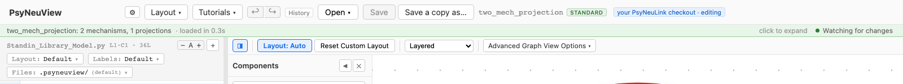
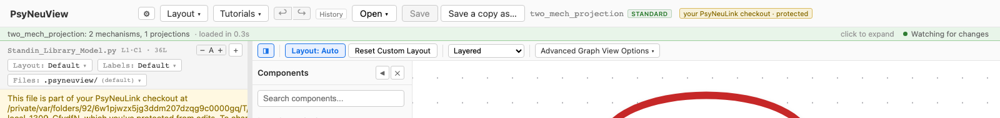
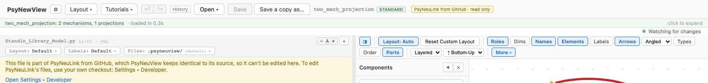
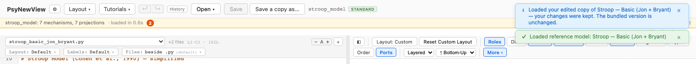
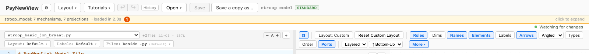
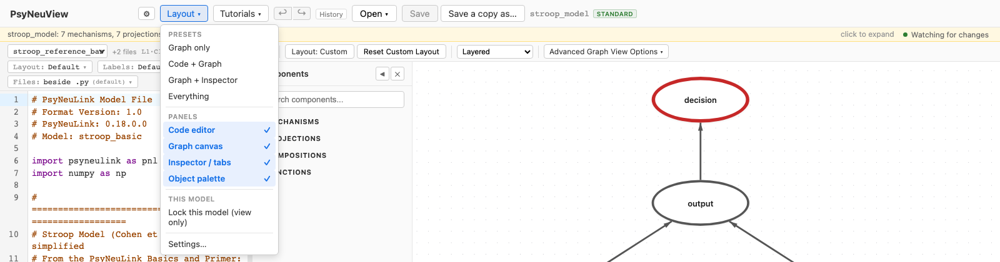
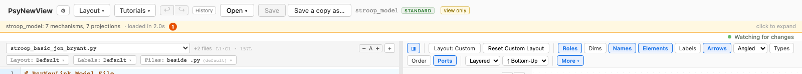
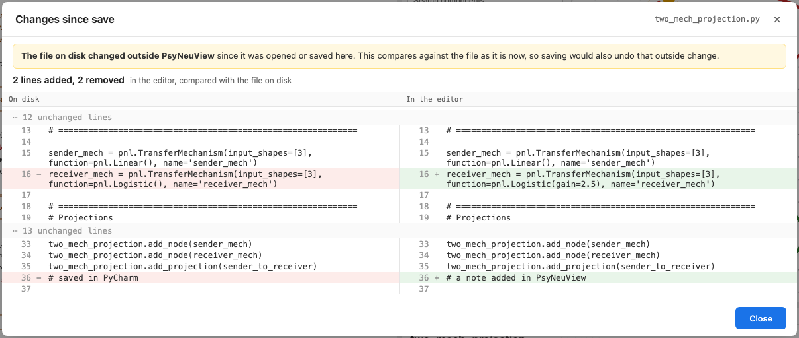

# What you can edit, and why

PsyNeuView opens models from several places, and not all of them are yours
to change. This page says, for each kind of file, whether you can edit it,
what **Save** does, and how to change the rule when you need to. It ends with
one table that sums it all up. Where each folder lives is on
[Where PsyNeuView keeps things](where-things-live.md); what Save, autosave
and undo do to the file, and how to revert it to an earlier save, is on
[Saving, autosave and undo](saving-autosave-and-undo.md).

The short version:

- **Your own files** — My Project Folder, your catalogs, anything you open by
  path — are editable, and Save writes to the file.
- **PsyNeuLink's own files** (the PsyNeuLink Library, the Examples) are
  editable when the PsyNeuLink in use is **your own checkout**, and read only
  when it is one **PsyNeuView installed and manages**.
- **Models included with PsyNeuView** (Reference Models, Demo Models) open as
  a **working copy**. You edit the copy; the bundled original is never
  touched.
- Any model can be **locked** so that nothing in PsyNeuView changes it — not
  the graph, not the inspector, not the code editor — which is for teaching
  and for curated models. Moving nodes around is still fine. That includes a
  model in your own PsyNeuLink checkout, so you can protect one model while
  the rest of the checkout stays editable.
- A model's **own file** can ask for protection with a comment line near the
  top — `# PsyNeuView: protected`, or `# PsyNeuView: protected permanently`
  — which travels with the file through git to every computer
  ([below](#a-protection-line-in-the-models-file)).

## Your files

**My Project Folder**, the catalogs you add in Settings ▸ Folders, and any
`.py` you open with **Open from path…** are ordinary files of yours. They open
in place, so the file in the editor *is* the file on disk.

- **Can you edit it?** Yes: on the canvas, in the inspector, and in the code
  editor.
- **What Save does:** writes your changes back to that file, then reloads the
  model. Save is greyed out until there is something unsaved; the orange dot
  beside the model name means there is, and clicking it shows what changed
  ([below](#seeing-what-changed-since-the-last-save)). **Save a copy as…** writes a copy
  somewhere else instead, in `.py`, `.pnlproject` or MDF form, and a `.py`
  copy becomes the open file. The copy takes the model's layout and label
  files with it, named to match, so it opens looking the same; they go where
  a new model's would (next point), and if one is already there you are
  asked before it is replaced, just as for the `.py`.
- **Where the layout and label files go:** beside the `.py` as
  `<model>.pnlview.json` and `<model>.labels.yaml`, or in a hidden
  `.psyneuview/` folder next to it. A model that already has visible files
  beside it keeps using them; a new model's go in the hidden folder (the
  default is a setting: Settings ▸ General ▸ Model files ▸ *Sidecar files (new models)*).
  See [File conventions](file-conventions.md#sidecars). These files move with
  the folder, and a `.pnlproject` bundle carries them inside it.

Nothing in the toolbar says "editable": when a file is yours, there is nothing
to say. A tag appears only when something is different, below.

## Autosave

By default nothing is written to your `.py` until you press **Save**. Typing
updates a private preview copy, so the canvas keeps up, but your file changes
only when you save. That is what you want when another editor (PyCharm) has
the same file open ([#1029](https://github.com/jonhanke-nam/PsyNeuView/issues/1029)).

If you would rather not press Save, turn on **Settings ▸ General ▸ Model
files ▸ Autosave** and choose how long to wait: **after N seconds without
activity**, 10 by default, from 2 to 600
([#1347](https://github.com/jonhanke-nam/PsyNeuView/issues/1347)).

- **When it saves:** N seconds after your last edit to the code, if there
  are unsaved changes. Each edit starts the wait over. (Edits made from the
  graph or the inspector are written when you make them, with or without
  autosave, as before.) It is exactly a press of
  Save: the same check that the file hasn't changed on disk, the same error
  messages if it fails.
- **When it waits:** while the code has an error, or before the latest edit
  has been checked. Autosave writes only code that builds, so a half-typed
  line is never written behind your back. (A manual Save still writes
  whatever is there.) Once the code builds again, the wait starts over.
- **When it never saves:**
  - while the "file changed on disk" question is open, and after you answer
    **Keep my changes**, until you press Save yourself: the file holds the
    other editor's version, and writing over it is a choice only you make;
  - while the model is locked (view only), or it is a PsyNeuLink file that
    can't be edited here; after you unlock it, edits that were waiting are
    saved;
  - for a model opened from a `.pnlproject` bundle: Save re-packs the bundle,
    so that stays a press of Save.
- **What you see:** beside the model name, a quiet line — *Autosave on*,
  *Autosaved 12 s ago*, *Autosave waiting: code has an error*, *Autosave
  paused: file changed on disk*, *Autosave paused: model is locked*. Its
  tooltip says autosave is on and after how many seconds; clicking it opens
  the setting. When autosave is off, nothing is shown.

Autosave saves only the model's `.py`, as Save does. The layout (where nodes
sit) is saved as it always has been. Each autosave appears in History, marked
*automatic* ([Saving, autosave and undo](saving-autosave-and-undo.md#saves-in-history)).

## Undo, and going back to a save

Undo never writes the file: undoing past a save makes the model unsaved
again, and the file keeps what you saved. History shows each save, keeps
every step of the session, and can put an earlier save back on disk, after showing you
what will change. See [Saving, autosave and undo](saving-autosave-and-undo.md).

## PsyNeuLink's own files

The **PsyNeuLink Library** and **PsyNeuLink Examples** sections of the Open
menu list files inside the PsyNeuLink that PsyNeuView is using. Those files
open in place, so what you can do with them depends on where that PsyNeuLink
came from. Settings ▸ General ▸ PsyNeuLink version, and Settings ▸ Developer
▸ Which PsyNeuLink is installed, say which it is.

### Your own checkout: editable, and you can protect it

If you chose your own PsyNeuLink checkout in Settings ▸ Developer, its files
are **editable as soon as you choose it**. Choosing your checkout is the
opt-in. Type, Save, and the change is in your repo, where PyCharm and git see
it too. The toolbar says so with a tag:



To keep a stray edit out of a checkout, click that tag and it becomes **your
PsyNeuLink checkout · protected**: the editor goes read only and says why at
the top of the file, and Save is refused for any file in that checkout. Click
the tag again to allow edits. PsyNeuView remembers this per checkout.



Protecting is all or nothing for the checkout. To keep **one model** from
changing while the rest of the checkout stays editable, lock that model
instead: **Layout ▸ Lock this model (view only)**, as for any file of yours
([the per-model lock](#the-per-model-lock), below). The two combine in this
order:

1. **Checkout protected:** every file in it is read only, locked or not.
2. **Checkout editable, model locked:** that model is read only; the
   checkout's other files are editable.
3. **Otherwise:** editable.

The toolbar shows the stricter of the two. In a protected checkout the tag
reads *your PsyNeuLink checkout · protected* and the **view only** tag
steps aside; if the model is locked too, the tag's tooltip and the
editor's banner say so, since allowing edits to the checkout leaves that
model locked until you unlock it as well. In an editable checkout a locked
model shows **view only** beside *· editing*, and clicking **view only**
unlocks it. Each tag's tooltip says which rule applies and how to undo it.

### A PsyNeuLink that PsyNeuView manages: read only

**Latest development** (and any other GitHub copy), an **Official release**
from PyPI, and a **kept release** are installed and managed by PsyNeuView.
Their files are **read only**:

- the toolbar tag says *PsyNeuLink from GitHub · read only* (or *from PyPI*);
  click it for a short note on why, with a **Save a copy as…** button, so
  the reason and the way out are there even with the code editor closed;
- the editor is read only and says why at the top of the file, with a button
  to Settings ▸ Developer;
- typing changes nothing, so Save stays greyed out — and if a write is
  attempted some other way, PsyNeuView refuses it;
- opening such a file never rewrites it either (PsyNeuView skips the import
  tidy-up it does on your own files).



**Why.** PsyNeuView promises that a managed PsyNeuLink is identical to its
source — the branch or the release it came from. An edit would quietly break
that promise, and would be lost the next time PsyNeuView switched or
reinstalled it. Editing PsyNeuLink is what your own checkout is for.

**To change it:** either select your own checkout (Settings ▸ Developer ▸
Which PsyNeuLink is installed ▸ Local checkout), or use **Save a copy as…**
to put a `.py` copy in My Project Folder and work on that.

**Examples from a managed PsyNeuLink** are the one exception: they open as a
fresh working copy (next section), so you can edit them. Opening the same
example again starts from a fresh copy, so Save a copy if you want to keep
your changes.

**Layout and label files** for a PsyNeuLink file are not PsyNeuLink's, so
moving a node is still recorded even when the file is read only. For every
managed PsyNeuLink — a GitHub copy, a `git+` install, an official or kept
release — they are kept **outside the install**, under
`~/.psyneuview/layouts/<source>/<path>`, keyed by where the PsyNeuLink came
from rather than by its version, so a reinstall, an automatic update or a
switch of release doesn't lose them, and the install itself is never
written ([#1321](https://github.com/jonhanke-nam/PsyNeuView/issues/1321);
[where things live](where-things-live.md#layouts-for-read-only-psyneulink-files)).
For your own checkout they go beside the file, like any file of yours.

## Models included with PsyNeuView

**Reference Models** and **Demo Models** ship with PsyNeuView and don't change
with the PsyNeuLink in use. They show in the Open menu in developer mode, when
switched on in Settings ▸ Open menu, or during a walkthrough that needs them.

Neither kind is ever edited in its bundled form. Opening one makes a **working
copy** in PsyNeuView's working folder — the `backend/` folder of the
PsyNeuView that is running — and that copy is what you see, edit and save. The
toolbar's model-name tooltip shows the copy's path.

### Reference Models keep your edits

- **Opening** a reference model copies the bundled file into the working copy
  **only if there is no working copy yet, or it is unchanged**. If you edited
  and saved the working copy earlier, opening the model again loads *your*
  version and says so: *"Loaded your edited copy of … — your changes were
  kept. The bundled version is unchanged."*
- **Save** writes to the working copy. The bundled original is never written.
- **Layout and labels:** the curated layout and labels that ship with the
  model are copied beside the working copy only when it has none, so your own
  arrangement is never overwritten by the shipped one.
- **To start over** from the bundled version, delete the working copy (the
  `.py` at the path in the tooltip, and its layout file beside it) and open
  the model again.



### Demo Models start fresh every time

- **Opening** a demo always copies the bundled file over the working copy and
  resets its layout. Edits you saved to the copy are gone the next time you
  open the demo from the menu.
- **Save** writes to the working copy. While the code differs from the demo, a
  **Reset to Original** button in the toolbar puts the bundled version back.
- **To keep your work**, use **Save a copy as…** and save a `.py` into My
  Project Folder; from then on you are editing your own file.

## The per-model lock

Sometimes the problem is not *whose* file it is but that nobody should change
it by accident: a model used in a class, a curated reference model, a
colleague's file you opened to read. For that, a model can be **locked**.

- **What it does:** while locked, nothing in PsyNeuView changes the model.
  The graph and the inspector can't — no adding, deleting or connecting
  nodes, no parameter or function edits, no renames, no port or condition
  changes — and neither can the **code editor**: it goes read only and says
  why at the top of the file (*"This model is view only. Click the 'view
  only' tag or use Layout ▸ Unlock this model to edit it."*), with an
  **Unlock this model** button beside it. PsyNeuView refuses a write from any
  of them and says so; it is not just a hidden button.
- **What it leaves alone:** moving nodes around, zooming and choosing a
  layout variant are still fine, since those are layout, not the model, and
  the lock is for arranging what you are looking at without changing it.
  **Save a copy as…** still works too, and the copy starts unlocked.
- **What it is not:** a way to keep someone out. Anyone can unlock the model
  in two clicks, or edit the file in another program. It protects against a
  stray keystroke, not against intent.
- **To lock:** with the model open, choose **Layout ▸ Lock this model (view
  only)** in the toolbar. A **view only** tag appears beside the model name.
- **To unlock:** click the **view only** tag, or choose **Layout ▸ Unlock
  this model**.
- **Where it is kept:** in the model's layout file (`"editLock": "viewOnly"`
  in `<model>.pnlview.json`), not in your settings. The lock travels with the
  model and its layout file, so a curated model can ship locked and stays
  locked for whoever opens it. A `.py` copy made with Save a copy as… gets a
  copy of the layout file *without* the lock, so it starts unlocked.
- **In your own PsyNeuLink checkout** the lock works the same way, and
  protects one model while the rest of the checkout stays editable. Its
  layout file is in the checkout, beside the model (or in the hidden
  `.psyneuview/` folder next to it), so if you commit it the lock travels
  with the repo. The lock is offered whether the checkout is editable or
  protected; while the checkout is protected, that rule comes first (see
  [your own checkout](#your-own-checkout-editable-and-you-can-protect-it)).
- **Not shown for a PsyNeuLink that PsyNeuView manages.** A file from
  GitHub, PyPI or a kept release is read only because of where it lives;
  that rule already answers the question, and the lock items are hidden.

Unlocked is the normal state, so an unlocked model shows no tag at all:



The lock lives in the Layout menu, under *This model*:



And a locked model says so:



## A protection line in the model's file

The lock is kept in the model's layout file. A model can also say it should
not be changed **in its own `.py`**, with a comment line near the top, beside
the standard header:

```python
# PsyNeuLink Model File
# Format Version: 1.0
# PsyNeuView: protected
```

Because the line is in the file, it travels with the file — through git, to
every computer and everyone who opens it in PsyNeuView.

There are two levels:

- **`# PsyNeuView: protected`** — the model opens **read only**, as a locked
  one does: the graph, the inspector and the code editor can't change it, and
  PsyNeuView refuses a write from any of them. The toolbar shows **view only
  · protected**, and the editor says why at the top of the file. The usual
  unlock works — click the tag, choose **Layout ▸ Unlock this model**, or the
  editor's **Unlock this model** — and PsyNeuView **remembers the unlock for
  that file on this computer**, so it opens editable from then on. The line
  stays in the file, so the model is still protected for everyone else, and
  on your other computers. **Layout ▸ Lock this model (view only)** forgets
  the unlock, and the file's own rule is back.
- **`# PsyNeuView: protected permanently`** — read only, and PsyNeuView
  **offers no unlock** anywhere. The toolbar shows **protected permanently**
  (a label, not a button), the editor's banner says why and offers **Save a
  copy as…**, and the Layout menu says *Protected permanently by a line in its
  file* where the lock would be. The only way to change it is to **remove the
  line outside PsyNeuView** — in another editor, or with git. When the
  change on disk arrives, the model becomes editable straight away.

**How the line is recognised.** It counts anywhere in the file's leading
comment block — the lines before the first one that is neither blank nor a
comment — so it can sit beside the standard header, above it, or below it.
Capitals and spaces don't matter (`#psyneuview:PROTECTED` counts). Anything
else on the line does: `# PsyNeuView: protected, please` is not protection,
and nor is the line anywhere after the first line of code (a commented-out
example in the middle of a model never protects it). If both lines are
present, *permanently* wins.

**Save a copy as…** writes the copy **without** the line, whatever its
level: the line is about the original, and the copy is yours to work on —
the same reason a copy starts unlocked. A `.py` copy saved to a folder or
downloaded is unprotected; the dialog says so. (A `.pnlproject` bundle keeps
the model's file exactly as it is, line included.)

**Where the unlock is remembered.** In PsyNeuView's preferences on this
computer (`protected_models_unlocked` in `~/.psynewview.json`, a list of the
unlocked files' paths), next to the protected checkouts — not in the model's
layout file, which sits beside the model and may be committed with it. An
unlock is your choice on your computer; the line is the file's statement for
everyone. Moving or renaming the file forgets the unlock.

**What it is not:** security. Anyone can edit the file in another program and
remove the line. It is a convention that stops a stray edit in PsyNeuView and
states the intent in the file. The prefix names PsyNeuView on purpose, so it
is not mistaken for a PsyNeuLink setting; PsyNeuLink itself ignores it, as it
does any comment.

**PsyNeuLink's own Library models.** Adding these lines to the models in
PsyNeuLink's own repository is a separate conversation with PsyNeuLink's
maintainers; PsyNeuView doesn't add them.

### The order of the rules

Several rules can make a model read only. PsyNeuView checks them in this
order, enforced when it writes (not only in what the window shows), and the
toolbar and the editor show the first that applies:

1. **Where the file lives:** a PsyNeuLink that PsyNeuView manages, or your own
   checkout you protected. Every file there is read only, whatever else is
   true of it.
2. **`# PsyNeuView: protected permanently`** in the file. No unlock.
3. **`# PsyNeuView: protected`** in the file, unless unlocked on this
   computer; or the **per-model lock** in its layout file.
4. **Otherwise:** editable.

So in your own editable checkout a file can be protected by its line while
its neighbours stay editable, and in a protected checkout the checkout's tag
speaks first: its tooltip, and the editor's banner, say when the model's file
protects it too, so allowing edits to the checkout and still finding the
model read only isn't a surprise. Unlocking clears both rules of step 3 at
once.

## Seeing what changed since the last save

The orange dot beside the model name says there are unsaved changes. Click
it to see what they are: **Changes since save** compares the code in the
editor with the model's file **as it is on disk now**. It also opens from
**History ▸ Changes since save…**, where it is offered whenever the model has
a file, saved or not.

- **At the top**, a summary: "2 lines added, 1 removed", or **No changes**
  when the editor matches the file.
- **Below**, the changes side by side — the file on disk on the left, the
  editor on the right — or in one column when the window is narrow. Long
  stretches of unchanged lines are folded to "⋯ 12 unchanged lines".
- **If the file changed outside PsyNeuView** — PyCharm, or any other editor,
  saved it since you opened or saved it here, and you chose *Keep my changes*
  — the dialog says so at the top. The comparison is still against what is
  on disk now, so it shows that saving would also undo the outside change.

It only looks; it never writes. So it works the same for a locked or
read-only model, and it is not offered when there is no file to compare
against.



## How each state looks

| State | Toolbar | Editor | Save |
|---|---|---|---|
| Your file, unlocked | the model name and its format tag; no other tag | editable | enabled once there are changes |
| Your file, locked | **view only** | read only, with the reason at the top and an Unlock button | stays greyed out (nothing can change); a write is refused |
| Your PsyNeuLink checkout | **your PsyNeuLink checkout · editing** | editable | enabled once there are changes |
| Your checkout, a locked model | **view only** and **your PsyNeuLink checkout · editing** | read only, with the reason at the top and an Unlock button; the checkout's other files stay editable | stays greyed out; a write is refused |
| Your checkout, protected | **your PsyNeuLink checkout · protected** (no **view only** tag, even for a locked model: its tooltip mentions the lock) | read only, with the reason at the top (and a note when the model is locked too) | stays greyed out (nothing can change); a write is refused |
| Managed PsyNeuLink (GitHub, PyPI, kept release) | **PsyNeuLink from GitHub · read only** (or *from PyPI*) | read only, with the reason and a button to Settings ▸ Developer | stays greyed out; a write is refused |
| Reference or Demo working copy | like your file; a demo also shows **Reset to Original** while changed | editable | writes the working copy |
| A file with `# PsyNeuView: protected` | **view only · protected**; clicking it unlocks (remembered on this computer) | read only, with the reason at the top and an Unlock button | stays greyed out; a write is refused |
| The same file, unlocked here | like your file (Layout ▸ Lock this model puts the protection back) | editable | enabled once there are changes |
| A file with `# PsyNeuView: protected permanently` | **protected permanently** (a label: no unlock) | read only, with the reason at the top and a Save a copy as… button | stays greyed out; a write is refused |

## Summary

| What you opened | Can you edit it? | What Save does | How to change the rule |
|---|---|---|---|
| A file of yours: My Project Folder, a catalog, Open from path… | Yes | Writes the file | Lock it (Layout ▸ Lock this model) to keep the graph and inspector from changing it |
| PsyNeuLink Library or Examples, from **your own checkout** | Yes, by default | Writes the file in your checkout | Click the toolbar tag to protect the whole checkout, or again to allow edits; lock one model with Layout ▸ Lock this model. Protected comes first, then the lock |
| PsyNeuLink Library, from a **managed** PsyNeuLink (Latest development, Official release, kept release) | No: read only | Nothing to save; a write is refused | Select your own checkout in Settings ▸ Developer, or Save a copy as… `.py` |
| PsyNeuLink Examples, from a managed PsyNeuLink | Yes, in a fresh working copy | Writes the working copy, which the next open replaces | Save a copy as… `.py` to keep it |
| A Reference Model | Yes, in a working copy that keeps your edits | Writes the working copy; the bundled original is never written | Delete the working copy to start over from the bundle |
| A Demo Model | Yes, in a working copy that starts fresh each open | Writes the working copy; Reset to Original restores the demo | Save a copy as… `.py` to keep it |
| A `.pnlproject` bundle | Yes | Writes back into the bundle | Save a copy as… to make another bundle |
| Any of the above, locked (except a managed PsyNeuLink, which is read only already) | No: not the graph, the inspector or the code editor. Moving nodes is still fine | Nothing to save; a write is refused. Save a copy as… still works | Click the **view only** tag, Layout ▸ Unlock this model, or the Unlock button in the editor (in a protected checkout, allow edits to the checkout first) |
| A file whose header says `# PsyNeuView: protected` | No, until you unlock it; then yes, on this computer | Nothing to save while protected; a write is refused | Unlock it like a locked model; PsyNeuView remembers that per file on this computer. The line stays in the file |
| A file whose header says `# PsyNeuView: protected permanently` | No, and PsyNeuView offers no unlock | Nothing to save; a write is refused. Save a copy as… writes an unprotected copy | Remove the line outside PsyNeuView (another editor, git) |

## For developers

- The location rule is `backend/app/services/pnl_source_guard.py`, enforced
  in `file_writer.write_model_source`, which every write to a model `.py`
  goes through. A refused write answers HTTP 409 with
  `reason: "psyneulink_source_protected"`.
- The lock is `backend/app/services/edit_lock.py`, enforced in
  `file_writer.write_generated_source` (every write PsyNeuView composes), in
  `file_writer.save_source` (the code editor's save, #1320) and at
  `/api/model/structural-change`. A refused write answers 409 with
  `reason: "model_view_only"`. `GET`/`POST /api/model/edit-mode` read and set
  it; it is stored through `layout.save_layout`, which carries it forward on
  every layout save (so layout saves are never refused by it).
- When both rules apply, the location rule is checked first
  (`file_writer.guard_edit`, and the structural-change route), so a model
  that is locked inside a protected checkout is refused with
  `psyneulink_source_protected`, not `model_view_only` (#1346).
- The protection line is read by `backend/app/services/protection_line.py`
  (detection, stripping it from a copy, and the unlocked-here list) and
  answered with the lock in `edit_lock.status`, strictest first. Refused
  writes answer 409 with `reason: "model_protected_permanently"` or
  `"model_protected"`; `POST /api/model/edit-mode` with `editable` on a
  permanently protected file is refused the same way. `GET
  /api/model/edit-mode` returns `rule` (`protectedPermanently`, `protected`,
  `lock` or null), `canUnlock`, `unlockedHere` and `message` beside `mode`.
  Converting to the standard format is guarded too (and keeps a `protected`
  line in an unlocked file), and opening a protected or locked file never
  rewrites its imports. The copies are stripped in `/api/models/save-as`
  (when it is a copy of an open model) and `/api/model/save-copy`; a
  downloaded `.py` is stripped in the browser by
  `frontend/src/utils/protectionLine.ts`, which mirrors the backend's rule.
- Reference and demo working copies are made by `/api/reference-models/load`
  and `/api/demos/reset` in `backend/app/api/routes.py`; the working folder
  is `PSYNEWVIEW_WORKING_DIR` when set (the e2e harness sets it), else
  `backend/`.
- Autosave's rules and timer are `frontend/src/utils/autosave.ts`, wired to
  the stores in `frontend/src/hooks/useAutosave.ts`; it saves by sending the
  toolbar Save's event (`frontend/src/utils/saveRequest.ts`) to the code
  editor's one save routine, never through a writer of its own. The setting
  is `GET`/`POST /api/settings/autosave`, kept in the preferences file by
  `backend/app/services/app_settings.py`.
- Sidecar placement is `backend/app/services/sidecar_placement.py`; for a
  read-only PsyNeuLink file, `managed_layouts.redirect_path` (which
  `clone_manager.artifact_path` now delegates to) decides the out-of-install
  path, and `managed_layouts.migrate_legacy_layouts` runs at startup
  ([file handling](file-handling.md#sidecar-backup-placement)). Tested by
  `backend/tests/test_managed_layouts.py`.
- The behaviour on this page is tested by `frontend/e2e/model-lock.spec.ts`,
  `frontend/e2e/own-checkout-editable.spec.ts`,
  `frontend/e2e/reference-model-editing.spec.ts`,
  `frontend/e2e/lock-in-checkout.spec.ts`,
  `frontend/e2e/protection-line.spec.ts`,
  `backend/tests/test_edit_lock.py`, `backend/tests/test_pnl_source_guard.py`,
  `backend/tests/test_lock_in_checkout.py` and
  `backend/tests/test_protection_line.py`.

Related: [#1116](https://github.com/jonhanke-nam/PsyNeuView/issues/1116) (the
lock), [#1320](https://github.com/jonhanke-nam/PsyNeuView/issues/1320) (the
lock covers the code editor), [#1305](https://github.com/jonhanke-nam/PsyNeuView/issues/1305) (your
own checkout is editable), [#1346](https://github.com/jonhanke-nam/PsyNeuView/issues/1346)
(locking one model in your own checkout, and the protection line in a
model's file), [#1309](https://github.com/jonhanke-nam/PsyNeuView/issues/1309)
(this page), [#1010](https://github.com/jonhanke-nam/PsyNeuView/issues/1010)
(reference models keep edits).
